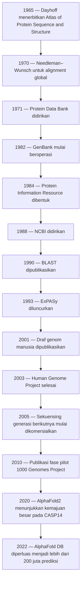

# Sejarah Biologi & Bioinformatika

[Beranda](../../README.md) · [← Indeks materi](../../README.md) · [Struktur Sel →](../02-Cell-Structure/README.md)

Daftar isi

- [Gambaran dan Cara Belajar](#bagian-1)
- [Apa itu Biologi?](#bagian-2)
- [Garis Waktu Sejarah Biologi](#bagian-3)
- [Sejarah Bioinformatika](#bagian-4)
- [Mengapa Bioinformatika Penting?](#bagian-5)
- [Pertanyaan Latihan](#bagian-6)
- [Bacaan Selanjutnya](#bagian-7)

## Gambaran dan Cara Belajar

Telusuri bagaimana pengamatan sel berkembang menjadi analisis genom. Gunakan garis waktu untuk mengaitkan penemuan biologis dengan metode komputasi, lalu uji pemahaman melalui pertanyaan latihan.

## Apa itu Biologi?

**Biologi** adalah ilmu pengetahuan yang mempelajari makhluk hidup — struktur, fungsi, pertumbuhan, asal-usul, evolusi, dan distribusinya. Kata "biologi" berasal dari bahasa Yunani: *bios* (kehidupan) dan *logos* (ilmu).

---

## Garis Waktu Sejarah Biologi

### Era Kuno (sebelum 1600 M)

| Tokoh | Tahun | Kontribusi |
|-------|-------|-----------|
| Aristoteles | 384–322 SM | Mengklasifikasikan > 500 spesies hewan; dianggap "Bapak Biologi" |
| Theophrastus | 371–287 SM | Mengklasifikasikan tumbuhan; "Bapak Botani" |
| Hippocrates | 460–370 SM | Dasar-dasar ilmu kedokteran |
| Galen | 129–216 M | Anatomi dan fisiologi manusia |

### Era Renaisans (1500–1700 M)

| Tokoh | Tahun | Kontribusi |
|-------|-------|-----------|
| Andreas Vesalius | 1543 | *De Humani Corporis Fabrica* — anatomi manusia modern |
| William Harvey | 1628 | Menemukan sirkulasi darah |
| Antonie van Leeuwenhoek | 1674 | Menemukan mikroorganisme menggunakan mikroskop |
| Robert Hooke | 1665 | Menemukan sel dari sayatan gabus |

### Era Modern Awal (1700–1900 M)

| Tokoh | Tahun | Kontribusi |
|-------|-------|-----------|
| Carl Linnaeus | 1735 | Sistem klasifikasi binomial nomenklatur |
| Charles Darwin | 1859 | Teori Evolusi melalui Seleksi Alam (*On the Origin of Species*) |
| Gregor Mendel | 1865 | Hukum pewarisan sifat (genetika) |
| Louis Pasteur | 1860s | Teori kuman penyakit; pasteurisasi |
| Robert Koch | 1876 | Mengidentifikasi bakteri penyebab penyakit |

### Era Biologi Molekuler (1900–2000 M)

| Tokoh | Tahun | Kontribusi |
|-------|-------|-----------|
| Thomas Hunt Morgan | 1910 | Bukti pewarisan terpaut kromosom melalui penelitian lalat buah |
| Avery, MacLeod & McCarty | 1944 | Bukti DNA sebagai prinsip transformasi pada pneumokokus |
| Watson & Crick; data Franklin & Wilkins | 1953 | Model heliks ganda DNA yang didukung data difraksi sinar-X |
| Frederick Sanger | 1977 | Metode sekuensing DNA terminasi rantai |
| Human Genome Project | 1990–2003 | Penyusunan sekuens referensi genom manusia; masih menyisakan celah |

---

## Sejarah Bioinformatika

### Apa itu Bioinformatika?

**Bioinformatika** adalah bidang ilmu yang menggabungkan biologi, ilmu komputer, matematika, dan statistik untuk menganalisis dan menginterpretasikan data biologis, terutama data sekuens DNA, RNA, dan protein.

### Garis Waktu Bioinformatika

### Tokoh Kunci Bioinformatika

| Tokoh | Kontribusi |
|-------|-----------|
| Margaret Dayhoff | Pioneer database protein & scoring matrix (PAM) |
| Saul Needleman & Christian Wunsch | Algoritma global alignment (1970) |
| Temple Smith & Michael Waterman | Algoritma local alignment (1981) |
| Stephen Altschul | Mengembangkan BLAST (1990) |
| Eric Lander | Salah satu pemimpin pusat sekuensing Human Genome Project |
| Demis Hassabis & John Jumper | AlphaFold — AI untuk prediksi struktur protein |

---

## Mengapa Bioinformatika Penting?

1. **Data biologis terus bertambah** — laju pertumbuhan berbeda menurut basis data dan teknologi pengukuran
2. **Analisis manual tidak mungkin** — 1 genom manusia = ~3 miliar pasangan basa
3. **Aplikasi nyata:**
   - Pengembangan obat & vaksin
   - Diagnosis penyakit genetik
   - Pertanian presisi
   - Forensik DNA
   - Studi evolusi & keanekaragaman hayati

---

## Pertanyaan Latihan

1. Siapa yang pertama kali mengamati sel dan menggunakan istilah "cell"?
2. Apa perbedaan antara biologi klasik dan bioinformatika?
3. Tahun berapa Human Genome Project dimulai dan selesai?
4. Apa yang dimaksud dengan algoritma BLAST?
5. Mengapa sekuensing DNA membutuhkan komputasi?

---

## Bacaan Selanjutnya

- [Molecular Biology of the Cell — Alberts et al.](https://www.ncbi.nlm.nih.gov/books/NBK21054/)
- [NCBI Bookshelf: koleksi buku biomedis](https://www.ncbi.nlm.nih.gov/books/)
- [Lanjut ke: Struktur Sel →](../02-Cell-Structure/README.md)

---

[↑ Atas](#top) · [Beranda](../../README.md) · [← Indeks materi](../../README.md) · [Struktur Sel →](../02-Cell-Structure/README.md)
