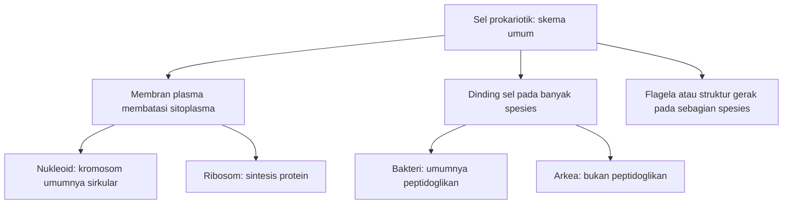
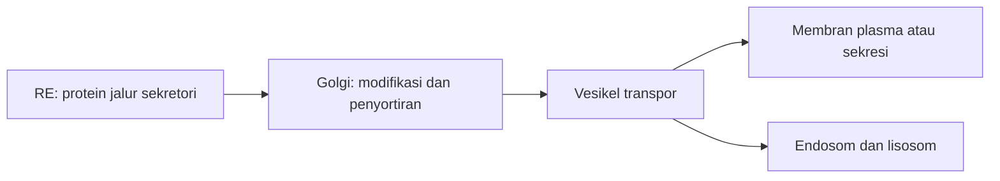
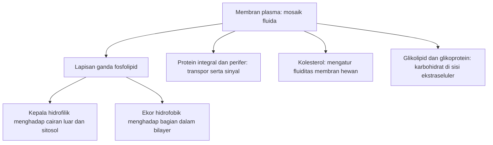

<a id="top"></a>

# Struktur Sel

[Beranda](../../README.md) · [← Sejarah](../01-History/README.md) · [Biologi Molekuler →](../03-Molecular-Biology/README.md)

## Gambaran dan Cara Belajar

Kenali kompartemen sel, fungsi organel, dan transpor membran sebelum mempelajari proses molekuler. Bandingkan tabel prokariota–eukariota dan hubungkan lokasi protein dengan fungsinya.

## Apa itu Sel?

**Sel** adalah unit struktural dan fungsional terkecil dari semua makhluk hidup. Semua organisme tersusun dari satu atau lebih sel. Teori sel menyatakan:

1. Semua makhluk hidup tersusun dari sel
2. Sel adalah unit dasar kehidupan
3. Semua sel berasal dari sel yang sudah ada sebelumnya

---

## Dua Jenis Sel Utama

### 1. Sel Prokariotik

Sel tanpa membran inti (nukleus tidak terbungkus membran).

- Tidak memiliki nukleus bermembran; DNA utama berada di wilayah nukleoid.
- Umumnya berukuran sekitar 1–10 µm, dengan pengecualian.
- Tidak memiliki organel bermembran khas eukariota.
- Mencakup bakteri dan arkea.

**Struktur sel prokariotik:**



---

### 2. Sel Eukariotik

Sel dengan membran inti yang nyata dan organel bermembran.

- Memiliki nukleus yang dibungkus membran dan berbagai organel bermembran.
- Umumnya berukuran sekitar 10–100 µm, dengan pengecualian.
- Kromosom nuklir berupa DNA linear; organel tertentu juga memiliki DNA.
- Mencakup tumbuhan, hewan, fungi, dan beragam protista.

---

## Organel Sel Eukariotik

### Nukleus (Inti Sel)

| Komponen | Fungsi |
|----------|--------|
| Membran nukleus | Memisahkan nukleus dari sitoplasma |
| Nukleolus | Sintesis rRNA dan perakitan ribosom |
| Kromatin | DNA + protein histon (materi genetik) |
| Pori nukleus | Transportasi molekul masuk/keluar nukleus |

### Retikulum Endoplasma (RE)

| Tipe | Ciri | Fungsi |
|------|------|--------|
| RE Kasar | Ada ribosom di permukaan | Sintesis dan modifikasi protein |
| RE Halus | Tanpa ribosom | Sintesis lipid, detoksifikasi |

### Mitokondria — "Pembangkit Energi Sel"

**Fungsi:** menghasilkan ATP melalui respirasi seluler. Membran luar relatif permeabel terhadap molekul kecil; membran dalam yang selektif membentuk lipatan krista. Matriks mengandung enzim, DNA mitokondria, dan ribosom.

Oksidasi lengkap glukosa menghasilkan sekitar **30–32 ATP per glukosa pada banyak sel eukariotik**, bukan seluruhnya di mitokondria; glikolisis berlangsung di sitosol.

> **Fakta unik:** Mitokondria memiliki DNA sendiri — bukti teori endosimbiosis (dulunya bakteri bebas)

### Kloroplas (tumbuhan dan alga fotosintetik)

**Fungsi:** fotosintesis. Kloroplas memiliki membran luar dan dalam, tilakoid yang mengandung klorofil, grana berupa tumpukan tilakoid, serta stroma yang mengandung enzim.

Persamaan netto yang disederhanakan:

```text
6 CO₂ + 6 H₂O + cahaya → C₆H₁₂O₆ + 6 O₂
```

### Aparatus Golgi



### Lisosom

**Fungsi:** pencernaan intrasel dengan enzim hidrolitik pada pH asam, sekitar 4,5–5. Lisosom mendegradasi makromolekul dan mendaur ulang komponen sel melalui autofagi.

### Organel Lain

| Organel | Fungsi |
|---------|--------|
| Ribosom | Sintesis protein (translasi mRNA → protein) |
| Vakuola | Penyimpanan (besar di sel tumbuhan) |
| Sentrosom | Mengatur pembelahan sel |
| Peroksisom | Oksidasi asam lemak, detoksifikasi H₂O₂ |
| Sitoskeleton | Bentuk sel, pergerakan, transportasi intrasel |

---

## Perbandingan Sel Hewan vs Sel Tumbuhan

| Struktur | Sel Hewan | Sel Tumbuhan |
|----------|-----------|--------------|
| Dinding sel | ✗ | ✔ (selulosa) |
| Kloroplas | ✗ | Ada pada sel fotosintetik; tidak pada semua sel tumbuhan |
| Vakuola tengah | Kecil/tidak ada | Besar |
| Sentrosom | ✔ | Sebagian besar ✗ |
| Lisosom | ✔ | Jarang |
| Bentuk | Beragam, dipengaruhi sitoskeleton | Cenderung lebih kaku karena dinding sel |

---

## Membran Plasma

**Model Mosaik Fluida** (Singer & Nicolson, 1972):



**Komposisi membran:**
- Fosfolipid bilayer (kepala hidrofilik, ekor hidrofobik)
- Protein integral & perifer
- Kolesterol pada membran hewan (mengatur fluiditas)
- Glikoprotein & glikolipid (pengenalan sel)

**Fungsi membran plasma:**
1. Batas sel (memisahkan intra & ekstrasel)
2. Transportasi selektif
3. Komunikasi antar sel
4. Pengenalan sel (imun)

---

## Transportasi Melalui Membran

### Transpor Pasif (tanpa masukan energi metabolik langsung)

| Jenis | Mekanisme | Contoh |
|-------|-----------|--------|
| Difusi sederhana | Gerakan dari konsentrasi tinggi → rendah | O₂, CO₂ |
| Difusi terfasilitasi | Melalui kanal atau protein pembawa | Glukosa, ion |
| Osmosis | Difusi air melalui membran semipermeabel | Air |

### Transpor Aktif dan Vesikular (memerlukan energi)

| Jenis | Contoh |
|-------|--------|
| Pompa ion: transpor aktif primer | Pompa Na⁺/K⁺ menggunakan ATP |
| Kotranspor: transpor aktif sekunder | Simport Na⁺/glukosa menggunakan gradien ion |
| Endositosis | Fagositosis, pinositosis |
| Eksositosis | Sekresi protein |

---

## Relevansi dengan Bioinformatika

- **Analisis protein membran** — target utama pengembangan obat
- **Sinyal seluler** — pathway yang dimodelkan secara komputasional
- **Metabolisme** — dianalisis dengan metabolomics
- **Protein organel** — diprediksi lokalisasinya dengan machine learning
- **Genom mitokondria** — digunakan untuk studi filogenetik

---

## Pertanyaan Latihan

1. Apa perbedaan utama sel prokariotik dan eukariotik?
2. Mengapa mitokondria disebut "pembangkit energi sel"?
3. Organel apa yang tidak ditemukan pada sel hewan?
4. Jelaskan model mosaik fluida membran plasma!
5. Apa yang dimaksud dengan osmosis?

---

[↑ Atas](#top) · [Beranda](../../README.md) · [← Sejarah](../01-History/README.md) · [Biologi Molekuler →](../03-Molecular-Biology/README.md)
