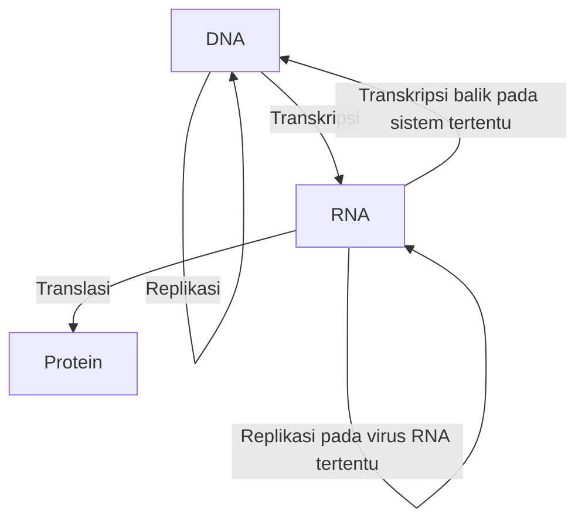
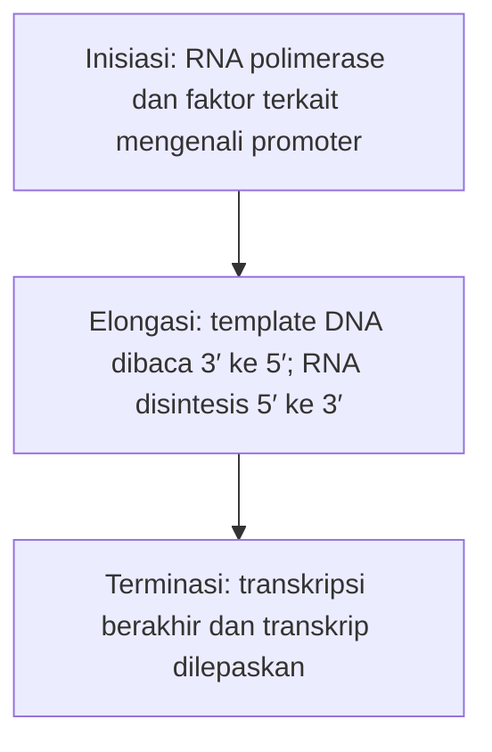
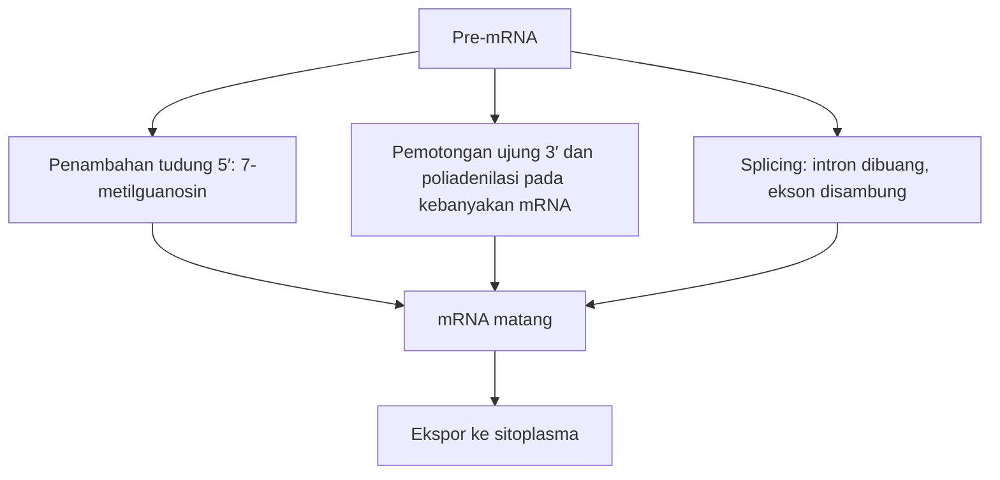
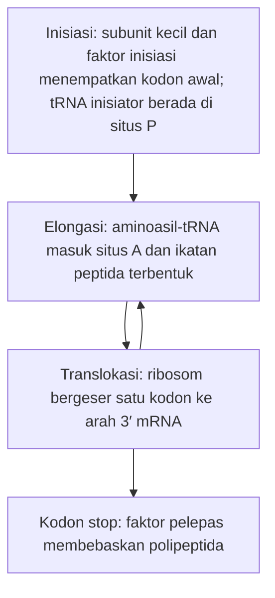
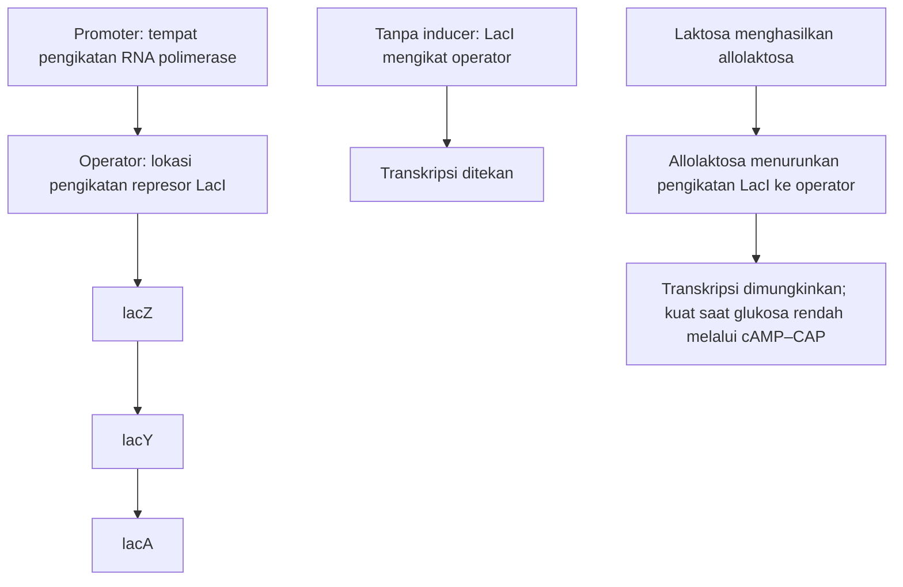
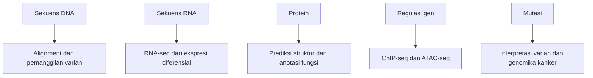

<a id="top"></a>

# Biologi Molekuler

[Beranda](../../README.md) · [← Struktur Sel](../02-Cell-Structure/README.md) · [Genetika →](../04-Genetics/README.md)

<details>
<summary>Daftar isi</summary>

- [Gambaran dan Cara Belajar](#bagian-1)
- [Apa itu Biologi Molekuler?](#bagian-2)
- [Dogma Sentral Biologi Molekuler](#bagian-3)
- [DNA (Deoxyribonucleic Acid)](#bagian-4)
- [RNA (Ribonucleic Acid)](#bagian-5)
- [Transkripsi](#bagian-6)
- [Translasi](#bagian-7)
- [Regulasi Ekspresi Gen](#bagian-8)
- [Mutasi DNA](#bagian-9)
- [Relevansi dengan Bioinformatika](#bagian-10)
- [Pertanyaan Latihan](#bagian-11)

</details>

<a id="bagian-1"></a>

## Gambaran dan Cara Belajar

Ikuti aliran informasi dari DNA ke RNA dan protein, beserta regulasinya. Gunakan contoh sekuens untuk berlatih menentukan arah transkripsi dan membaca kodon; bedakan proses biologis dari analisis komputasionalnya.

<a id="bagian-2"></a>

## Apa itu Biologi Molekuler?

**Biologi molekuler** mempelajari proses biologis pada tingkat molekuler — khususnya bagaimana informasi genetik disimpan dalam DNA, diekspresikan menjadi RNA, dan diterjemahkan menjadi protein.

---

<a id="bagian-3"></a>

## Dogma Sentral Biologi Molekuler



> **Batas dogma sentral:** informasi sekuens tidak ditransfer kembali dari protein ke asam nukleat. Transkripsi balik tidak melanggar batas ini.

---

<a id="bagian-4"></a>

## DNA (Deoxyribonucleic Acid)

### Struktur DNA

DNA adalah polimer dari **nukleotida**. Setiap nukleotida terdiri dari:

```text
Nukleotida = Fosfat + Gula Deoksiribosa + Basa Nitrogen
```

**4 Basa Nitrogen DNA:**

| Basa | Tipe | Pasangan |
|------|------|----------|
| Adenin (A) | Purin | T (2 ikatan H) |
| Timin (T) | Pirimidin | A (2 ikatan H) |
| Guanin (G) | Purin | C (3 ikatan H) |
| Sitosin (C) | Pirimidin | G (3 ikatan H) |

**Aturan Chargaff:** `[A] = [T]` dan `[G] = [C]`

### Struktur Heliks Ganda

```text
5'-ATGCATGC-3'
3'-TACGTACG-5'
```

Kedua untai berpasangan secara komplementer dan antiparalel. Label pengode (*sense*) dan cetakan (*antisense*) ditentukan relatif terhadap gen yang ditranskripsi. Diameter DNA bentuk B sekitar 2 nm; satu putaran rata-rata sekitar 10,5 pasangan basa dengan kenaikan sekitar 0,34 nm per pasangan basa.

### Replikasi DNA

Proses penggandaan DNA sebelum pembelahan sel.

**Model:** Semi-konservatif (setiap untai baru menggunakan 1 untai lama sebagai template)

| Enzim | Peran |
|---|---|
| Helikase | Membuka heliks ganda |
| Primase | Membuat primer RNA |
| DNA polimerase | Menyintesis DNA baru dalam arah 5′→3′ |
| Ligase | Menutup celah antarnukleotida, termasuk setelah pemrosesan fragmen Okazaki |
| Topoisomerase | Mengatur tegangan puntir dan superkoiling |

---

<a id="bagian-5"></a>

## RNA (Ribonucleic Acid)

### Perbedaan DNA vs RNA

| Fitur | DNA | RNA |
|-------|-----|-----|
| Gula | Deoksiribosa | Ribosa |
| Basa | A, T, G, C | A, **U**, G, C |
| Untai | Umumnya ganda | Umumnya tunggal; dapat membentuk struktur berpasangan |
| Lokasi | Nukleus dan organel ber-DNA pada eukariota; nukleoid pada prokariota | Nukleus, sitoplasma, dan organel sesuai jenis sel |
| Fungsi | Menyimpan info genetik | Ekspres gen |

### Jenis-jenis RNA

| Jenis | Singkatan | Fungsi |
|-------|-----------|--------|
| mRNA | messenger RNA | Membawa instruksi dari DNA ke ribosom |
| tRNA | transfer RNA | Membawa asam amino ke ribosom |
| rRNA | ribosomal RNA | Komponen struktural dan katalitik ribosom |
| miRNA | micro RNA | Regulasi ekspresi gen |
| siRNA | small interfering RNA | RNA interference (silencing) |
| lncRNA | long non-coding RNA | Regulasi genomik |

---

<a id="bagian-6"></a>

## Transkripsi

Proses sintesis RNA dari template DNA; transkrip pengode protein diproses atau digunakan sebagai mRNA.

### Tahapan Transkripsi



Tidak semua promoter memiliki TATA box. Pasangan basa template DNA ke RNA adalah A–U, T–A, G–C, dan C–G; transkripsi menghasilkan berbagai jenis RNA, bukan hanya mRNA.

### Pemrosesan mRNA (pada eukariot)



Pemrosesan dapat berlangsung tumpang tindih dengan transkripsi; diagram tidak menetapkan urutan wajib antartahap.

> **Intron:** bagian transkrip yang dibuang saat splicing.
> **Ekson:** bagian yang dipertahankan pada RNA matang, termasuk daerah pengode dan daerah tak diterjemahkan (UTR).

---

<a id="bagian-7"></a>

## Translasi

Proses pembuatan protein dari mRNA.

### Kode Genetik

mRNA dibaca dalam **kodon**, masing-masing tiga basa. Kodon pengode menentukan asam amino; kodon stop menandai terminasi.

| Kodon mRNA | Makna dalam kode genetik standar |
|---|---|
| UUU, UUC | Fenilalanin, Phe (F) |
| UUA | Leusin, Leu (L) |
| AUG | Metionin, Met (M); kodon awal yang paling umum |
| UAA, UAG, UGA | Sinyal stop |

Dalam kode genetik standar, **61 kodon mengode 20 asam amino dan 3 kodon merupakan sinyal stop**. Beberapa kodon berbeda mengode asam amino yang sama (degenerasi kode genetik).

### Tahapan Translasi



---

<a id="bagian-8"></a>

## Regulasi Ekspresi Gen

### Pada Prokariot: Model Operon



### Pada Eukariot

| Level Regulasi | Mekanisme |
|---------------|-----------|
| Kromatin | Modifikasi histon, metilasi DNA |
| Transkripsi | Faktor transkripsi, enhancer, silencer |
| Pasca-transkripsi | Splicing alternatif, stabilitas mRNA |
| Translasi | miRNA, regulasi inisiasi |
| Pasca-translasi | Modifikasi protein, degradasi |

---

<a id="bagian-9"></a>

## Mutasi DNA

Perubahan pada sekuens DNA.

| Tipe Mutasi | Deskripsi | Contoh |
|-------------|-----------|--------|
| Substitusi | 1 basa diganti | A→G |
| Insersi | Basa ditambahkan | +T |
| Delesi | Basa dihapus | -C |
| Inversi | Segmen DNA dibalik orientasinya | Sekuens referensi 5′-ATCG-3′ menjadi 5′-CGAT-3′ pada segmen yang diinversi |
| Translokasi | Segmen pindah kromosom | |
| Frameshift | Insersi/delesi bukan kelipatan tiga pada daerah pengode menggeser kerangka baca | +1 basa |

**Akibat mutasi:**
- **Silent:** tidak mengubah asam amino
- **Missense:** mengubah 1 asam amino
- **Nonsense:** menghasilkan kodon stop prematur

---

<a id="bagian-10"></a>

## Relevansi dengan Bioinformatika



---

<a id="bagian-11"></a>

## Pertanyaan Latihan

1. Tuliskan sekuens mRNA dari template DNA berikut: `3'-TACGGGCTA-5'`
2. Apa perbedaan intron dan ekson?
3. Kodon apa yang menjadi sinyal "start" dan "stop" dalam translasi?
4. Mengapa kode genetik disebut "degenerate"?
5. Jelaskan mengapa mutasi frameshift biasanya lebih berbahaya dari substitusi!

---

[↑ Atas](#top) · [Beranda](../../README.md) · [← Struktur Sel](../02-Cell-Structure/README.md) · [Genetika →](../04-Genetics/README.md)
