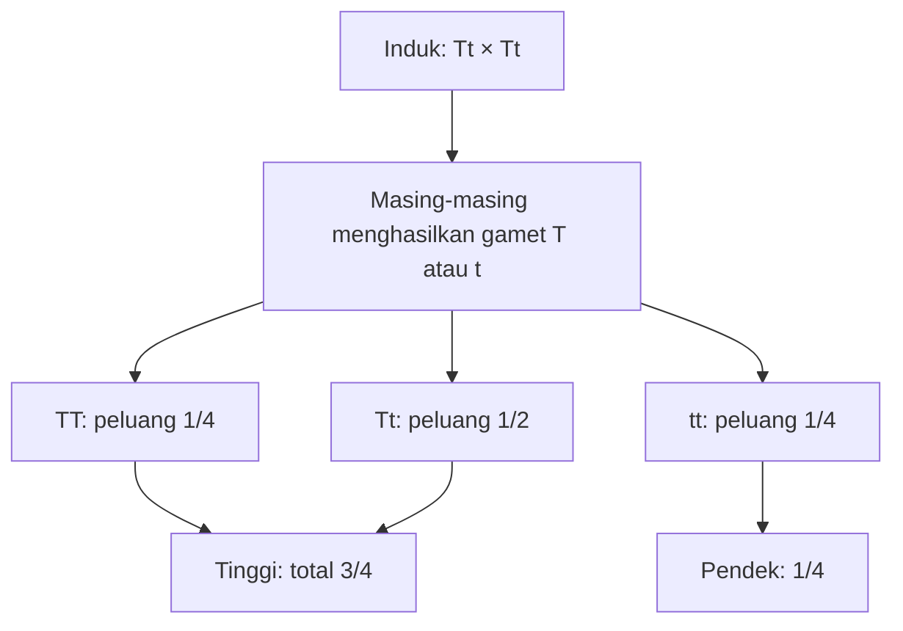
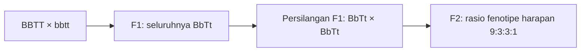
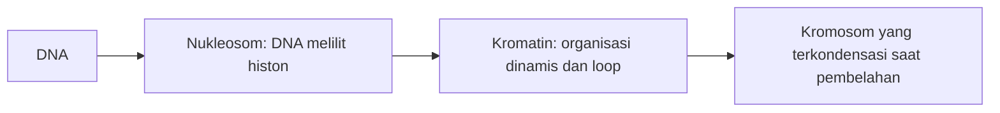
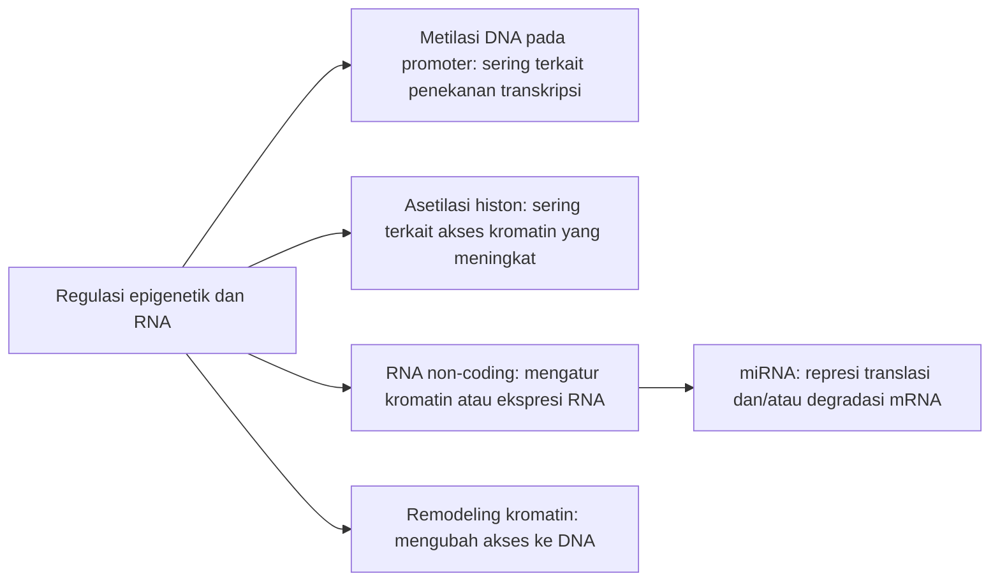
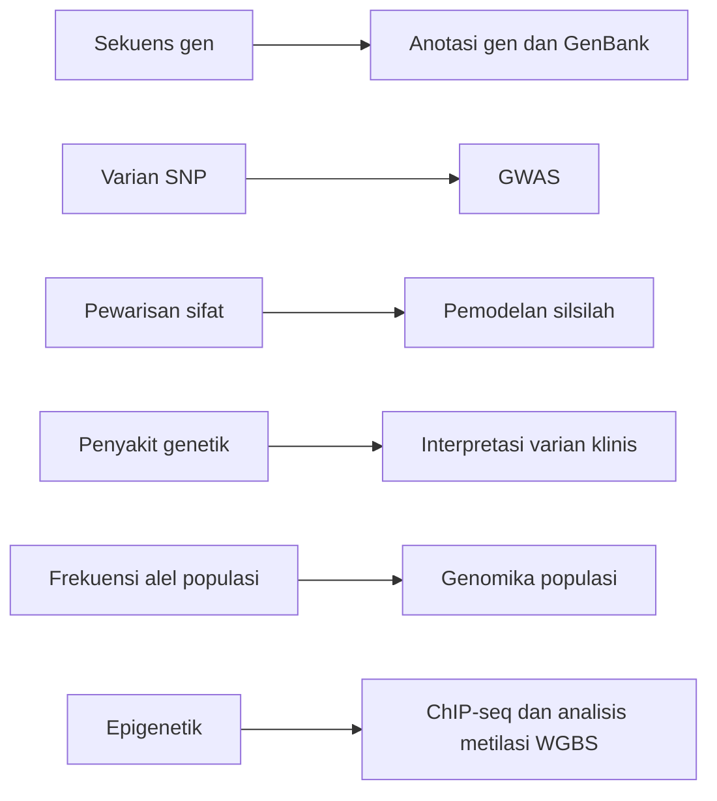

<a id="top"></a>

# Genetika

[Beranda](../../README.md) · [← Biologi Molekuler](../03-Molecular-Biology/README.md) · [Biokimia →](../05-Biochemistry/README.md)

## Gambaran dan Cara Belajar

Pelajari pewarisan alel dari persilangan hingga populasi. Gunakan bagan dan tabel untuk membedakan genotipe, fenotipe, pola pewarisan, serta asumsi model Mendel dan Hardy–Weinberg.

## Apa itu Genetika?

**Genetika** adalah cabang biologi yang mempelajari gen, pewarisan sifat, dan variasi pada organisme. Kata "genetika" berasal dari bahasa Yunani *genesis* (asal-usul).

---

## Hukum Mendel

### Gregor Mendel (1822–1884)

Bapak genetika modern. Melakukan percobaan pada ~29.000 tanaman kacang polong (*Pisum sativum*) selama 8 tahun.

### Hukum I Mendel — Segregasi

> *"Dua alel untuk sifat tertentu dipisahkan saat pembentukan gamet, sehingga setiap gamet hanya membawa satu alel."*

**Contoh:**



Rasio genotipe 1 TT : 2 Tt : 1 tt dan fenotipe 3 tinggi : 1 pendek merupakan harapan untuk dominansi penuh, bukan jumlah pasti pada setiap keluarga.

### Hukum II Mendel — Pemisahan Bebas

> Alel pada lokus yang tidak terpaut, atau berjarak cukup jauh sehingga tampak tidak terpaut, dapat memilah secara bebas saat pembentukan gamet. Gen terpaut tidak selalu mengikuti pola ini.



Rasio ini mensyaratkan pemilahan bebas kedua lokus, dominansi penuh, dan tidak adanya interaksi gen yang mengubah pengelompokan fenotipe.

---

## Terminologi Genetika

| Istilah | Definisi |
|---------|----------|
| Gen | Segmen DNA yang mengkode protein/RNA fungsional |
| Alel | Varian dari gen yang sama |
| Genotip | Komposisi genetik (TT, Tt, tt) |
| Fenotip | Sifat teramati atau terukur hasil interaksi genotipe dan lingkungan |
| Dominan | Alel yang menentukan fenotipe heterozigot pada model dominansi penuh (T) |
| Resesif | Efek fenotipenya tertutupi pada heterozigot dalam model dominansi penuh (t) |
| Homozigot | Dua alel identik (TT atau tt) |
| Heterozigot | Dua alel berbeda (Tt) |
| Lokus | Posisi gen pada kromosom |

---

## Kromosom

### Struktur Kromosom

Kromosom eukariotik tersusun atas DNA, histon, dan protein pengorganisasi lainnya.



Model solenoid bukan tahapan universal pengemasan kromatin di dalam sel.

### Jumlah Kromosom

| Organisme | Jumlah Kromosom (2n) |
|-----------|----------------------|
| Manusia | 46 (23 pasang) |
| Tikus | 40 |
| Nyamuk | 6 |
| Semangka | 22 |
| Bawang | 16 |
| Lalat buah (*Drosophila*) | 8 |

### Kromosom Seks

Pada manusia, kariotipe **XX** umumnya berkaitan dengan perkembangan perempuan dan **XY** dengan laki-laki. Terdapat variasi kromosom dan perkembangan seks; kromosom bukan satu-satunya faktor penentunya.

---

## Pola Pewarisan

### 1. Dominan Autosomal

**Ciri:** sifat dapat muncul lintas generasi, tetapi penetransi dan usia onset dapat memengaruhi pola. **Contoh:** penyakit Huntington dan beberapa bentuk polidaktili.

Pada model dominansi penuh, persilangan `Aa × aa` memberi peluang 1/2 anak terdampak pada setiap kelahiran.

### 2. Resesif Autosomal

**Ciri:** heterozigot dapat menjadi pembawa tanpa gejala penyakit resesif. **Contoh:** fibrosis kistik dan penyakit sel sabit.

Pada persilangan dua pembawa `Aa × Aa`, peluang anak `aa` adalah 1/4 pada setiap kelahiran.

### 3. X-Linked

**Ciri:** lokus berada pada kromosom X. Untuk sifat resesif terpaut X, individu XY lebih sering terdampak karena hanya memiliki satu salinan lokus tersebut. **Contoh:** buta warna merah–hijau dan hemofilia A.

### 4. Kodominans

**Ciri:** kedua alel tampak pada fenotipe heterozigot. Pada sistem ABO, alel Iᴬ dan Iᴮ bersifat kodominan; keduanya dominan terhadap i. Genotipe IᴬIᴮ menghasilkan golongan darah AB.

---

## Golongan Darah ABO

| Genotip | Golongan |
|---------|----------|
| IᴬIᴬ atau Iᴬi | A |
| IᴮIᴮ atau Iᴮi | B |
| IᴬIᴮ | AB |
| ii | O |

---

## Mutasi dan Penyakit Genetik

### Contoh Penyakit Genetik

| Penyakit | Tipe | Penyebab |
|----------|------|----------|
| Down Syndrome | Kromosomal | Trisomi 21 (3 kromosom ke-21) |
| Turner Syndrome | Kromosomal | 45,X (monosomi X; sebagian kasus mosaik) |
| Klinefelter | Kromosomal | XXY |
| Anemia Sel Sabit | Titik mutasi | Glu→Val pada HbS |
| Fibrosis Kistik | Resesif | Mutasi gen CFTR |
| Hemofilia A | X-linked | Mutasi gen F8 |

---

## Epigenetik

Perubahan keadaan regulasi gen atau kromatin **tanpa perubahan sekuens DNA**, yang dapat dipertahankan melalui pembelahan sel. Istilah epigenetik tidak berarti setiap perubahan ekspresi diwariskan lintas generasi.



Efek bergantung pada lokasi dan konteks. Tidak semua regulasi oleh RNA non-coding merupakan perubahan epigenetik yang stabil atau diwariskan.

**Fakta menarik:** Kembar identik memiliki DNA sama, tetapi ekspresi gen dapat berbeda karena epigenetik!

---

## Genetika Populasi

### Hukum Hardy-Weinberg

Frekuensi alel dalam populasi tetap konstan **jika**:
- Populasi besar
- Perkawinan acak
- Tidak ada mutasi
- Tidak ada migrasi
- Tidak ada seleksi alam

```text
Formula: p² + 2pq + q² = 1
         p + q = 1

p = frekuensi alel dominan (A)
q = frekuensi alel resesif (a)
p² = frekuensi AA
2pq = frekuensi Aa
q² = frekuensi aa
```

---

## Relevansi dengan Bioinformatika



---

## Pertanyaan Latihan

1. Apa perbedaan genotip dan fenotip?
2. Jika Aa × Aa, berapa probabilitas anak aa?
3. Mengapa hemofilia lebih sering pada laki-laki?
4. Apa yang dimaksud dengan Hukum Hardy-Weinberg?
5. Bagaimana epigenetik berbeda dari mutasi DNA?

---

[↑ Atas](#top) · [Beranda](../../README.md) · [← Biologi Molekuler](../03-Molecular-Biology/README.md) · [Biokimia →](../05-Biochemistry/README.md)
