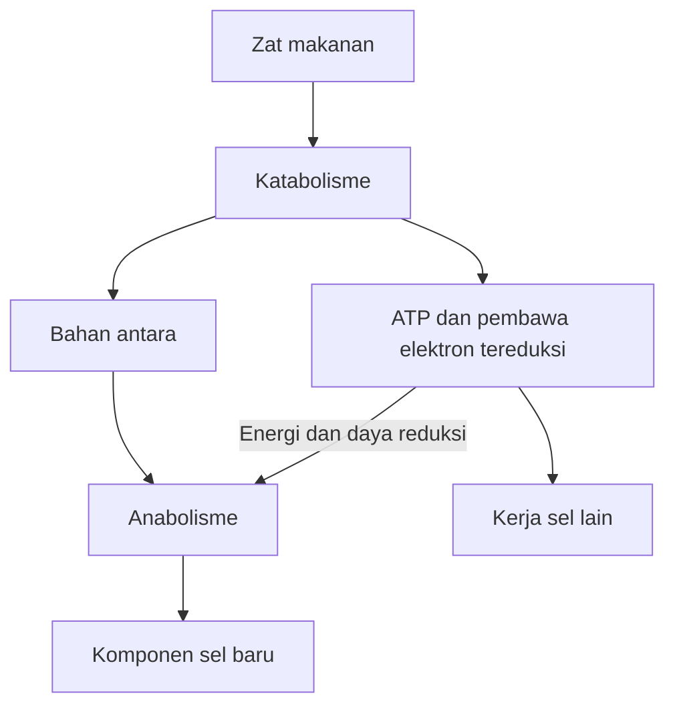
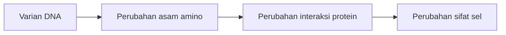

<a id="top"></a>

# Biokimia Dasar

[Beranda](../../README.md) · [← Genetika](../04-Genetics/README.md) · [Protein →](../06-Protein/README.md)

## Gambaran dan Cara Belajar

Hubungkan sifat kimia biomolekul dengan fungsi sel dan penggunaan energi. Baca konsep dasar sebelum menelaah contoh laktase dan hemoglobin; gunakan latihan untuk menjelaskan hubungan struktur, reaksi, dan bukti bioinformatika.

Biokimia mempelajari molekul penyusun makhluk hidup, reaksi kimia yang terjadi di dalam sel, serta cara reaksi tersebut mendukung kehidupan. Jika biologi molekuler menjelaskan bagaimana informasi DNA digunakan untuk menghasilkan protein, biokimia membantu menjawab pertanyaan berikut: **Bagaimana struktur molekul menentukan fungsi, dan bagaimana sel memperoleh serta menggunakan energi?**

Materi ini menghubungkan pengetahuan tentang struktur sel, dogma sentral, dan genetika dengan proses kimia yang mendasari pertumbuhan, pewarisan sifat, dan respons organisme terhadap lingkungan.

## Tujuan Pembelajaran

Setelah mempelajari topik ini, mahasiswa diharapkan mampu:

1. Menjelaskan peran air, ikatan kimia, pH, dan penyangga dalam sistem biologis.
2. Membandingkan struktur dan fungsi karbohidrat, lipid, protein, serta asam nukleat.
3. Menjelaskan hubungan antara struktur protein, aktivitas enzim, dan pengaruh kondisi lingkungan.
4. Menguraikan prinsip energi bebas, ATP, reaksi redoks, dan organisasi metabolisme.
5. Menghubungkan data sekuens, struktur, dan jalur metabolik dengan analisis bioinformatika dasar.

## Konsep Utama

### 1. Dasar Kimia Kehidupan: Ikatan dan Gugus Fungsi

Sebagian besar molekul biologis dibangun dari karbon, hidrogen, oksigen, nitrogen, fosfor, dan sulfur. Karbon sangat penting karena dapat membentuk empat ikatan kovalen dan menghasilkan kerangka molekul berupa rantai, cabang, atau cincin.

**Ikatan kovalen** terbentuk ketika atom berbagi pasangan elektron. Ikatan ini menyusun kerangka utama biomolekul, misalnya ikatan peptida pada protein dan ikatan fosfodiester pada DNA.

Selain ikatan kovalen, terdapat interaksi nonkovalen yang penting:

- **Ikatan hidrogen:** terjadi antara donor hidrogen dan atom penerima yang sesuai; membantu menstabilkan pasangan basa DNA dan struktur protein.
- **Interaksi elektrostatik:** berupa tarikan atau tolakan antara muatan listrik.
- **Interaksi van der Waals:** interaksi jarak dekat yang secara individual lemah, tetapi bermakna jika jumlahnya banyak.
- **Efek hidrofobik:** kecenderungan permukaan nonpolar berkumpul di lingkungan berair, terutama karena pengaruhnya terhadap susunan dan kebebasan gerak molekul air.

Efek hidrofobik bukan jenis ikatan kovalen baru. Fenomena ini penting dalam pembentukan membran dan pelipatan protein.

Sifat molekul juga ditentukan oleh **gugus fungsi**, seperti hidroksil, karbonil, karboksil, amino, fosfat, dan sulfhidril. Sebagai contoh, gugus karboksil dapat melepaskan proton, sedangkan gugus amino dapat menerima proton. Karena itu, keadaan muatan suatu biomolekul dapat berubah mengikuti pH lingkungannya.

### 2. Air, pH, dan Sistem Penyangga

Air bersifat polar: distribusi elektronnya tidak merata sehingga sisi oksigen bermuatan parsial negatif dan sisi hidrogen bermuatan parsial positif. Sifat ini memungkinkan air membentuk ikatan hidrogen dan berinteraksi dengan banyak ion serta molekul polar.

Molekul **hidrofilik** berinteraksi baik dengan air, sedangkan bagian **hidrofobik** tidak berinteraksi menguntungkan dengan air. Molekul **amfipatik**, seperti banyak lipid membran, memiliki bagian hidrofilik sekaligus hidrofobik.

Keasaman larutan dinyatakan dengan pH:

\[
\mathrm{pH}=-\log_{10}a_{\mathrm{H^+}}
\]

Aktivitas ion hidrogen, \(a_{\mathrm{H^+}}\), sering didekati menggunakan konsentrasi ion hidrogen pada pembahasan larutan encer. Karena skalanya logaritmik, perubahan satu unit pH berarti perubahan aktivitas ion hidrogen sebesar sepuluh kali.

**Penyangga atau buffer** mengurangi perubahan pH ketika sejumlah terbatas asam atau basa ditambahkan. Sistem ini biasanya terdiri atas asam lemah dan basa konjugatnya. Hubungannya dapat diperkirakan dengan persamaan Henderson–Hasselbalch:

\[
\mathrm{pH}=\mathrm{p}K_a+\log_{10}\frac{[\mathrm{A^-}]}{[\mathrm{HA}]}
\]

Di sini, HA adalah asam lemah dan A⁻ adalah basa konjugatnya. Penyangga bekerja paling efektif ketika pH mendekati pKa dan kapasitasnya terbatas oleh jumlah komponen yang tersedia.

Sel membutuhkan pengaturan pH karena perubahan protonasi dapat mengubah muatan protein, pengikatan substrat, serta aktivitas enzim. Kompartemen sel juga dapat memiliki pH berbeda sesuai fungsinya.

### 3. Karbohidrat: Sumber Energi dan Komponen Struktural

Karbohidrat mencakup monosakarida, oligosakarida, dan polisakarida. **Monosakarida**, seperti glukosa dan fruktosa, merupakan unit gula sederhana. Unit-unit gula dapat dihubungkan oleh **ikatan glikosidik**.

Fungsi karbohidrat meliputi:

- Menyediakan bahan bakar metabolik.
- Menyimpan cadangan energi.
- Membentuk struktur pendukung.
- Menjadi bagian penanda pengenalan sel.

Pati pada tumbuhan dan glikogen pada hewan merupakan cadangan glukosa. Selulosa merupakan komponen struktural utama dinding sel tumbuhan.

Walaupun pati dan selulosa sama-sama tersusun dari glukosa, konfigurasi ikatan glikosidiknya berbeda. Perbedaan tersebut menghasilkan struktur dan sifat biologis yang berbeda. Manusia memiliki enzim untuk mencerna pati, tetapi tidak menghasilkan enzim selulase untuk memecah selulosa secara langsung.

Contoh ini menunjukkan prinsip utama biokimia: **komposisi yang mirip tidak selalu menghasilkan fungsi yang sama; susunan atom juga menentukan sifat molekul.**

### 4. Lipid: Membran, Cadangan Energi, dan Pensinyalan

Lipid merupakan kelompok molekul yang beragam dan umumnya sukar larut dalam air. Tidak seperti protein atau asam nukleat, lipid tidak seluruhnya merupakan polimer dengan unit berulang yang seragam.

Kelompok lipid penting meliputi:

- **Triasilgliserol:** tersusun dari gliserol dan tiga asam lemak; berfungsi terutama sebagai cadangan energi.
- **Gliserofosfolipid:** memiliki kerangka gliserol, dua rantai asil, dan gugus kepala yang mengandung fosfat; banyak ditemukan pada membran.
- **Sterol:** memiliki kerangka cincin, misalnya kolesterol pada sel hewan.

Asam lemak jenuh tidak memiliki ikatan rangkap karbon–karbon. Asam lemak tak jenuh memiliki satu atau lebih ikatan rangkap. Ikatan rangkap berkonfigurasi *cis* menimbulkan tekukan yang menyulitkan pengemasan rantai secara rapat.

Komposisi asam lemak, panjang rantai, suhu, dan kandungan sterol memengaruhi fluiditas membran. Karena lipid membran bersifat amfipatik, molekul-molekul tersebut dapat membentuk lapisan ganda dengan bagian hidrofobik menghadap ke dalam dan bagian hidrofilik menghadap lingkungan berair.

Membran bukan sekadar pembatas: membran menyediakan lingkungan bagi protein transpor, reseptor, dan sistem pembentukan energi.

### 5. Protein: Dari Urutan Asam Amino ke Fungsi

Protein tersusun atas asam amino yang dihubungkan oleh ikatan peptida. Setiap asam amino memiliki gugus samping atau gugus R yang memengaruhi ukuran, polaritas, muatan, dan reaktivitasnya.

Struktur protein dijelaskan pada beberapa tingkat:

1. **Primer:** urutan asam amino.
2. **Sekunder:** susunan lokal seperti heliks alfa dan lembar beta, terutama distabilkan oleh ikatan hidrogen antargugus tulang punggung.
3. **Tersier:** organisasi tiga dimensi keseluruhan satu rantai polipeptida.
4. **Kuartener:** susunan beberapa subunit polipeptida pada protein multimerik.

Tidak semua protein memiliki struktur kuartener. Selain itu, beberapa protein atau bagian protein secara alami bersifat tidak teratur dan tidak mempunyai satu bentuk tiga dimensi yang tetap.

Pelipatan dipengaruhi oleh urutan asam amino dan kondisi lingkungan. Sebagian protein memerlukan bantuan **chaperone** untuk mencapai pelipatan yang tepat atau mengurangi agregasi.

**Denaturasi** adalah hilangnya organisasi struktur protein akibat kondisi seperti suhu tinggi atau pH ekstrem. Denaturasi umumnya tidak memutus ikatan peptida, tetapi dapat menghilangkan fungsi protein. Denaturasi juga tidak selalu dapat dibalik.

Hubungannya dengan genetika jelas: perubahan DNA dapat mengubah urutan asam amino, tetapi dampak fungsionalnya bergantung pada lokasi dan sifat perubahan tersebut.

### 6. Enzim dan Pengaturan Laju Reaksi

Enzim adalah katalis biologis; sebagian besar berupa protein, meskipun beberapa RNA juga bersifat katalitik. Enzim mempercepat reaksi dengan menurunkan **energi bebas aktivasi**, yaitu hambatan menuju keadaan transisi.

Enzim tidak mengubah perubahan energi bebas keseluruhan reaksi maupun posisi kesetimbangannya. Enzim mempercepat tercapainya kesetimbangan dengan mempercepat reaksi maju dan balik.

Substrat berinteraksi dengan **situs aktif**. Pengikatan ini tidak harus menyerupai kunci dan gembok yang kaku: enzim dapat mengalami perubahan konformasi saat berinteraksi dengan substrat.

Untuk enzim yang mengikuti model Michaelis–Menten:

\[
v=\frac{V_{\max}[S]}{K_m+[S]}
\]

Keterangan:

- \(v\): laju awal reaksi.
- \([S]\): konsentrasi substrat.
- \(V_{\max}\): laju maksimum pada jumlah enzim tertentu.
- \(K_m\): konsentrasi substrat saat laju mencapai setengah \(V_{\max}\).

Nilai \(K_m\) tidak selalu sama dengan ukuran afinitas pengikatan substrat; interpretasinya bergantung pada mekanisme reaksi.

Aktivitas enzim dapat dipengaruhi oleh suhu, pH, konsentrasi substrat, inhibitor, modifikasi kovalen, dan regulator alosterik. Beberapa enzim juga memerlukan **kofaktor**, misalnya ion logam, atau koenzim organik seperti NAD⁺.

### 7. Energi Bebas, ATP, dan Reaksi Redoks

Kelayakan termodinamik reaksi dinyatakan melalui perubahan energi bebas Gibbs:

\[
\Delta G=\Delta H-T\Delta S
\]

Pada suhu dan tekanan tetap, reaksi dengan \(\Delta G<0\) menguntungkan secara termodinamik ke arah yang dituliskan. Namun, reaksi tersebut belum tentu berlangsung cepat karena masih dapat memiliki hambatan aktivasi tinggi.

Nilai \(\Delta G\) bergantung pada kondisi aktual, termasuk konsentrasi reaktan dan produk. Karena itu, nilai standar biokimia tidak boleh langsung dianggap sebagai nilai di dalam sel.

**ATP** membantu menghubungkan reaksi pelepasan energi dengan proses yang memerlukan energi, seperti sintesis molekul dan transpor aktif. Hidrolisis ATP menguntungkan karena keseluruhan perubahan dari reaktan menuju produk, bukan karena pemutusan ikatan itu sendiri melepaskan energi. Pemutusan ikatan justru memerlukan energi.

Pada reaksi **redoks**, terjadi perpindahan elektron:

- Oksidasi adalah pelepasan elektron.
- Reduksi adalah penerimaan elektron.

NAD⁺/NADH dan FAD/FADH₂ merupakan pasangan pembawa elektron penting. Dalam respirasi aerob, aliran elektron menuju oksigen dapat dihubungkan dengan pembentukan gradien proton yang digunakan ATP sintase untuk menghasilkan ATP.

### 8. Metabolisme sebagai Jaringan Terintegrasi

Metabolisme adalah keseluruhan reaksi kimia dalam sistem biologis.

- **Katabolisme** menguraikan molekul dan menyediakan energi serta bahan antara.
- **Anabolisme** menyusun molekul kompleks dengan menggunakan energi dan daya reduksi.

Glikolisis mengubah glukosa menjadi piruvat dan menghasilkan ATP serta NADH. Pada sel eukariotik, glikolisis berlangsung di sitosol. Dalam respirasi aerob, piruvat dapat diubah menjadi asetil-KoA, yang kemudian memasuki siklus asam sitrat.

Pada eukariota, siklus asam sitrat terutama berlangsung di matriks mitokondria, sedangkan rantai transpor elektron berada pada membran dalam mitokondria. Pada bakteri, organisasi tempat berlangsungnya proses tersebut berbeda karena tidak terdapat mitokondria.

Jalur metabolik saling terhubung dan diatur sesuai kebutuhan sel. Misalnya, penghambatan umpan balik memungkinkan produk akhir mengurangi aktivitas enzim pada tahap sebelumnya, sehingga produksi berlebihan dapat dibatasi.

## Ringkasan Konsep

| Kelompok biomolekul | Penyusun atau komponen utama | Ikatan atau ciri penting | Fungsi utama | Contoh |
|---|---|---|---|---|
| Karbohidrat | Monosakarida | Ikatan glikosidik | Energi, cadangan, struktur | Glukosa, glikogen, selulosa |
| Lipid | Beragam; sering melibatkan asam lemak | Banyak bagian nonpolar; sebagian amfipatik | Membran, cadangan energi, sinyal | Triasilgliserol, fosfolipid |
| Protein | Asam amino | Ikatan peptida | Katalisis, transpor, struktur | Amilase, hemoglobin |
| Asam nukleat | Nukleotida | Ikatan fosfodiester | Penyimpanan dan penggunaan informasi genetik | DNA, RNA |

Nukleotida terdiri atas basa nitrogen, gula pentosa, dan satu atau lebih gugus fosfat. Selain membentuk asam nukleat, nukleotida juga menjalankan fungsi lain; ATP, misalnya, berperan dalam penggandengan energi.

Diagram sederhana hubungan katabolisme dan anabolisme:



## Contoh Konkret

### Pencernaan laktosa dan peran enzim

Laktosa adalah disakarida yang tersusun dari glukosa dan galaktosa. Enzim laktase pada permukaan usus halus mengatalisis hidrolisis laktosa:

```text
Laktosa + air → glukosa + galaktosa
```

Jika aktivitas laktase rendah, sebagian laktosa tidak tercerna dan mencapai kolon. Aktivitas mikroba serta efek osmotiknya dapat berkontribusi pada gejala seperti kembung dan diare.

Contoh ini menghubungkan struktur karbohidrat, spesifisitas enzim, regulasi ekspresi gen, dan fisiologi. Rendahnya aktivitas laktase tidak selalu berarti urutan protein laktase rusak; perubahan tingkat ekspresi juga dapat menjadi penyebab penting.

### Perubahan satu asam amino pada hemoglobin

Pada hemoglobin S, perubahan glutamat menjadi valin pada posisi yang secara konvensional disebut posisi 6 rantai beta mengubah sifat permukaan protein. Pada kondisi terdeoksigenasi, perubahan ini meningkatkan kecenderungan hemoglobin membentuk polimer.

Akibatnya, sifat mekanik sel darah merah dapat berubah. Contoh ini memperlihatkan alur hubungan:



## Hubungan dengan Bioinformatika

Bioinformatika memungkinkan prinsip biokimia dianalisis menggunakan data digital.

1. **Analisis sekuens protein.**  
   Sekuens dapat diperoleh dari NCBI atau UniProt. Dari urutan tersebut, kita dapat mengenali residu bermuatan, daerah hidrofobik, domain, serta kandidat residu katalitik.

2. **Analisis struktur.**  
   PDB menyediakan struktur makromolekul hasil penelitian. Visualisasi struktur membantu menjelaskan posisi situs aktif, pengikatan ligan, dan kemungkinan dampak perubahan asam amino.

3. **Anotasi fungsi.**  
   Kemiripan sekuens dan keberadaan domain dapat mendukung dugaan fungsi protein. Namun, kemiripan saja tidak menjamin bahwa dua protein memiliki substrat atau aktivitas identik.

4. **Analisis metabolisme.**  
   Data gen, protein, dan metabolit dapat digunakan untuk mempelajari jalur metabolik. Keberadaan gen tidak otomatis membuktikan bahwa suatu jalur sedang aktif; diperlukan informasi ekspresi, aktivitas enzim, atau aliran metabolik.

Latihan awal yang berguna adalah memilih satu enzim di UniProt, mencatat fungsi dan kofaktornya, lalu memeriksa apakah tersedia struktur terkait di PDB. Bedakan informasi yang telah diuji secara eksperimen dari anotasi berbasis prediksi.

## Ringkasan

- Fungsi biomolekul bergantung pada komposisi, struktur, dan lingkungan kimianya.
- Air, pH, dan interaksi nonkovalen berperan penting dalam organisasi serta aktivitas molekul biologis.
- Karbohidrat, lipid, protein, dan asam nukleat mempunyai struktur serta fungsi yang beragam.
- Enzim mempercepat reaksi tanpa mengubah kesetimbangan; aktivitasnya dapat diatur.
- ATP dan pembawa elektron menghubungkan berbagai proses metabolik.
- Bioinformatika membantu mengaitkan sekuens, struktur, fungsi, dan jaringan metabolisme, tetapi prediksi tetap memerlukan evaluasi bukti.

## Pertanyaan Latihan

1. Mengapa air dapat melarutkan banyak senyawa ionik, sedangkan minyak cenderung membentuk fase terpisah?
2. Pati dan selulosa sama-sama tersusun dari glukosa. Jelaskan mengapa struktur dan kecernaannya berbeda.
3. Jelaskan perbedaan struktur primer, sekunder, tersier, dan kuartener protein. Tingkat mana yang umumnya tetap utuh saat denaturasi?
4. Apakah enzim dapat membuat reaksi dengan \(\Delta G\) positif menjadi negatif hanya dengan menurunkan energi aktivasi? Jelaskan, lalu terangkan bagaimana penggandengan dengan hidrolisis ATP dapat membantu.
5. Sebuah varian mengganti residu bermuatan dengan residu hidrofobik di dekat situs aktif enzim. Data sekuens, struktur, dan eksperimen apa yang diperlukan untuk menilai dampaknya?

## Bacaan Lanjutan

- **Nelson dan Cox, *Lehninger Principles of Biochemistry*.** Dasar struktur biomolekul, enzim, energi, dan metabolisme.
- **Berg, Tymoczko, Gatto, dan Stryer, *Biochemistry*.** Hubungan struktur molekul dengan fungsi biologis.
- **Alberts dan kolega, *Molecular Biology of the Cell*.** Konteks seluler protein, membran, dan produksi energi.
- **NCBI Bookshelf.** Koleksi buku dan materi biomedis untuk memperkuat konsep dasar.
- **UniProt.** Informasi sekuens, fungsi, kofaktor, dan anotasi protein.
- **Protein Data Bank (PDB).** Struktur tiga dimensi protein, asam nukleat, dan kompleks biomolekul.

---

[↑ Atas](#top) · [Beranda](../../README.md) · [← Genetika](../04-Genetics/README.md) · [Protein →](../06-Protein/README.md)
