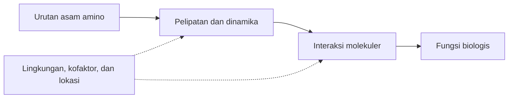
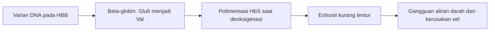
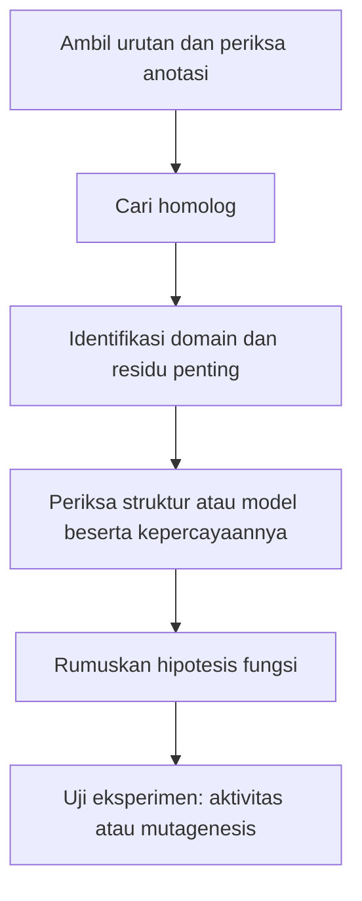

# Struktur & Fungsi Protein

[Beranda](../../README.md) · [← Biokimia](../05-Biochemistry/README.md) · [Enzim →](../07-Enzyme/README.md)

## Gambaran dan Cara Belajar

Pelajari hubungan urutan, pelipatan, dinamika, dan fungsi protein. Gunakan hemoglobin sebagai contoh lintas skala, lalu ikuti alur analisis untuk membedakan hipotesis fungsi dari bukti eksperimen.

## Tujuan Pembelajaran

Setelah mempelajari materi ini, mahasiswa diharapkan mampu:

1. Menjelaskan hubungan antara sifat kimia asam amino, ikatan peptida, dan pembentukan struktur protein.
2. Membedakan struktur primer, sekunder, tersier, dan kuartener beserta interaksi yang menstabilkannya.
3. Menghubungkan bentuk, dinamika, dan lokasi protein dengan fungsi biologisnya.
4. Menjelaskan dampak mutasi, denaturasi, dan modifikasi pascatranslasi terhadap aktivitas protein.
5. Mengenali pendekatan bioinformatika untuk menganalisis urutan, struktur, dan fungsi protein beserta keterbatasannya.

## Konsep Utama

### 1. Protein sebagai penghubung informasi genetik dan aktivitas sel

Dalam dogma sentral, informasi genetik mengalir dari DNA ke RNA, kemudian diterjemahkan menjadi urutan asam amino. Protein merupakan salah satu pelaksana utama aktivitas sel: mempercepat reaksi, mengangkut zat, menerima sinyal, membentuk kerangka sel, dan mengatur ekspresi gen.

Namun, urutan asam amino belum otomatis menghasilkan protein yang berfungsi. Rantai hasil translasi perlu mencapai keadaan struktural yang sesuai. Sebagian protein juga membutuhkan pemotongan, modifikasi kimia, pengikatan kofaktor, atau perakitan bersama subunit lain.

Prinsip pentingnya adalah:

Hubungan ini dipengaruhi lingkungan, termasuk pH, suhu, komposisi ion, dan keberadaan molekul pasangan. Karena itu, protein tidak dapat dipahami hanya sebagai “produk akhir gen”, tetapi sebagai molekul dinamis yang bekerja dalam konteks sel.

### 2. Asam amino dan ikatan peptida

Protein tersusun terutama dari 20 jenis asam amino standar. Setiap asam amino memiliki karbon alfa yang terikat pada gugus amino, gugus karboksil, atom hidrogen, dan rantai samping atau **gugus R**. Pada glisin, gugus R berupa hidrogen.

Perbedaan gugus R menentukan sifat kimia asam amino:

- **Nonpolar**, misalnya leusin dan valin, cenderung berada di bagian dalam protein globular yang larut dalam air.
- **Polar tidak bermuatan**, misalnya serin dan asparagin, dapat membentuk ikatan hidrogen.
- **Bermuatan negatif**, seperti aspartat dan glutamat pada pH mendekati fisiologis.
- **Bermuatan positif**, seperti lisin dan arginin; muatan histidin lebih peka terhadap pH setempat.

Pengelompokan tersebut adalah penyederhanaan. Sifat suatu residu juga dipengaruhi lingkungan kimia di sekitarnya.

Asam amino terhubung melalui **ikatan peptida** antara gugus karboksil satu asam amino dan gugus amino asam amino berikutnya. Asam amino yang telah menjadi bagian rantai disebut **residu**.

Rantai polipeptida memiliki arah: dari **ujung N** menuju **ujung C**. Urutan protein biasanya ditulis dalam arah ini, memakai kode satu atau tiga huruf.

Ikatan peptida memiliki karakter ikatan rangkap parsial sehingga relatif planar dan rotasinya terbatas. Fleksibilitas tulang punggung terutama berasal dari rotasi pada ikatan di sekitar karbon alfa. Batasan geometris ini membantu menjelaskan mengapa tidak semua bentuk rantai mungkin terbentuk.

### 3. Empat tingkat organisasi struktur protein

**Struktur primer** adalah urutan residu asam amino. Urutan menentukan posisi gugus kimia yang tersedia untuk berinteraksi. Perubahan satu residu dapat berdampak kecil, besar, atau hampir tidak terdeteksi, bergantung pada posisinya dan perannya.

**Struktur sekunder** adalah pola lokal tulang punggung polipeptida, terutama:

- **Heliks alfa**, berbentuk spiral.
- **Lembaran beta**, tersusun dari untaian yang berdampingan, dengan orientasi sejajar atau berlawanan arah.
- **Belokan dan loop**, yang menghubungkan elemen struktur lain dan sering berperan dalam pengikatan atau katalisis.

Heliks alfa dan lembaran beta terutama distabilkan oleh ikatan hidrogen antara gugus karbonil dan amida pada **tulang punggung**, bukan langsung oleh rantai samping.

**Struktur tersier** adalah organisasi tiga dimensi keseluruhan satu rantai polipeptida. Struktur ini mencakup penataan heliks, lembaran, loop, dan rantai samping. Protein dapat memiliki beberapa **domain**, yaitu unit struktural yang relatif mandiri dan sering berkaitan dengan fungsi tertentu.

**Struktur kuartener** adalah susunan beberapa rantai polipeptida atau subunit menjadi satu kompleks. Subunitnya dapat identik atau berbeda. Protein dengan satu rantai tidak memiliki struktur kuartener.

Istilah **motif** berbeda dari domain. Motif adalah pola urutan atau susunan struktur yang berulang, sedangkan domain merupakan unit yang lebih besar dan relatif mandiri. Sebuah motif saja biasanya belum cukup untuk menyimpulkan fungsi protein.

### 4. Gaya penstabil, pelipatan, dan dinamika protein

Pelipatan muncul dari gabungan berbagai interaksi:

- **Efek hidrofobik:** gugus nonpolar cenderung terhindar dari air dan berkumpul di bagian dalam protein larut.
- **Ikatan hidrogen:** terbentuk antara gugus donor dan akseptor yang sesuai.
- **Interaksi elektrostatik:** termasuk tarik-menarik antara gugus bermuatan berlawanan.
- **Gaya van der Waals:** membantu penataan rapat atom-atom yang berdekatan.
- **Ikatan disulfida:** ikatan kovalen antara dua residu sistein, terutama umum pada protein di lingkungan ekstraseluler.

Efek hidrofobik bukan ikatan kimia tunggal, melainkan konsekuensi termodinamika interaksi molekul nonpolar dengan air. Pada protein membran, permukaan yang menghadap lipid justru sering kaya residu nonpolar.

Pelipatan dapat digambarkan melalui **lanskap energi**: protein menjelajahi banyak konformasi dan cenderung mencapai keadaan yang menguntungkan secara energi bebas dalam kondisi tertentu. Namun, prosesnya dapat terhambat oleh perangkap kinetik atau agregasi.

**Chaperone molekuler** membantu pelipatan dan mencegah interaksi yang tidak tepat. Chaperone tidak menjadi cetakan urutan protein; informasi utama pelipatan tetap terdapat dalam urutan dan konteks lingkungannya.

Protein juga bukan benda kaku. Protein terus berfluktuasi, dan perpindahan antarkonformasi sering diperlukan untuk bekerja. Sebagian protein atau bagiannya bersifat **tidak teratur secara intrinsik**: tidak memiliki satu struktur tiga dimensi stabil, tetapi tetap berfungsi, misalnya sebagai penghubung atau pengatur interaksi.

### 5. Bagaimana struktur menghasilkan fungsi?

Fungsi protein bergantung pada susunan gugus kimia dalam ruang dan kemampuannya berinteraksi dengan molekul lain.

Pada **enzim**, residu yang berjauhan dalam urutan dapat bertemu setelah pelipatan dan membentuk **situs aktif**. Situs ini menyediakan lingkungan yang membantu pengikatan substrat dan menurunkan energi aktivasi reaksi. Enzim tidak mengubah keseimbangan termodinamika reaksi.

Pengikatan tidak selalu mengikuti gambaran “kunci dan gembok” yang kaku. Protein dapat menyesuaikan konformasinya setelah berinteraksi dengan ligan (*induced fit*), atau ligan dapat menstabilkan salah satu konformasi yang sudah tersedia (*conformational selection*).

Selain enzim, protein menjalankan berbagai fungsi:

- **Transport:** hemoglobin mengikat dan mengangkut oksigen.
- **Struktural:** kolagen membantu memberikan kekuatan tarik pada jaringan.
- **Sinyal:** reseptor mendeteksi molekul sinyal dan memicu respons.
- **Pertahanan:** antibodi mengenali antigen.
- **Gerak:** miosin berinteraksi dengan aktin untuk menghasilkan gaya.

Pada **regulasi alosterik**, pengikatan molekul di suatu lokasi memengaruhi fungsi lokasi lain melalui perubahan konformasi atau dinamika. Mekanisme ini memungkinkan aktivitas protein disesuaikan dengan kebutuhan sel.

### 6. Mutasi, modifikasi, dan kehilangan fungsi

Mutasi pada DNA pengode dapat mengubah urutan protein. Substitusi residu mungkin memengaruhi kestabilan, situs aktif, interaksi antarsubunit, atau pengenalan oleh protein lain. Substitusi yang mempertahankan sifat kimia sering disebut konservatif, tetapi tetap dapat berdampak besar pada posisi penting.

Protein juga dapat mengalami **modifikasi pascatranslasi**, antara lain:

- **Fosforilasi**, yang dapat mengubah aktivitas atau interaksi.
- **Glikosilasi**, yang berperan dalam pelipatan, kestabilan, dan pengenalan.
- **Pemotongan proteolitik**, misalnya aktivasi prekursor enzim.
- **Penambahan gugus lipid**, yang dapat membantu penambatan pada membran.

Lokasi juga menentukan fungsi. Protein yang aktif secara kimia belum tentu bekerja dengan benar jika gagal mencapai organel atau kompartemen tujuannya.

**Denaturasi** adalah hilangnya organisasi struktural yang diperlukan untuk fungsi, misalnya akibat panas, pH ekstrem, atau bahan kimia. Denaturasi umumnya tidak memutus ikatan peptida, sehingga berbeda dari degradasi rantai protein.

Sebagian protein dapat melipat kembali setelah kondisi dipulihkan. Pada kasus lain, agregasi atau perubahan kimia menyebabkan kehilangan fungsi yang sulit dipulihkan.

## Ringkasan Konsep

| Tingkat struktur | Apa yang dijelaskan? | Penentu atau penstabil utama | Contoh konsekuensi fungsional |
|---|---|---|---|
| Primer | Urutan residu asam amino | Ikatan peptida | Menentukan residu yang tersedia untuk katalisis dan interaksi |
| Sekunder | Pola lokal tulang punggung | Ikatan hidrogen tulang punggung | Heliks transmembran dapat membantu protein melintasi membran |
| Tersier | Bentuk tiga dimensi satu rantai | Efek hidrofobik, ikatan hidrogen, interaksi elektrostatik, van der Waals, dan kadang disulfida | Membentuk situs aktif atau kantong pengikatan |
| Kuartener | Susunan beberapa subunit | Interaksi antarsubunit, kadang ikatan kovalen | Memungkinkan kerja sama antarsubunit pada hemoglobin |

Tingkat-tingkat ini merupakan cara menjelaskan organisasi protein, bukan empat tahap pelipatan yang selalu terjadi secara terpisah dan berurutan.

## Contoh Konkret

### Hemoglobin dan penyakit sel sabit

Hemoglobin dewasa yang paling umum tersusun dari dua subunit alfa dan dua subunit beta. Setiap subunit mengandung **heme** dengan atom besi yang dapat mengikat oksigen. Interaksi antarsubunit mendukung pengikatan oksigen secara kooperatif: pengikatan pada satu subunit memengaruhi afinitas subunit lain.

Pada hemoglobin S, residu glutamat di posisi 6 rantai beta menurut penomoran konvensional diganti oleh valin. Glutamat bermuatan negatif, sedangkan valin bersifat nonpolar.

Pergantian ini menghasilkan permukaan yang, terutama pada keadaan terdeoksigenasi, mendukung interaksi abnormal antarmolekul hemoglobin. Hemoglobin dapat membentuk polimer, mengurangi kelenturan eritrosit, dan berkontribusi pada gangguan aliran darah serta kerusakan sel.

Contoh ini menghubungkan beberapa skala:

Pelajarannya bukan bahwa setiap mutasi menyebabkan penyakit, melainkan bahwa dampak mutasi sangat bergantung pada konteks struktural dan fisiologis.

### Ribonuklease dan informasi pelipatan

Eksperimen klasik pada ribonuklease menunjukkan bahwa, dalam kondisi yang sesuai, protein yang didenaturasi dan direduksi dapat kembali memperoleh struktur serta aktivitasnya setelah kondisi dipulihkan.

Temuan ini mendukung gagasan bahwa urutan asam amino menyimpan informasi utama untuk pelipatan. Namun, hasil tersebut tidak berarti semua protein dapat melipat sendiri dengan mudah: banyak protein memerlukan bantuan sistem seluler, kofaktor, atau pasangan perakitan.

## Hubungan dengan Bioinformatika

Bioinformatika menghubungkan **urutan, struktur, fungsi, dan evolusi** melalui analisis komputasional.

1. **Mengakses urutan dan anotasi.**  
   NCBI dan UniProt menyediakan urutan serta informasi protein. UniProt juga membedakan entri yang ditinjau manual dan yang belum ditinjau. Anotasi perlu diperiksa dasar buktinya, bukan diterima tanpa evaluasi.

2. **Membandingkan urutan.**  
   BLAST membantu menemukan kemiripan dengan protein yang sudah dikenal. Penjajaran banyak urutan dapat menunjukkan residu yang terkonservasi, misalnya kandidat residu katalitik atau bagian penting untuk kestabilan. Kemiripan mendukung dugaan hubungan evolusioner, tetapi tidak otomatis membuktikan fungsi identik.

3. **Mengenali domain dan fitur.**  
   Basis data seperti InterPro dan Pfam membantu mengenali keluarga serta domain protein. Analisis urutan juga dapat memperkirakan peptida sinyal, segmen transmembran, dan wilayah tidak teratur.

4. **Menganalisis struktur.**  
   Protein Data Bank atau **PDB** menyimpan struktur biomolekul hasil penelitian eksperimental, termasuk kristalografi sinar-X, spektroskopi NMR, dan mikroskopi elektron kriogenik. Struktur dapat divisualisasikan untuk menelaah situs aktif, kontak residu, dan antarmuka subunit.

5. **Menggunakan prediksi secara kritis.**  
   Model prediksi, termasuk yang tersedia melalui AlphaFold Protein Structure Database, berguna ketika struktur eksperimental belum tersedia. Namun, model bukan pengukuran langsung. Tingkat kepercayaan model, wilayah fleksibel, keadaan kompleks, ligan, dan alternatif konformasi harus diperhatikan.

Alur analisis untuk pemula:

Prediksi fungsi tetap merupakan hipotesis sampai didukung bukti yang sesuai.

## Ringkasan

- Protein tersusun atas residu asam amino yang terhubung melalui ikatan peptida.
- Struktur primer hingga kuartener menjelaskan organisasi protein pada skala berbeda.
- Pelipatan dipengaruhi urutan, lingkungan, dan berbagai interaksi fisikokimia.
- Fungsi bergantung pada bentuk, dinamika, lokasi, kofaktor, serta interaksi dengan molekul lain.
- Mutasi dan modifikasi pascatranslasi dapat mengubah aktivitas, kestabilan, atau penempatan protein.
- Bioinformatika membantu menghubungkan urutan dengan struktur dan fungsi, tetapi prediksi harus dibaca bersama keterbatasan dan bukti pendukungnya.

## Pertanyaan Latihan

1. Jelaskan perbedaan struktur sekunder, tersier, dan kuartener. Mengapa protein satu rantai tidak memiliki struktur kuartener?
2. Mengapa residu nonpolar sering berada di bagian dalam protein globular larut, tetapi dapat ditemukan pada permukaan protein membran?
3. Sebuah enzim kehilangan aktivitas setelah dipanaskan, tetapi rantai polipeptidanya tetap utuh. Jelaskan kemungkinan perubahan yang terjadi dan bedakan denaturasi dari degradasi.
4. Menggunakan hemoglobin S sebagai contoh, jelaskan bagaimana perubahan satu residu dapat memengaruhi sifat sel dan menyebabkan gangguan fisiologis.
5. Anda menemukan protein dengan urutan mirip enzim yang sudah dikenal. Susun langkah bioinformatika untuk menguji dugaan fungsinya dan jelaskan mengapa kemiripan urutan saja belum cukup.

## Bacaan Lanjutan

- **Nelson dan Cox, *Lehninger Principles of Biochemistry*** — struktur protein, pelipatan, dan mekanisme enzim.
- **Alberts dan kolega, *Molecular Biology of the Cell*** — protein dalam konteks organisasi serta aktivitas sel.
- **Berg dan kolega, *Biochemistry*** — hubungan struktur, dinamika, dan fungsi protein.
- **UniProt** — latihan membaca urutan, domain, lokasi seluler, dan bukti anotasi.
- **RCSB Protein Data Bank dan PDB-101** — eksplorasi struktur tiga dimensi serta materi pengantar.
- **NCBI Bookshelf** — buku dan materi biomedis untuk memperkuat konsep dasar.

---

[↑ Atas](#top) · [Beranda](../../README.md) · [← Biokimia](../05-Biochemistry/README.md) · [Enzim →](../07-Enzyme/README.md)
