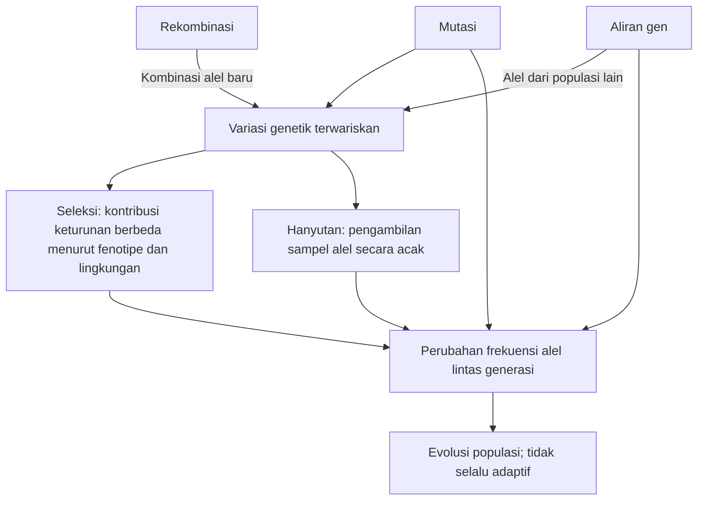
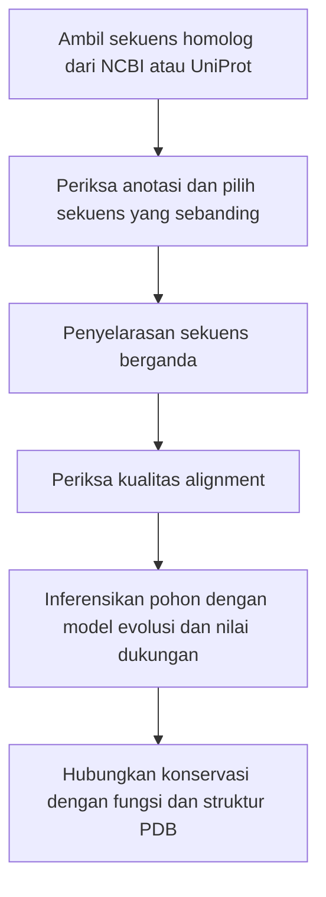

# Evolusi & Seleksi Alam

[Beranda](../../README.md) · [← Metabolisme](../08-Metabolism/README.md) · [Taksonomi →](../10-Taxonomy/README.md)

Daftar isi

- [Gambaran dan Cara Belajar](#bagian-1)
- [Tujuan Pembelajaran](#bagian-2)
- [Konsep Utama](#bagian-3)
- [Peta Mekanisme Evolusi](#bagian-4)
- [Tabel Mekanisme Evolusi](#bagian-5)
- [Contoh Konkret](#bagian-6)
- [Hubungan dengan Bioinformatika](#bagian-7)
- [Ringkasan](#bagian-8)
- [Pertanyaan Latihan](#bagian-9)
- [Bacaan Lanjutan](#bagian-10)

## Gambaran dan Cara Belajar

Bedakan sumber variasi dari proses yang mengubah frekuensi alel. Gunakan contoh resistansi antibiotik, model Hardy–Weinberg, dan alur filogenetika untuk menilai penjelasan evolusi secara kritis.

## Tujuan Pembelajaran

Setelah mempelajari materi ini, mahasiswa diharapkan mampu:

1. Menjelaskan evolusi sebagai perubahan sifat terwariskan pada populasi lintas generasi, termasuk perubahan frekuensi alel.
2. Membedakan seleksi alam, mutasi, hanyutan genetik, dan aliran gen sebagai mekanisme evolusi.
3. Menghubungkan variasi DNA dengan perubahan protein, fenotipe, dan keberhasilan reproduksi.
4. Menggunakan prinsip Hardy–Weinberg untuk memahami komposisi genetik populasi secara sederhana.
5. Menjelaskan bagaimana data sekuens dan metode bioinformatika digunakan untuk mempelajari hubungan evolusioner.

## Konsep Utama

### 1. Apa yang Dimaksud dengan Evolusi?

**Evolusi biologis** adalah perubahan karakteristik terwariskan suatu populasi dari generasi ke generasi. Dalam genetika populasi, perubahan ini sering diukur sebagai **perubahan frekuensi alel**, yaitu proporsi suatu alel di antara seluruh salinan gen pada lokus tertentu.

Misalkan sebuah populasi tumbuhan memiliki dua alel pada suatu lokus: **A** dan **a**. Jika frekuensi A berubah dari 0,40 menjadi 0,60 setelah beberapa generasi, populasi tersebut telah mengalami evolusi pada lokus itu. Perubahan ini tidak harus menghasilkan spesies baru atau perubahan bentuk yang mencolok.

**Individu tumbuh dan berkembang, sedangkan populasi berevolusi.** Seekor hewan dapat mengalami perubahan fisiologis selama hidupnya, tetapi perubahan tersebut belum tentu diwariskan. Sebagai contoh, peningkatan massa otot akibat latihan bukan dengan sendirinya perubahan evolusioner.

Evolusi juga tidak memiliki tujuan akhir. Organisme tidak secara otomatis berevolusi menjadi lebih besar, lebih kompleks, atau “lebih sempurna”. Keuntungan suatu sifat bergantung pada lingkungan dan dapat berubah ketika kondisi lingkungan berubah.

### 2. Sumber Variasi: Dari DNA ke Fenotipe

Seleksi alam memerlukan variasi yang dapat diwariskan. Berdasarkan materi dogma sentral, perubahan DNA dapat memengaruhi RNA, protein, dan akhirnya fenotipe. Namun, hubungan tersebut tidak selalu sederhana atau langsung.

Sumber utama variasi genetik meliputi:

- **Mutasi:** perubahan sekuens DNA, seperti substitusi basa, insersi, delesi, atau duplikasi.
- **Rekombinasi:** pembentukan kombinasi alel baru, terutama melalui pindah silang dan pemilahan kromosom saat meiosis.
- **Aliran gen:** perpindahan alel antarpopulasi melalui individu atau gamet.
- **Transfer gen horizontal:** perpindahan materi genetik di luar pewarisan langsung dari induk ke keturunan; penting terutama pada mikroorganisme.

Mutasi merupakan sumber asal alel baru, sedangkan rekombinasi terutama menyusun ulang variasi yang sudah ada. Duplikasi gen menyediakan salinan tambahan yang kemudian dapat mengalami perubahan fungsi.

Dampak mutasi bergantung pada konteks. Mutasi dapat bersifat merugikan, menguntungkan, atau hampir netral terhadap keberhasilan reproduksi. Mutasi sinonim tidak mengubah asam amino, tetapi tidak selalu netral karena terkadang memengaruhi pemrosesan atau kestabilan RNA.

Mutasi juga dapat terjadi pada daerah pengatur ekspresi gen. Karena itu, evolusi fenotipe tidak hanya berasal dari perubahan struktur protein, tetapi juga perubahan **kapan, di mana, dan seberapa banyak gen diekspresikan**.

Penting: mutasi tidak muncul karena organisme “membutuhkannya”. Mutasi bersifat acak terhadap kebutuhan adaptif, walaupun peluang mutasi tidak seragam di seluruh genom.

### 3. Seleksi Alam dan Kebugaran Biologis

**Seleksi alam** terjadi ketika perbedaan sifat terwariskan menyebabkan perbedaan keberhasilan bertahan hidup dan bereproduksi. Tiga unsur dasarnya adalah:

1. Terdapat variasi antarindividu.
2. Sebagian variasi tersebut dapat diwariskan.
3. Varian berbeda menghasilkan kontribusi keturunan yang berbeda dalam lingkungan tertentu.

Istilah **kebugaran biologis** atau *fitness* merujuk pada kontribusi relatif terhadap generasi berikutnya. Kebugaran bukan sekadar kekuatan fisik atau umur panjang. Individu yang hidup lama tetapi tidak menghasilkan keturunan dapat memiliki kontribusi genetik lebih kecil daripada individu yang hidup singkat tetapi berhasil bereproduksi.

Seleksi bekerja melalui fenotipe, tetapi perubahan evolusioner bergantung pada komponen genetik yang diwariskan. Contohnya, variasi aktivitas enzim dapat memengaruhi pemanfaatan nutrien, pertumbuhan, dan jumlah keturunan.

Beberapa pola seleksi meliputi:

- **Seleksi terarah:** menguntungkan salah satu ujung rentang fenotipe, misalnya ukuran paruh lebih besar ketika makanan yang tersedia didominasi biji keras.
- **Seleksi penstabil:** menguntungkan fenotipe menengah dan mengurangi fenotipe ekstrem.
- **Seleksi disruptif:** menguntungkan dua atau lebih fenotipe ekstrem dibandingkan fenotipe menengah.
- **Seleksi penyeimbang:** mempertahankan variasi genetik, misalnya karena heterozigot memiliki keuntungan dalam kondisi tertentu.

**Seleksi seksual** berkaitan dengan perbedaan keberhasilan memperoleh pasangan atau membuahi. Sifat yang meningkatkan peluang kawin dapat terseleksi meskipun menimbulkan biaya bagi kelangsungan hidup.

### 4. Evolusi Tidak Hanya Disebabkan oleh Seleksi

**Hanyutan genetik** atau *genetic drift* adalah perubahan frekuensi alel akibat proses pengambilan sampel secara acak antargenerasi. Tidak semua individu menyumbangkan keturunan dalam jumlah yang sama, bahkan ketika perbedaan tersebut tidak berkaitan dengan sifat adaptif.

Dampak hanyutan lebih kuat pada populasi dengan **ukuran populasi efektif kecil**. Ukuran efektif menggambarkan banyaknya individu yang secara genetik berkontribusi pada pewarisan dan tidak selalu sama dengan jumlah individu yang teramati.

Dua situasi penting adalah:

- **Efek pendiri:** populasi baru dibentuk oleh sedikit individu yang membawa sebagian variasi populasi asal.
- **Leher botol populasi:** penurunan jumlah populasi secara tajam menyebabkan sebagian variasi genetik hilang secara acak.

**Aliran gen** memasukkan alel dari populasi lain. Proses ini sering mengurangi perbedaan genetik antarpopulasi, tetapi juga dapat memasukkan alel yang membantu adaptasi lokal.

Mutasi, seleksi, hanyutan, dan aliran gen dapat berlangsung bersamaan. Karena itu, frekuensi suatu alel yang meningkat tidak otomatis membuktikan bahwa alel tersebut menguntungkan.

### 5. Prinsip Hardy–Weinberg sebagai Model Pembanding

Prinsip Hardy–Weinberg menyediakan model dasar untuk memahami hubungan antara frekuensi alel dan genotipe.

Untuk lokus autosomal dengan dua alel, A dan a:

$$
p+q=1
$$

dengan $p$ sebagai frekuensi A dan $q$ sebagai frekuensi a. Dalam kondisi Hardy–Weinberg, frekuensi genotipe yang diharapkan adalah:

$$
f(AA)=p^2,\qquad f(Aa)=2pq,\qquad f(aa)=q^2
$$

Model ini mengasumsikan perkawinan acak terhadap lokus tersebut, populasi sangat besar, serta tidak ada seleksi, mutasi, atau migrasi yang mengubah frekuensi alel.

Sebagai ilustrasi, jika $p=0{,}7$ dan $q=0{,}3$, frekuensi genotipe yang diharapkan adalah:

- AA: $0{,}49$
- Aa: $0{,}42$
- aa: $0{,}09$

Penyimpangan dari proporsi ini dapat menjadi petunjuk adanya proses biologis, struktur populasi, atau kesalahan data. Namun, penyimpangan **bukan bukti tunggal seleksi**. Perkawinan sekerabat, misalnya, dapat mengubah proporsi genotipe tanpa langsung mengubah frekuensi alel.

### 6. Adaptasi, Keterbatasan, dan Kompromi

**Adaptasi** adalah sifat terwariskan yang meningkatkan kebugaran dalam lingkungan tertentu dan terbentuk melalui seleksi alam. Istilah ini juga digunakan untuk proses terbentuknya sifat tersebut.

Adaptasi berbeda dari **aklimatisasi**, yaitu penyesuaian fisiologis selama kehidupan individu. Peningkatan ventilasi saat seseorang berada di dataran tinggi merupakan respons fisiologis; perubahan genetik pada populasi selama banyak generasi merupakan persoalan evolusi.

Seleksi tidak menghasilkan rancangan sempurna karena dibatasi oleh:

- Variasi genetik yang tersedia.
- Sejarah evolusioner dan struktur tubuh yang diwarisi.
- Pengaruh satu gen terhadap beberapa sifat, atau **pleiotropi**.
- Kompromi antara fungsi yang berbeda.

Contohnya, peningkatan kestabilan protein tidak selalu disertai peningkatan aktivitas katalitik. Dalam kondisi tertentu, fleksibilitas yang membantu katalisis justru dapat mengurangi kestabilan. Evolusi protein berlangsung dalam batas hubungan struktur, fungsi, dan biaya biologis tersebut.

### 7. Spesiasi dan Kekerabatan Evolusioner

**Spesiasi** adalah terbentuknya garis keturunan yang terpisah secara evolusioner. Pada organisme yang bereproduksi seksual, isolasi reproduksi merupakan unsur penting: pertukaran gen antarkelompok berkurang atau terhenti.

Pemisahan geografis dapat mengurangi aliran gen. Setelah itu, mutasi, seleksi, dan hanyutan dapat menyebabkan divergensi. Isolasi reproduksi dapat muncul melalui perbedaan waktu kawin, perilaku, kompatibilitas gamet, atau rendahnya kelangsungan hidup maupun kesuburan hibrida.

Konsep spesies biologis berguna, tetapi tidak mudah diterapkan pada organisme aseksual atau fosil. Karena itu, ahli biologi juga menggunakan bukti morfologi, ekologi, dan filogenetik.

Hubungan kekerabatan digambarkan melalui **pohon filogenetik**. Titik percabangan mewakili nenek moyang bersama yang diinferensikan. Spesies modern bukan “tangga kemajuan”; manusia dan simpanse, misalnya, berbagi nenek moyang bersama, bukan berarti manusia berasal dari simpanse modern.

## Peta Mekanisme Evolusi

## Tabel Mekanisme Evolusi

| Mekanisme | Proses utama | Hubungan dengan kebugaran | Dampak yang mungkin terjadi |
|---|---|---|---|
| Mutasi | Menghasilkan perubahan DNA dan alel baru | Tidak muncul sesuai kebutuhan adaptif | Menambah variasi; efek dapat menguntungkan, merugikan, atau netral |
| Rekombinasi | Menyusun ulang kombinasi alel | Tidak secara langsung memilih alel berdasarkan kebugaran | Menghasilkan kombinasi genetik baru |
| Seleksi alam | Perbedaan kontribusi keturunan terkait sifat terwariskan | Berkaitan dengan kebugaran dalam lingkungan tertentu | Meningkatkan varian menguntungkan atau mempertahankan variasi |
| Hanyutan genetik | Pengambilan sampel acak antargenerasi | Tidak harus berkaitan dengan kebugaran | Kehilangan atau fiksasi alel, terutama pada populasi kecil |
| Aliran gen | Memindahkan alel antarpopulasi | Tidak selalu bersifat adaptif | Menambah variasi lokal dan sering mengurangi perbedaan antarpopulasi |

**Fiksasi** berarti suatu alel mencapai frekuensi 1 pada populasi yang diamati. Fiksasi dapat terjadi melalui seleksi maupun hanyutan.

## Contoh Konkret

### 1. Resistansi Antibiotik pada Bakteri

Dalam populasi bakteri, sebagian sel dapat memiliki mutasi atau gen yang menyebabkan resistansi sebelum paparan antibiotik. Gen resistansi juga dapat diperoleh melalui transfer gen horizontal.

Saat antibiotik diberikan, bakteri rentan lebih banyak mati atau terhambat pertumbuhannya. Bakteri resistan kemudian menyumbangkan proporsi keturunan lebih besar, sehingga frekuensi resistansi meningkat.

Mekanismenya dapat berupa:

- Enzim yang menginaktivasi antibiotik.
- Perubahan protein target.
- Peningkatan pengeluaran antibiotik melalui pompa efluks.
- Penurunan masuknya antibiotik ke dalam sel.

Ini menghubungkan evolusi dengan struktur protein dan kinetika enzim. Antibiotik tidak “mengajari” bakteri menjadi kebal; antibiotik menjadi tekanan seleksi. Dalam lingkungan tanpa antibiotik, sebagian mekanisme resistansi dapat menimbulkan biaya kebugaran, tetapi biaya tersebut bergantung pada mekanisme dan latar belakang genetik.

### 2. Persistensi Laktase pada Manusia

Laktase adalah enzim yang memecah laktosa. Pada banyak manusia, ekspresinya menurun setelah masa kanak-kanak. Pada sebagian populasi, varian pengatur di sekitar lokus **LCT** mempertahankan ekspresi laktase hingga dewasa.

Dalam konteks budaya peternakan dan konsumsi susu, sifat ini dapat memberikan keuntungan. Contoh ini menunjukkan **koevolusi gen–budaya**: praktik budaya mengubah lingkungan seleksi.

Persistensi laktase tidak berarti semua orang yang dapat mengonsumsi produk susu memiliki varian genetik yang sama. Toleransi terhadap produk susu juga dipengaruhi jumlah konsumsi, pengolahan makanan, dan faktor fisiologis lainnya.

## Hubungan dengan Bioinformatika

Bioinformatika memungkinkan pengujian hipotesis evolusi menggunakan data molekuler.

### Perbandingan Sekuens dan Filogenetika

Sekuens DNA atau protein disejajarkan untuk mengenali posisi yang bersesuaian secara evolusioner. Dari pola perubahan tersebut, peneliti menginferensikan pohon filogenetik menggunakan model evolusi.

**Homologi** berarti kesamaan karena nenek moyang bersama, bukan sekadar persentase kemiripan. Gen homolog mencakup:

- **Ortolog:** berpisah akibat peristiwa spesiasi.
- **Paralog:** berpisah akibat duplikasi gen.

Pembedaan ini penting ketika memprediksi fungsi protein. Ortolog sering mempertahankan fungsi serupa, tetapi kesamaan fungsi tetap perlu diuji. Pohon satu gen juga tidak selalu sama dengan pohon spesies karena duplikasi, kehilangan gen, transfer horizontal, atau proses pewarisan lainnya.

### Deteksi Seleksi pada Gen

Pada gen pengode protein, peneliti dapat membandingkan laju substitusi nonsinonim dan sinonim melalui rasio $d_N/d_S$:

- $d_N/d_S<1$: sering konsisten dengan **seleksi pemurnian**, yang menyingkirkan perubahan merugikan.
- $d_N/d_S\approx1$: dapat konsisten dengan evolusi netral dalam model yang digunakan.
- $d_N/d_S>1$: dapat mendukung seleksi positif.

Interpretasinya memerlukan kehati-hatian. Hasil bergantung pada kualitas penyelarasan, model, dan apakah analisis dilakukan pada seluruh gen, cabang, atau posisi tertentu. Rasio ini bukan diagnosis otomatis seleksi.

### Alur Analisis Sederhana

Posisi yang sangat terkonservasi dapat menandakan kendala fungsional atau struktural. Namun, konservasi saja belum membuktikan mekanisme fungsi tertentu.

## Ringkasan

- Evolusi adalah perubahan sifat terwariskan pada populasi lintas generasi.
- Mutasi menyediakan alel baru; rekombinasi membentuk kombinasi baru.
- Seleksi alam berkaitan dengan perbedaan keberhasilan reproduksi, bukan sekadar kemampuan bertahan hidup.
- Hanyutan genetik dan aliran gen juga mengubah komposisi genetik populasi.
- Hardy–Weinberg merupakan model pembanding, bukan gambaran semua populasi nyata.
- Adaptasi bergantung pada lingkungan serta dibatasi sejarah dan kompromi biologis.
- Data sekuens membantu merekonstruksi kekerabatan dan menguji hipotesis seleksi, tetapi selalu memerlukan interpretasi kritis.

## Pertanyaan Latihan

1. Jelaskan mengapa perubahan frekuensi alel merupakan bukti evolusi, sedangkan peningkatan massa otot akibat latihan tidak dengan sendirinya menunjukkan evolusi.
2. Dalam populasi yang memenuhi asumsi Hardy–Weinberg, frekuensi alel a adalah 0,2. Hitung frekuensi AA, Aa, dan aa yang diharapkan.
3. Sebuah bencana menyisakan sedikit individu secara acak. Setelah beberapa generasi, satu alel menjadi sangat umum. Mekanisme apa yang paling langsung menjelaskan perubahan awal tersebut? Mengapa belum tentu merupakan adaptasi?
4. Uraikan evolusi resistansi antibiotik dengan menghubungkan variasi genetik, fungsi protein, tekanan seleksi, dan keberhasilan reproduksi.
5. Anda menemukan posisi asam amino yang identik pada banyak spesies. Apa kemungkinan penjelasan evolusionernya, dan bukti tambahan apa yang diperlukan sebelum menyimpulkan fungsi posisi tersebut?

## Bacaan Lanjutan

- **Campbell Biology** — bab evolusi, seleksi alam, genetika populasi, dan asal-usul spesies.
- **Evolution**, Douglas J. Futuyma dan Mark Kirkpatrick — pembahasan mekanisme evolusi dan bukti-buktinya.
- **NCBI Bookshelf** — buku dan materi tentang genetika, evolusi molekuler, serta biologi sel.
- **UniProt** — anotasi fungsi protein, keluarga protein, dan informasi sekuens untuk perbandingan evolusioner.
- **Ensembl** — informasi genom komparatif, ortolog, paralog, dan pohon gen.
- **PDB** — struktur tiga dimensi biomolekul untuk menghubungkan konservasi evolusioner dengan struktur dan fungsi.

---

[↑ Atas](#top) · [Beranda](../../README.md) · [← Metabolisme](../08-Metabolism/README.md) · [Taksonomi →](../10-Taxonomy/README.md)
