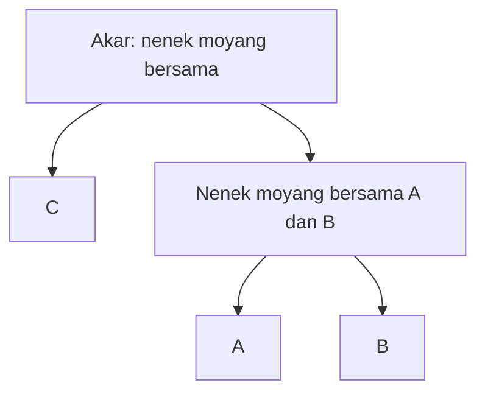

# Taksonomi & Klasifikasi Makhluk Hidup

[Beranda](../../README.md) · [← Evolusi](../09-Evolution/README.md)

Daftar isi

- [Gambaran dan Cara Belajar](#bagian-1)
- [Tujuan Pembelajaran](#bagian-2)
- [Konsep Utama](#bagian-3)
- [Perbandingan Konsep](#bagian-4)
- [Contoh Konkret](#bagian-5)
- [Hubungan dengan Bioinformatika](#bagian-6)
- [Ringkasan](#bagian-7)
- [Pertanyaan Latihan](#bagian-8)
- [Bacaan Lanjutan](#bagian-9)

## Gambaran dan Cara Belajar

Bandingkan hierarki takson dengan hubungan kekerabatan: keduanya bukan hal yang sama. Gunakan contoh pohon untuk membaca nenek moyang bersama, lalu kerjakan pertanyaan latihan.

## Tujuan Pembelajaran

Setelah mempelajari materi ini, mahasiswa diharapkan mampu:

1. Membedakan taksonomi, klasifikasi, identifikasi, nomenklatur, dan sistematika.
2. Menjelaskan hierarki takson serta menerapkan kaidah dasar penulisan nama ilmiah.
3. Menghubungkan klasifikasi makhluk hidup dengan evolusi, nenek moyang bersama, dan pohon filogenetik.
4. Membandingkan bukti morfologi, biokimia, ekologi, dan molekuler dalam penentuan hubungan kekerabatan.
5. Menjelaskan penggunaan data sekuens dan basis data bioinformatika untuk membantu identifikasi serta klasifikasi organisme.

## Konsep Utama

### 1. Mengapa Makhluk Hidup Perlu Diklasifikasikan?

Keanekaragaman makhluk hidup mencakup organisme dengan bentuk, ukuran, metabolisme, dan habitat yang sangat berbeda. Klasifikasi membantu kita mengatur keanekaragaman tersebut agar dapat dipelajari dan dikomunikasikan secara konsisten.

Namun, klasifikasi modern bukan sekadar kegiatan “mengelompokkan yang tampak mirip”. Tujuan pentingnya adalah menghasilkan kelompok yang mencerminkan **sejarah evolusi**.

Beberapa istilah dasar perlu dibedakan:

- **Taksonomi** adalah bidang yang mencakup penemuan, deskripsi, penamaan, dan klasifikasi organisme.
- **Klasifikasi** adalah penyusunan organisme ke dalam kelompok berdasarkan kriteria tertentu.
- **Identifikasi** adalah penentuan identitas suatu spesimen, misalnya menentukan spesies tumbuhan dari ciri bunganya.
- **Nomenklatur** adalah aturan pemberian dan penggunaan nama ilmiah.
- **Sistematika** mempelajari keanekaragaman organisme dan hubungan evolusionernya; cakupannya meliputi taksonomi dan filogenetika.

Sebagai contoh, mengamati ciri serangga untuk menentukan spesiesnya merupakan identifikasi. Menempatkan spesies tersebut dalam genus dan famili merupakan klasifikasi. Menganalisis hubungan evolusinya dengan serangga lain merupakan bagian dari sistematika.

### 2. Dasar Pengelompokan: Dari Kemiripan hingga Kekerabatan

Organisme dapat dibandingkan berdasarkan berbagai jenis karakter:

- **Morfologi:** bentuk tubuh, jumlah anggota gerak, struktur bunga, atau bentuk daun.
- **Anatomi dan perkembangan:** susunan organ serta pola perkembangan embrio.
- **Biokimia dan fisiologi:** komponen dinding sel, jenis pigmen, atau kemampuan menggunakan substrat tertentu.
- **Ekologi:** habitat, relung, dan interaksi dengan organisme lain.
- **Molekuler:** sekuens DNA, RNA, dan protein.

Pengetahuan biokimia membantu memahami bahwa perbedaan organisme tidak selalu tampak dari luar. Bacteria dan Archaea, misalnya, sama-sama memiliki sel tanpa inti bermembran, tetapi berbeda dalam sejumlah komponen membran dan mesin molekulernya.

Kemiripan juga tidak selalu menunjukkan kekerabatan dekat. Dalam evolusi konvergen, garis keturunan berbeda dapat mengembangkan ciri serupa karena menghadapi tekanan seleksi yang mirip.

Dua konsep penting adalah:

- **Homologi:** kesamaan karakter karena diwarisi dari nenek moyang bersama.
- **Analogi:** kemiripan fungsi atau bentuk yang berkembang secara independen.

Sayap burung dan sayap serangga merupakan struktur analog sebagai alat terbang. Sebaliknya, tulang anggota gerak depan manusia, paus, dan kelelawar merupakan struktur homolog, meskipun fungsinya berbeda.

Karena itu, klasifikasi modern menggabungkan banyak bukti, bukan hanya satu ciri yang mudah terlihat.

### 3. Hierarki Takson dan Nama Ilmiah

**Takson** adalah kelompok organisme yang diakui dalam klasifikasi, seperti Mammalia atau *Homo*. **Peringkat taksonomi** adalah tingkat kedudukan kelompok tersebut, seperti kelas atau genus.

Urutan peringkat utama yang umum digunakan adalah:

**Domain → Kingdom → Filum → Kelas → Ordo → Famili → Genus → Spesies**

Pada beberapa kelompok, terutama tumbuhan dan fungi, istilah **divisi** juga digunakan untuk tingkat yang setara dengan filum. Peringkat tambahan, seperti subfamili dan subspesies, dapat dipakai ketika diperlukan.

Nama spesies mengikuti sistem **binomial**, yaitu gabungan nama genus dan epitet spesifik. Contohnya adalah *Homo sapiens*.

Aturan penulisan dasarnya:

1. Nama genus diawali huruf kapital.
2. Epitet spesifik ditulis dengan huruf kecil.
3. Kedua kata dicetak miring.
4. Setelah disebut lengkap, nama genus dapat disingkat jika tidak menimbulkan ambiguitas: *H. sapiens*.

Kata *sapiens* saja bukan nama spesies lengkap.

Nomenklatur diatur oleh kode yang berbeda untuk kelompok organisme tertentu, misalnya hewan, tumbuhan–fungi–alga, dan prokariota. Dalam banyak sistem nomenklatur, nama dihubungkan dengan **tipe nomenklatural**, seperti spesimen atau galur acuan. Tipe berfungsi sebagai jangkar penggunaan nama, bukan harus menjadi individu yang paling “rata-rata” atau paling mewakili seluruh variasi spesies.

Peringkat yang sama juga tidak menjamin umur evolusi atau tingkat keragaman yang sama. Dua famili pada kelompok berbeda tidak otomatis setara dalam jumlah spesies maupun besarnya perbedaan genetik.

### 4. Apa yang Dimaksud dengan Spesies?

Spesies merupakan unit penting dalam taksonomi, tetapi tidak ada satu definisi yang sesuai untuk seluruh bentuk kehidupan.

**Konsep spesies biologis** menekankan kelompok populasi alami yang dapat saling kawin dan terisolasi secara reproduktif dari kelompok lain. Konsep ini berguna pada banyak organisme yang bereproduksi seksual.

Namun, penerapannya terbatas untuk:

- Organisme yang bereproduksi aseksual.
- Fosil yang tidak dapat diuji perkawinannya.
- Populasi terpisah secara geografis.
- Kelompok yang mengalami hibridisasi.

**Konsep spesies morfologis** menggunakan perbedaan bentuk atau struktur. Pendekatan ini praktis untuk spesimen museum dan fosil, tetapi dapat melewatkan **spesies kriptik**, yaitu spesies berbeda yang bentuknya sangat mirip.

**Konsep spesies filogenetik**, dalam salah satu rumusannya, menekankan garis keturunan terkecil yang dapat dibedakan berdasarkan karakter yang diwariskan dan sejarah evolusinya. Penerapannya bergantung pada data serta kriteria analisis.

Pada praktiknya, peneliti sering menggunakan **taksonomi integratif**, yaitu menggabungkan morfologi, genetika, ekologi, perilaku, dan persebaran geografis.

Hal ini berkaitan dengan genetika Mendel: variasi alel dapat muncul di dalam satu spesies. Karena itu, satu perbedaan basa DNA atau satu perbedaan sifat tidak otomatis menandakan spesies berbeda.

### 5. Domain, Kingdom, dan Keterbatasan Sistem Klasifikasi

Dalam kerangka tiga domain yang umum diajarkan, kehidupan seluler dibagi menjadi:

- **Bacteria:** organisme prokariotik; sebagian besar memiliki dinding sel yang mengandung peptidoglikan.
- **Archaea:** organisme prokariotik dengan ciri molekuler khas, termasuk kimia lipid membran yang berbeda dari Bacteria.
- **Eukarya:** organisme dengan sel berinti bermembran, mencakup hewan, tumbuhan, fungi, dan beragam eukariota lainnya.

Archaea tidak hanya hidup di lingkungan ekstrem. Banyak ditemukan di laut, tanah, dan lingkungan biasa lainnya.

Kerangka tiga domain penting secara historis dan pendidikan, tetapi bukan gambaran akhir yang tidak dapat berubah. Banyak analisis filogenomik modern mendukung asal-usul garis keturunan eukariota dari dalam keragaman Archaea. Dengan demikian, hubungan terdalam kehidupan masih terus dipelajari.

Istilah **prokariota** berguna untuk menggambarkan organisasi sel tanpa inti bermembran. Namun, istilah tersebut tidak sebaiknya dianggap sebagai satu klad yang setara dengan kelompok evolusioner monofiletik.

Sistem lima kingdom juga penting secara historis, tetapi tidak sepenuhnya sesuai dengan filogeni modern. “Protista”, misalnya, merupakan istilah praktis bagi beragam eukariota yang tidak semuanya membentuk satu klad eksklusif.

Virus memerlukan perhatian terpisah. Virus bersifat aseluler, bergantung pada sel inang untuk memperbanyak diri, dan tidak dimasukkan ke dalam tiga domain kehidupan seluler. Klasifikasinya ditangani melalui sistem tersendiri oleh ICTV.

### 6. Pohon Filogenetik dan Kelompok Evolusioner

**Filogeni** adalah sejarah evolusi suatu kelompok. **Pohon filogenetik** merupakan hipotesis tentang hubungan tersebut berdasarkan bukti yang dianalisis.

Komponen utamanya meliputi:

- **Ujung:** takson atau sekuens yang dibandingkan.
- **Cabang:** garis keturunan.
- **Simpul internal:** nenek moyang bersama yang diinferensikan.
- **Akar:** titik acuan arah sejarah evolusi pada pohon berakar.

Kelompok **monofiletik**, atau klad, mencakup satu nenek moyang bersama beserta seluruh keturunannya. Kelompok **parafiletik** mengecualikan sebagian keturunan. Kelompok **polifiletik** menyatukan garis keturunan berbeda tanpa memasukkan nenek moyang bersama terdekatnya sebagai bagian kelompok.

Dalam pengertian tradisional yang mengecualikan burung, “reptil” merupakan kelompok parafiletik. Burung berevolusi di dalam garis keturunan reptil; klasifikasi berbasis klad harus memperhitungkan hubungan tersebut.

Pohon juga harus dibaca dengan hati-hati. Posisi kiri–kanan ujung tidak menunjukkan tingkat “kemajuan”. Memutar cabang pada suatu simpul tidak mengubah hubungan kekerabatan. Panjang cabang hanya bermakna kuantitatif jika diagram menyediakan skala, misalnya perubahan sekuens atau waktu.

## Perbandingan Konsep

Tabel berikut menunjukkan contoh hierarki klasifikasi manusia.

| Peringkat | Takson | Ciri atau konteks |
|---|---|---|
| Domain | Eukarya | Sel memiliki inti bermembran |
| Kingdom | Animalia | Hewan multiseluler |
| Filum | Chordata | Memiliki notokorda pada suatu tahap perkembangan |
| Kelas | Mammalia | Memiliki kelenjar susu |
| Ordo | Primates | Kelompok yang mencakup lemur, monyet, dan kera |
| Famili | Hominidae | Kelompok kera besar, termasuk manusia |
| Genus | *Homo* | Genus manusia dan kerabat dekatnya yang telah punah |
| Spesies | *Homo sapiens* | Manusia modern |

Diagram sederhana berikut menunjukkan hubungan tiga takson hipotetis:

A dan B memiliki nenek moyang bersama yang lebih baru dibandingkan nenek moyang bersama masing-masing dengan C. Karena itu, A dan B disebut **takson saudara**. Diagram ini tidak menyatakan bahwa C lebih primitif.

## Contoh Konkret

### 1. Paus: Kemiripan Habitat Tidak Sama dengan Kekerabatan

Paus dan ikan sama-sama hidup di air serta memiliki tubuh yang mendukung pergerakan di dalamnya. Namun, paus dikelompokkan sebagai mamalia.

Buktinya mencakup pernapasan dengan paru-paru, kelenjar susu, serta pola anatomi dan perkembangan khas mamalia. Data molekuler juga menempatkan paus di dalam garis keturunan mamalia berkuku genap dalam pengertian luas.

Kesimpulannya, bentuk tubuh yang serupa dapat mencerminkan adaptasi, bukan kekerabatan terdekat.

### 2. Identifikasi Bakteri dari Sampel Lingkungan

Misalkan diperoleh isolat bakteri dari tanah. Bentuk sel dan hasil pewarnaan dapat memberikan petunjuk awal, tetapi biasanya belum cukup untuk menentukan spesies.

Peneliti dapat menggabungkan:

1. Pengamatan morfologi dan pertumbuhan.
2. Uji metabolisme.
3. Pengurutan gen RNA ribosomal 16S.
4. Perbandingan dengan sekuens acuan.
5. Analisis genom bila diperlukan.

Gen 16S berguna karena terdapat luas pada Bacteria dan Archaea serta memiliki bagian konservatif dan variabel. Namun, spesies berkerabat dekat dapat memiliki sekuens 16S yang sangat mirip. Jadi, kecocokan tinggi tidak selalu memastikan identitas spesies.

### 3. Fungi Bukan Tumbuhan Tanpa Klorofil

Fungi pernah dikelompokkan bersama tumbuhan dalam sistem lama. Namun, fungi memperoleh nutrisi melalui absorpsi setelah pencernaan di luar sel, dan dinding selnya umumnya mengandung kitin.

Data molekuler menunjukkan bahwa fungi berkerabat lebih dekat dengan hewan daripada dengan tumbuhan. Contoh ini menunjukkan bagaimana bukti baru dapat mengubah klasifikasi.

## Hubungan dengan Bioinformatika

Bioinformatika memungkinkan perbandingan organisme menggunakan ribuan karakter molekuler, bahkan seluruh genom.

Alur kerja sederhananya adalah:

1. **Mengumpulkan data dan metadata.** Catat asal sampel, metode identifikasi, serta kualitas sekuens.
2. **Memeriksa kualitas.** Kontaminasi dan kesalahan pembacaan dapat menghasilkan kesimpulan keliru.
3. **Mencari sekuens pembanding.** BLAST dapat membantu menemukan sekuens yang mirip dalam basis data.
4. **Membuat penjajaran sekuens.** Posisi yang dibandingkan harus mewakili karakter homolog.
5. **Menyusun pohon filogenetik.** Metode seperti kemungkinan maksimum menggunakan model perubahan sekuens.
6. **Menafsirkan hasil bersama bukti lain.** Identifikasi tidak sebaiknya bergantung pada satu hasil komputasi.

Hubungannya dengan struktur dan fungsi protein penting: protein homolog dapat mempertahankan fungsi tertentu meskipun sekuensnya berubah. Namun, peneliti harus membedakan **ortolog**, yang berpisah akibat spesiasi, dari **paralog**, yang berasal dari duplikasi gen.

Selain itu, pohon suatu gen tidak selalu sama dengan pohon spesies. Transfer gen horizontal, duplikasi dan kehilangan gen, serta pemilahan garis keturunan yang tidak lengkap dapat menghasilkan perbedaan.

Beberapa sumber data utama adalah:

- **NCBI Taxonomy:** nama, garis klasifikasi, dan pengenal takson.
- **GenBank:** sekuens nukleotida beserta anotasinya.
- **UniProt:** sekuens dan informasi protein.
- **Ensembl:** genom dan anotasi berbagai organisme.

Dalam *DNA barcoding*, penanda tertentu digunakan untuk membantu identifikasi, misalnya COI pada banyak hewan dan ITS pada fungi. Tidak ada satu penanda atau ambang kemiripan universal yang dapat membedakan semua spesies.

Prinsip pentingnya adalah: **hasil BLAST teratas merupakan petunjuk kemiripan, bukan bukti otomatis identitas spesies**. Cakupan penjajaran, kualitas acuan, dan keterwakilan organisme dalam basis data tetap harus diperiksa.

## Ringkasan

- Taksonomi mengatur deskripsi, penamaan, dan klasifikasi; sistematika mengaitkannya dengan hubungan evolusioner.
- Hierarki takson memudahkan komunikasi, tetapi peringkat yang sama tidak selalu setara secara evolusioner.
- Nama spesies ditulis secara binomial, seperti *Homo sapiens*.
- Tidak ada satu konsep spesies yang dapat diterapkan tanpa keterbatasan pada semua organisme.
- Klasifikasi modern mengutamakan kekerabatan dan kelompok monofiletik, bukan sekadar kemiripan bentuk.
- Data molekuler memperkuat klasifikasi, tetapi harus ditafsirkan bersama kualitas data, metadata, dan bukti biologis lainnya.

## Pertanyaan Latihan

1. Jelaskan perbedaan taksonomi, identifikasi, nomenklatur, dan sistematika menggunakan satu contoh organisme.
2. Tuliskan aturan dasar penulisan nama ilmiah. Mengapa epitet spesifik saja tidak cukup sebagai nama spesies?
3. Mengapa konsep spesies biologis sulit diterapkan pada bakteri dan fosil? Jelaskan alternatif bukti yang dapat digunakan.
4. Pada diagram filogenetik di atas, mengapa A lebih dekat kekerabatannya dengan B daripada dengan C? Apakah memutar posisi A dan B mengubah kesimpulan?
5. Suatu sekuens memiliki kemiripan tinggi dengan spesies tertentu pada hasil BLAST. Mengapa identitas spesies belum dapat dipastikan? Sebutkan sedikitnya tiga pemeriksaan tambahan.

## Bacaan Lanjutan

- **Campbell Biology** — pembahasan pengantar tentang sistematika, filogeni, spesiasi, dan keanekaragaman organisme.
- **NCBI Taxonomy** — untuk menelusuri nama serta garis klasifikasi organisme yang terkait dengan data sekuens.
- **NCBI BLAST dan materi pelatihan NCBI** — untuk mempelajari pencarian kemiripan sekuens dan interpretasi hasilnya.
- **UniProt** — untuk mengeksplorasi hubungan antara organisme, sekuens protein, dan anotasi fungsi.
- **Ensembl** — untuk mempelajari genom komparatif, ortolog, paralog, dan pohon gen.
- **ICTV** — untuk mempelajari klasifikasi dan nomenklatur virus.
