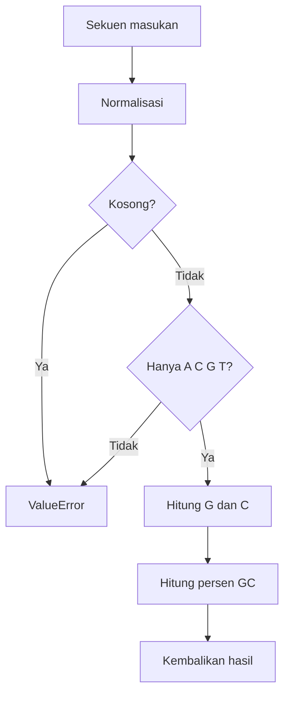

# Fungsi & Modul dalam Python

## Tujuan Pembelajaran

Setelah mempelajari materi ini, mahasiswa mampu:

1. Mendefinisikan dan memanggil fungsi Python menggunakan parameter, argumen, dan nilai kembalian.
2. Menjelaskan perbedaan `return` dan `print()`, serta memahami ruang lingkup variabel.
3. Menulis fungsi sederhana untuk mengolah data biologis dengan validasi masukan.
4. Membuat modul, mengimpor fungsi, dan menggunakan pustaka standar Python.
5. Menyusun program analisis sederhana yang dapat digunakan ulang dan diuji.

## Konsep Utama

### 1. Mengapa Menggunakan Fungsi?

Dalam analisis biologis, operasi yang sama sering dilakukan berulang kali: menghitung panjang sekuens, menentukan persentase GC, atau menghitung laju reaksi enzim. Menyalin kode untuk setiap sampel membuat program panjang dan menyulitkan perbaikan.

**Fungsi** adalah unit kode bernama yang mengerjakan tugas tertentu. Fungsi dapat menerima masukan, melakukan pengolahan, lalu mengembalikan hasil.

Contoh paling sederhana:

```python
def panjang_sekuens(sekuens):
    return len(sekuens)

panjang = panjang_sekuens("ATGCGT")
print(panjang)
```

Output:

```text
6
```

Bagian-bagian pentingnya:

- `def` memulai definisi fungsi.
- `panjang_sekuens` merupakan nama fungsi.
- `sekuens` adalah parameter yang menerima masukan.
- Tanda titik dua `:` mengawali blok fungsi.
- Indentasi menandai kode yang termasuk dalam fungsi.
- `return` mengembalikan hasil kepada pemanggil.

Gunakan indentasi empat spasi secara konsisten. Nama fungsi sebaiknya deskriptif dan mengikuti gaya `snake_case`, misalnya `hitung_gc`, bukan nama samar seperti `proses1`.

Mendefinisikan fungsi tidak langsung menjalankan isinya. Isi fungsi baru dijalankan ketika fungsi tersebut **dipanggil**.

### 2. Parameter, Argumen, dan Nilai Bawaan

**Parameter** adalah nama yang ditulis dalam definisi fungsi. **Argumen** adalah nilai yang diberikan saat fungsi dipanggil.

```python
def konsentrasi_massa(massa_mg, volume_ml):
    return massa_mg / volume_ml

hasil = konsentrasi_massa(10, 2)
```

Di sini, `massa_mg` dan `volume_ml` adalah parameter, sedangkan `10` dan `2` adalah argumen. Jika satuannya sesuai nama parameter, hasilnya adalah `5.0` mg/mL.

Argumen dapat diberikan berdasarkan posisi atau nama:

```python
konsentrasi_massa(10, 2)
konsentrasi_massa(volume_ml=2, massa_mg=10)
```

Keduanya menghasilkan nilai yang sama. Argumen bernama membantu pembaca memahami arti suatu nilai, terutama pada fungsi dengan banyak parameter.

Parameter juga dapat memiliki **nilai bawaan**:

```python
def label_sampel(nama, organisme="Escherichia coli"):
    return f"{nama}: {organisme}"

print(label_sampel("Sampel_A"))
print(label_sampel("Sampel_B", organisme="Saccharomyces cerevisiae"))
```

Parameter tanpa nilai bawaan harus ditempatkan sebelum parameter bernilai bawaan.

Hindari menggunakan objek yang dapat diubah, seperti daftar, sebagai nilai bawaan:

```python
def tambah_sampel(nama, daftar=None):
    if daftar is None:
        daftar = []
    daftar.append(nama)
    return daftar
```

Pola `None` memastikan daftar baru dibuat ketika pemanggil tidak menyediakan daftar. Sebaliknya, nilai bawaan `[]` akan dibuat sekali saat definisi fungsi dijalankan dan dapat digunakan bersama oleh beberapa pemanggilan.

### 3. Nilai Kembalian Berbeda dari Tampilan

`print()` menampilkan informasi, sedangkan `return` menyerahkan nilai kepada bagian program yang memanggil fungsi.

```python
def kuadrat(x):
    return x ** 2

hasil = kuadrat(4)
print(hasil + 1)
```

Output:

```text
17
```

Nilai kembalian dapat disimpan, dihitung lebih lanjut, atau diberikan kepada fungsi lain. Fungsi yang hanya mencetak hasil kurang fleksibel untuk analisis lanjutan.

Jika fungsi berakhir tanpa menjalankan `return` bernilai, hasilnya adalah `None`.

```python
def tampilkan_nama(nama):
    print(nama)

hasil = tampilkan_nama("Albumin")
print(hasil)
```

Output:

```text
Albumin
None
```

Fungsi juga dapat mengembalikan beberapa nilai melalui sebuah *tuple*:

```python
def hitung_basa_gc(sekuens):
    return sekuens.count("G"), sekuens.count("C")

jumlah_g, jumlah_c = hitung_basa_gc("AGGCT")
```

Contoh ini mengasumsikan sekuens sudah menggunakan huruf kapital dan telah divalidasi.

### 4. Ruang Lingkup Variabel dan Efek Samping

**Ruang lingkup** atau *scope* menentukan bagian program yang dapat mengakses suatu nama variabel.

Variabel yang dibuat di dalam fungsi biasanya bersifat lokal:

```python
def hitung_panjang(sekuens):
    panjang = len(sekuens)
    return panjang
```

Nama `panjang` di dalam fungsi tidak otomatis tersedia di luar fungsi. Pemanggil harus menerima hasilnya melalui `return`.

Fungsi dapat membaca variabel tingkat modul, tetapi ketergantungan tersembunyi seperti ini sebaiknya dibatasi. Parameter membuat sumber masukan lebih jelas.

Perhatikan pula **efek samping**, yaitu perubahan yang terjadi di luar nilai kembalian fungsi. Contohnya mencetak teks, menulis berkas, atau mengubah daftar milik pemanggil.

```python
def urutkan_salinan(nilai):
    return sorted(nilai)

data = [3, 1, 2]
terurut = urutkan_salinan(data)
```

`data` tetap `[3, 1, 2]`, sedangkan `terurut` berisi `[1, 2, 3]`. Untuk analisis ilmiah, fungsi yang tidak diam-diam mengubah data masukan biasanya lebih mudah dipahami dan diuji.

### 5. Dokumentasi, Validasi, dan Kesalahan

Fungsi yang baik memiliki tujuan jelas, menyebutkan satuan, dan menjelaskan asumsi. Dokumentasi singkat dapat ditulis sebagai **docstring**, yaitu string pertama di dalam fungsi.

```python
def konsentrasi_massa(massa_mg: float, volume_ml: float) -> float:
    """Hitung konsentrasi dalam mg/mL dari massa dan volume."""
    if massa_mg < 0:
        raise ValueError("Massa tidak boleh negatif.")
    if volume_ml <= 0:
        raise ValueError("Volume harus lebih besar dari nol.")
    return massa_mg / volume_ml
```

Penanda `float` dan `-> float` adalah **anotasi tipe**. Keduanya membantu dokumentasi dan alat pemeriksaan kode, tetapi tidak otomatis memaksa tipe data saat program berjalan.

Validasi di atas memeriksa rentang nilai, bukan seluruh kemungkinan tipe masukan. Misalnya, teks `"sepuluh"` tetap tidak cocok untuk perhitungan tersebut.

`raise ValueError(...)` menghentikan proses ketika nilai tidak memenuhi ketentuan. Ini lebih aman daripada menghasilkan angka yang tampak sah dari masukan yang tidak masuk akal.

Pada fungsi biologis, validasi juga perlu mempertimbangkan:

- Apakah sekuens boleh kosong?
- Apakah huruf kecil diterima?
- Apakah kode basa ambigu seperti `N` diperbolehkan?
- Satuan apa yang digunakan?
- Apa yang dilakukan terhadap data tidak valid?

Keputusan tersebut harus dinyatakan, bukan dibiarkan menjadi asumsi tersembunyi.

### 6. Modul, Impor, dan Paket

**Modul** adalah unit organisasi kode Python yang dapat diimpor. Dalam proyek sederhana, modul biasanya berupa berkas `.py` berisi fungsi, konstanta, atau kode lain.

Python juga menyediakan pustaka standar. Misalnya, modul `statistics` menyediakan fungsi statistik dasar:

```python
import statistics

nilai_gc = [40.0, 50.0, 60.0]
rata_rata = statistics.mean(nilai_gc)
print(rata_rata)
```

Output:

```text
50.0
```

Beberapa bentuk impor yang umum:

```python
import statistics
from statistics import mean
import statistics as stat
```

Pilih bentuk yang menjaga keterbacaan dan gunakan secara konsisten. Bentuk `statistics.mean(...)` langsung menunjukkan asal fungsi.

Hindari `from statistics import *` karena nama yang masuk ke program menjadi kurang jelas dan berpotensi bertabrakan dengan nama lain.

**Paket** mengorganisasi modul dalam struktur bernama. Untuk paket sederhana yang dibuat sendiri, direktori biasanya memiliki berkas `__init__.py`. Pustaka pihak ketiga, seperti Biopython, menyediakan kemampuan tambahan dan umumnya perlu dipasang terpisah.

Jangan menamai berkas sendiri `statistics.py` jika ingin mengimpor modul standar tersebut. Nama berkas lokal dapat menutupi modul yang sebenarnya ingin digunakan.

### 7. Memisahkan Kode yang Diimpor dan Kode yang Dijalankan

Ketika sebuah modul pertama kali diimpor dalam suatu proses Python, kode tingkat atasnya dijalankan. Karena itu, demonstrasi atau analisis utama sebaiknya ditempatkan dalam penjaga berikut:

```python
def main():
    print("Analisis dimulai.")

if __name__ == "__main__":
    main()
```

Ketika berkas dijalankan langsung, `__name__` bernilai `"__main__"` sehingga `main()` dipanggil. Ketika berkas diimpor, blok tersebut tidak dijalankan.

Pola ini memungkinkan fungsi digunakan ulang tanpa otomatis menjalankan seluruh analisis.

## Tabel dan Diagram

| Konsep | Peran | Contoh |
|---|---|---|
| Fungsi | Membungkus satu tugas | `hitung_gc(sekuens)` |
| Parameter | Nama masukan dalam definisi | `sekuens` |
| Argumen | Nilai saat pemanggilan | `"ATGC"` |
| Nilai kembalian | Hasil untuk pemanggil | `50.0` |
| Modul | Mengorganisasi kode yang dapat diimpor | `analisis_dna.py` |
| Paket | Mengorganisasi modul | `Bio` pada Biopython |
| Validasi | Memeriksa kesesuaian masukan | Menolak sekuens kosong |
| Docstring | Menjelaskan kontrak fungsi | Masukan, keluaran, asumsi |

Diagram berikut menunjukkan alur perhitungan persentase GC dengan validasi ketat.



## Contoh Konkret

Kita akan membuat modul untuk menghitung persentase GC. Untuk sekuens yang hanya mengandung basa A, C, G, dan T:

$$
\mathrm{GC}\% = \frac{n_G + n_C}{n_A + n_C + n_G + n_T} \times 100
$$

### Membuat modul analisis

Simpan kode berikut sebagai `analisis_dna.py`:

```python
def normalisasi_dna(sekuens: str) -> str:
    """Hapus whitespace dan ubah huruf menjadi kapital."""
    return "".join(sekuens.split()).upper()


def hitung_gc(sekuens: str) -> float:
    """Hitung persen GC; tolak sekuens kosong dan basa selain ACGT."""
    dna = normalisasi_dna(sekuens)

    if not dna:
        raise ValueError("Sekuen tidak boleh kosong.")

    if set(dna) - set("ACGT"):
        raise ValueError("Sekuen hanya boleh mengandung A, C, G, dan T.")

    jumlah_gc = dna.count("G") + dna.count("C")
    return 100 * jumlah_gc / len(dna)
```

`split()` tanpa argumen memisahkan teks berdasarkan *whitespace*, termasuk spasi, tab, dan pergantian baris. `join()` menggabungkan kembali potongannya, sedangkan `upper()` mengubah huruf menjadi kapital.

Operasi `set(dna) - set("ACGT")` mencari karakter yang tidak termasuk basa yang diperbolehkan. Jika hasilnya tidak kosong, validasi gagal.

Kebijakan ini sengaja ketat: `N` ditolak. Pada data nyata, kode ambigu dapat ditangani dengan kebijakan lain, tetapi cara menghitung penyebutnya harus dijelaskan.

### Memakai modul dari program lain

Simpan kode berikut sebagai `jalankan_analisis.py` dalam direktori yang sama:

```python
from analisis_dna import hitung_gc


def main():
    sampel = {
        "Sampel_A": "ATGCGC",
        "Sampel_B": "aatt gg",
    }

    for nama, sekuens in sampel.items():
        gc = hitung_gc(sekuens)
        print(f"{nama}: {gc:.2f}%")


if __name__ == "__main__":
    main()
```

Output:

```text
Sampel_A: 66.67%
Sampel_B: 33.33%
```

Format `:.2f` menampilkan dua angka di belakang tanda desimal. Pembulatan hanya diterapkan pada tampilan, bukan pada nilai yang dikembalikan fungsi.

### Menguji hasil dan kesalahan

Pengujian sederhana membantu memastikan perilaku fungsi:

```python
from analisis_dna import hitung_gc

assert hitung_gc("GGCC") == 100.0
assert hitung_gc("AATT") == 0.0
assert hitung_gc("at gc") == 50.0

try:
    hitung_gc("ATGN")
except ValueError as kesalahan:
    print(kesalahan)
```

`assert` berguna untuk pemeriksaan saat pengembangan. Jangan menggunakannya sebagai pengganti validasi masukan produksi karena pemeriksaan tersebut dapat dinonaktifkan.

Untuk perhitungan pecahan yang lebih rumit, perbandingan hasil sering memerlukan toleransi, bukan kesamaan tepat.

## Hubungan dengan Bioinformatika

Fungsi dan modul membantu menerjemahkan pertanyaan biologis menjadi prosedur komputasi yang jelas.

**Pertama, fungsi memisahkan model dari pelaksanaannya.** Sebagai contoh, persamaan Michaelis–Menten dapat ditulis:

$$
v = \frac{V_{\max}[S]}{K_m + [S]}
$$

Implementasi sederhananya:

```python
def laju_michaelis_menten(substrat, vmax, km):
    """Hitung laju dengan model Michaelis–Menten sederhana."""
    if substrat < 0 or vmax < 0 or km <= 0:
        raise ValueError("Perlu substrat ≥ 0, Vmax ≥ 0, dan Km > 0.")
    return vmax * substrat / (km + substrat)
```

`substrat` dan `km` harus memakai satuan konsentrasi yang sama; hasil memiliki satuan yang sama dengan `vmax`. Kode yang berjalan benar belum menjamin model cocok dengan eksperimen. Model ini menggunakan asumsi kinetika tertentu dan bukan model universal semua enzim.

**Kedua, modularisasi mendukung analisis sekuens.** Pembersihan data, validasi, perhitungan statistik, dan pelaporan dapat dipisahkan menjadi fungsi berbeda. Ketika aturan validasi berubah, bagian lain tidak selalu perlu ditulis ulang.

**Ketiga, fungsi mendukung reproduksibilitas.** Prosedur yang sama dapat diterapkan pada banyak sampel. Namun, reproduksibilitas juga memerlukan pencatatan data masukan, versi perangkat lunak, parameter, dan lingkungan komputasi.

**Keempat, hasil komputasi memerlukan interpretasi biologis.** Persentase GC saja tidak cukup untuk menentukan spesies, hubungan evolusi, atau fungsi gen. Dalam analisis protein, urutan asam amino juga tidak boleh langsung diperlakukan sebagai sekuens DNA. Representasi data dan pertanyaan biologis harus selalu sesuai.

## Ringkasan

- Fungsi membungkus tugas tertentu agar kode dapat digunakan ulang dan diuji.
- Parameter mendefinisikan masukan; argumen memberikan nilai saat pemanggilan.
- `return` menghasilkan nilai untuk pengolahan lanjutan, sedangkan `print()` menampilkan informasi.
- Variabel lokal dan pembatasan efek samping membantu menjaga perilaku program tetap jelas.
- Docstring, satuan, dan validasi merupakan bagian penting dari kode ilmiah.
- Modul mengorganisasi kode; impor memungkinkan penggunaan fungsi dari modul lain.
- Penjaga `if __name__ == "__main__":` memisahkan penggunaan sebagai modul dari pelaksanaan langsung.
- Ketepatan program harus disertai ketepatan asumsi dan interpretasi biologis.

## Pertanyaan Latihan

1. Jelaskan perbedaan parameter, argumen, dan nilai kembalian menggunakan fungsi `hitung_gc`.
2. Buat fungsi `fraksi_gc(sekuens)` yang menggunakan `hitung_gc` dan mengembalikan nilai antara 0 dan 1. Mengapa tidak perlu menyalin seluruh kode validasinya?
3. Apa yang terjadi jika sebuah fungsi hanya menjalankan `print(hasil)` tanpa mengembalikan nilai? Jelaskan akibatnya jika hasil pemanggilan dipakai dalam perhitungan.
4. Susun dua berkas: modul berisi fungsi `laju_michaelis_menten` dan program utama yang memanggilnya untuk tiga konsentrasi substrat. Cantumkan satuan parameter.
5. Rancang pengujian `hitung_gc` untuk sekuens kosong, huruf kecil, whitespace, sekuens seluruhnya G/C, dan sekuens yang mengandung `N`. Jelaskan hasil yang diharapkan.

## Bacaan Lanjutan

- **Dokumentasi resmi Python — The Python Tutorial**: bagian fungsi, modul, serta kesalahan dan pengecualian.
- **Dokumentasi pustaka standar Python**: modul `statistics` dan `math`.
- **PEP 8**: pedoman gaya penulisan kode Python.
- **PEP 257**: konvensi penulisan docstring.
- **Biopython Tutorial & Cookbook**: pengolahan sekuens dan data biologis menggunakan Python.
- **NCBI**: sumber data sekuens dan dokumentasi format biologis untuk latihan lanjutan.

---

## Contoh Kode

Jalankan: `python Python/01-Basics/08-Function/main.py`

<details><summary>Contoh output</summary>

```text
=== Fungsi & Modul dalam Python: Analisis DNA ===

1. Parameter, argumen posisi, argumen bernama, dan nilai bawaan
  Parameter adalah nama pada def; argumen adalah nilai saat pemanggilan.
  Nilai bawaan: Sampel_A (Escherichia coli)
  Argumen bernama: Sampel_B (Saccharomyces cerevisiae)
  Argumen posisi: panjang_sekuens('ATGCGT') = 6

2. return berbeda dari print()
  return memberi angka: 50.00; dapat dibagi dua = 25.00
  Tampilan dari print(): GC = 50.00%
  Nilai kembalian fungsi tampilan: None

3. Ruang lingkup variabel
  Variabel sekuens di main() tetap: ' atgc '
  Hasil variabel lokal dna dikembalikan sebagai: 'ATGC'

4. Fungsi yang digunakan ulang dan modul pustaka standar
  Sampel_A: DNA=ATGCGT, panjang=6 basa, GC=50.00%, komplemen balik=ACGCAT
  Sampel_B: DNA=GGCCAA, panjang=6 basa, GC=66.67%, komplemen balik=TTGGCC
  Sampel_C: DNA=AATTAT, panjang=6 basa, GC=0.00%, komplemen balik=ATAATT
  Rata-rata GC antarsampel (statistics.mean): 38.89%
  Counter dari collections menghitung basa di dalam hitung_gc().
  main.py adalah modul; penjaga __main__ mencegah demo berjalan saat diimpor.

5. Nilai bawaan yang aman untuk daftar
  Dua pemanggilan membuat daftar terpisah: ['A'] dan ['B']
  Daftar eksplisit dapat ditambah: ['A', 'C']

6. Validasi masukan dan pengujian
  Masukan 'ATGN' ditolak: Basa tidak valid: N.
  Masukan '' ditolak: Sekuens DNA tidak boleh kosong.
  Masukan 123 ditolak: Sekuens DNA harus berupa string.
  Hasil pengujian otomatis: 11 pemeriksaan lulus.
```

</details>
