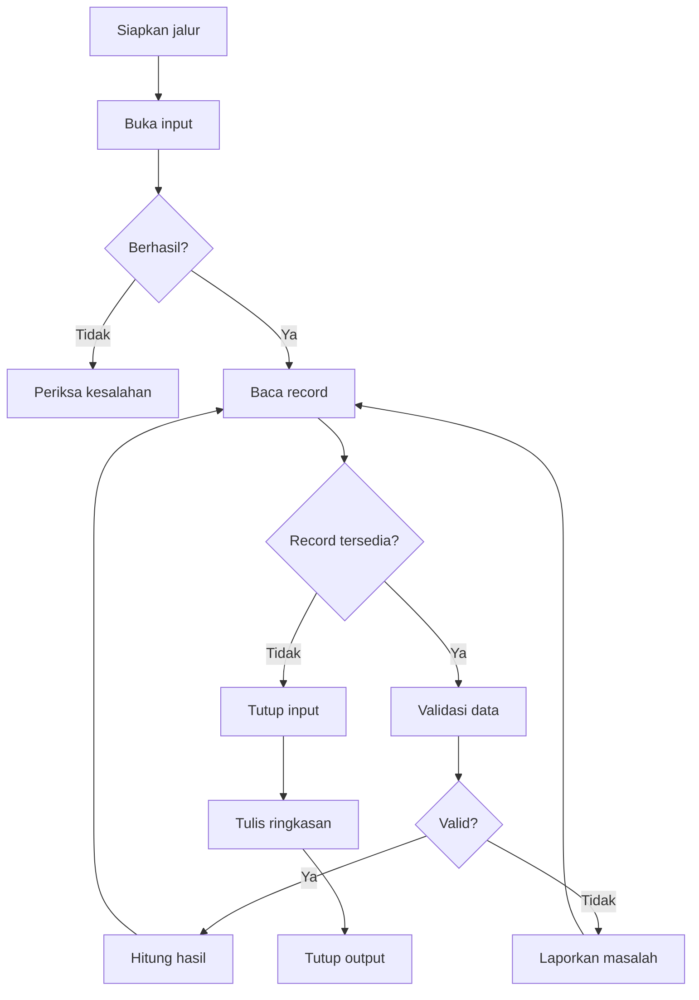

# File I/O dalam Python

## Tujuan Pembelajaran

Setelah mempelajari materi ini, mahasiswa diharapkan mampu:

1. Menjelaskan hubungan antara berkas, jalur berkas, objek berkas, dan operasi *input/output*.
2. Membaca serta menulis berkas teks menggunakan `open()` dan pengelola konteks `with`.
3. Memilih mode akses, encoding, dan metode pembacaan yang sesuai dengan kebutuhan.
4. Mengolah data sederhana dalam format CSV, TSV, dan FASTA dengan memperhatikan struktur datanya.
5. Menangani kesalahan berkas serta menerapkan kebiasaan kerja yang aman dan dapat direproduksi.

## Konsep Utama

### 1. Pengertian File I/O

**File I/O** adalah proses memasukkan data dari berkas ke program (*input*) dan mengeluarkan data dari program ke berkas (*output*). Berbeda dari variabel yang biasanya hilang ketika program selesai, berkas menyediakan penyimpanan yang dapat digunakan kembali.

Dalam bioinformatika, program sering perlu membaca sekuens, mengolah tabel anotasi, lalu menyimpan hasil analisis. Sebagai contoh, fungsi penghitung panjang protein dapat menerima sekuens dari berkas, bukan dari teks yang ditulis langsung di dalam kode.

Secara konseptual, ada tiga unsur penting:

- **Berkas**: data yang tersimpan pada media penyimpanan.
- **Jalur berkas atau path**: lokasi yang digunakan untuk menemukan berkas.
- **Objek berkas**: objek Python yang menyediakan metode untuk membaca atau menulis data.

Objek berkas memiliki posisi pembacaan atau penulisan. Setelah sebagian isi dibaca, pembacaan berikutnya biasanya berlanjut dari posisi terakhir, bukan kembali ke awal.

### 2. Jalur Berkas dan Direktori Kerja

Jalur **relatif** ditafsirkan terhadap direktori kerja program. Sebaliknya, jalur **absolut** menyatakan lokasi lengkap dalam sistem berkas.

```python
from pathlib import Path

print("Direktori kerja:", Path.cwd())

jalur = Path("data") / "protein.fasta"
print(jalur)
```

Kode tersebut membentuk jalur menuju `protein.fasta` di dalam folder `data`. Kode itu **belum membuat folder atau berkas**.

Direktori kerja tidak selalu sama dengan folder tempat skrip disimpan, terutama ketika bekerja melalui notebook atau lingkungan pengembangan. Karena itu, kesalahan “berkas tidak ditemukan” sering disebabkan oleh jalur relatif yang ditafsirkan dari direktori yang berbeda.

Modul `pathlib` membantu menyusun jalur tanpa merangkai pemisah direktori secara manual:

```python
folder_hasil = Path("hasil")
folder_hasil.mkdir(parents=True, exist_ok=True)

jalur_hasil = folder_hasil / "ringkasan.txt"
```

`parents=True` mengizinkan pembuatan direktori induk yang belum ada. `exist_ok=True` mencegah kesalahan apabila direktori tujuan sudah tersedia.

### 3. Membuka dan Menutup Berkas dengan Aman

Fungsi `open()` membuka berkas dan mengembalikan objek berkas. Bentuk yang disarankan adalah menggunakan `with`:

```python
with open("catatan.txt", "w", encoding="utf-8") as berkas:
    berkas.write("Belajar membaca data biologis.\n")
```

Ketika blok `with` berakhir, berkas ditutup secara otomatis, termasuk ketika terjadi pengecualian di dalam blok. Penutupan juga membantu memastikan data yang masih berada dalam penyangga (*buffer*) diteruskan ke sistem operasi. Namun, ini bukan jaminan mutlak terhadap kehilangan data akibat kegagalan perangkat atau listrik.

Mode akses menentukan operasi yang diizinkan. Perhatikan bahwa mode `"w"` akan mengosongkan berkas yang sudah ada ketika berkas dibuka. Jika tujuannya membuat berkas baru tanpa menimpa berkas lama, gunakan `"x"`.

Mengandalkan penutupan otomatis saat program berhenti bukan kebiasaan yang baik. Gunakan `with` agar masa penggunaan sumber daya jelas.

### 4. Berkas Teks, Biner, dan Encoding

Pada mode teks, Python bekerja dengan objek `str`. Data dalam berkas diterjemahkan dari atau menjadi byte menggunakan **encoding**.

```python
with open("catatan.txt", "r", encoding="utf-8") as berkas:
    teks = berkas.read()
```

Menuliskan `encoding="utf-8"` secara eksplisit mengurangi ketergantungan pada pengaturan komputer. Meskipun sekuens biologis sering hanya menggunakan karakter dasar, nama organisme dan catatan eksperimen dapat mengandung karakter lain.

Encoding yang keliru dapat menghasilkan `UnicodeDecodeError` atau teks yang terbaca salah. Jangan langsung menggunakan `errors="ignore"` karena karakter dapat hilang tanpa diketahui.

Pada mode biner, Python bekerja dengan objek `bytes`:

```python
with open("arsip.bin", "wb") as berkas:
    berkas.write(b"\x01\x02\x03")

with open("arsip.bin", "rb") as berkas:
    data = berkas.read()
```

Parameter `encoding` tidak digunakan dalam mode biner. Pemilihan mode harus mengikuti representasi datanya; mengganti ekstensi tidak mengubah teks menjadi format biner tertentu.

### 5. Strategi Membaca dan Menulis

Ada beberapa cara umum membaca teks:

```python
with open("catatan.txt", encoding="utf-8") as berkas:
    seluruh_teks = berkas.read()
```

`read()` tanpa argumen membaca seluruh isi yang tersisa. Cara ini sederhana untuk berkas kecil, tetapi dapat menghabiskan banyak memori pada berkas besar.

Alternatifnya, baca satu baris pada satu waktu:

```python
with open("catatan.txt", encoding="utf-8") as berkas:
    for nomor, baris in enumerate(berkas, start=1):
        print(nomor, baris.rstrip("\r\n"))
```

Iterasi baris cocok untuk pemrosesan bertahap. Metode `readline()` membaca satu baris, sedangkan `readlines()` menghasilkan daftar semua baris yang tersisa.

Karakter akhir baris biasanya ikut terbaca. `rstrip("\r\n")` menghapus karakter akhir baris tanpa menghilangkan spasi lain. Sebaliknya, `strip()` menghapus whitespace di kedua ujung, sehingga penggunaannya harus sesuai dengan struktur data.

Untuk menulis teks, gunakan `write()`:

```python
with open("hasil.txt", "w", encoding="utf-8") as berkas:
    berkas.write("Analisis selesai.\n")
    berkas.write("Hasil perlu diperiksa.\n")
```

`write()` tidak menambahkan baris baru secara otomatis. Metode `writelines()` juga tidak menyisipkan pemisah; setiap elemen perlu mengandung `\n` jika ingin ditulis pada baris berbeda.

### 6. Data Terstruktur dan Penanganan Kesalahan

CSV dan TSV menyimpan data berbentuk baris dan kolom. CSV umumnya menggunakan koma, sedangkan TSV menggunakan tab. Semua nilai hasil pembacaan CSV pada umumnya berupa string, sehingga data numerik perlu dikonversi.

Gunakan modul `csv`, bukan sekadar `split(",")`. Sebuah kolom dapat memuat koma di dalam tanda kutip, dan modul `csv` menangani aturan tersebut.

Kesalahan juga dapat terjadi pada berbagai tahap:

- `FileNotFoundError`: berkas atau jalurnya tidak ditemukan.
- `PermissionError`: program tidak memiliki izin yang diperlukan.
- `UnicodeDecodeError`: isi tidak cocok dengan encoding yang dipakai.
- `ValueError`: nilai tidak dapat dikonversi atau melanggar validasi.

Tangani kesalahan yang dapat dijelaskan atau ditindaklanjuti:

```python
try:
    with open("data.txt", encoding="utf-8") as berkas:
        teks = berkas.read()
except FileNotFoundError:
    print("Berkas tidak ditemukan. Periksa jalur dan direktori kerja.")
```

Hindari menangkap semua kesalahan lalu mengabaikannya. Program yang terus berjalan dengan data tidak lengkap dapat menghasilkan kesimpulan biologis yang salah.

## Tabel dan Diagram

### Ringkasan Mode Akses

| Mode | Fungsi utama | Jika berkas belum ada | Jika berkas sudah ada |
|---|---|---|---|
| `"r"` | Membaca teks | Menghasilkan kesalahan | Membaca isi |
| `"w"` | Menulis teks | Membuat berkas | Mengosongkan isi |
| `"a"` | Menambahkan teks | Membuat berkas | Menulis di akhir |
| `"x"` | Membuat berkas baru | Membuat berkas | Menghasilkan kesalahan |
| `"rb"` | Membaca biner | Menghasilkan kesalahan | Membaca byte |
| `"wb"` | Menulis biner | Membuat berkas | Mengosongkan isi |

Mode `"r+"` memungkinkan membaca dan menulis tanpa langsung mengosongkan isi. Namun, penggunaannya memerlukan perhatian terhadap posisi berkas dan tidak otomatis menyisipkan teks.

### Alur Pengolahan Berkas



Satu **record** berarti satu unit data logis, misalnya satu baris tabel atau satu entri FASTA. Record FASTA dapat terdiri atas beberapa baris fisik.

## Contoh Konkret

### 1. Membaca CSV dan Menghitung Panjang Rata-Rata

Contoh berikut membuat data latihan buatan, bukan data eksperimen nyata. Jalankan di folder latihan karena mode `"w"` akan menimpa berkas bernama sama.

```python
import csv

with open("protein.csv", "w", encoding="utf-8", newline="") as berkas:
    penulis = csv.writer(berkas)
    penulis.writerow(["id", "panjang_aa"])
    penulis.writerows([
        ["protein_A", 120],
        ["protein_B", 180],
        ["protein_C", 150],
    ])
```

Parameter `newline=""` memungkinkan modul `csv` mengelola akhir baris dengan benar.

Berikut fungsi pembaca dan pemeriksa datanya:

```python
def rata_rata_panjang(jalur):
    total = 0
    jumlah = 0

    with open(jalur, encoding="utf-8", newline="") as berkas:
        pembaca = csv.DictReader(berkas)

        if pembaca.fieldnames is None:
            raise ValueError("Berkas tidak memiliki header.")

        wajib = {"id", "panjang_aa"}
        if not wajib.issubset(pembaca.fieldnames):
            raise ValueError("Kolom wajib tidak lengkap.")

        for record_ke, baris in enumerate(pembaca, start=1):
            try:
                panjang = int(baris["panjang_aa"])
            except (ValueError, TypeError) as galat:
                raise ValueError(
                    f"Panjang tidak valid pada record {record_ke}."
                ) from galat

            if panjang <= 0:
                raise ValueError("Panjang protein harus positif.")

            total += panjang
            jumlah += 1

    if jumlah == 0:
        raise ValueError("Tidak ada data protein.")

    return total / jumlah


rerata = rata_rata_panjang("protein.csv")
print(f"Rata-rata panjang: {rerata:.1f} aa")
```

Output:

```text
Rata-rata panjang: 150.0 aa
```

Untuk TSV, gunakan `csv.DictReader(berkas, delimiter="\t")`. Pemisah harus mengikuti isi berkas, bukan hanya namanya.

### 2. Membaca FASTA Sederhana

FASTA menggunakan baris header yang diawali `>`, diikuti satu atau lebih baris sekuens. Buat berkas latihan:

```python
with open("latihan.fasta", "w", encoding="utf-8") as berkas:
    berkas.write(">protein_A\nMKTAYI\nAKQR\n")
    berkas.write(">protein_B\nGAVLIP\n")
```

Pembaca sederhana berikut menghitung panjang tanpa menyimpan seluruh sekuens:

```python
def baca_panjang_fasta(jalur):
    header = None
    panjang = 0

    with open(jalur, encoding="utf-8") as berkas:
        for nomor, baris in enumerate(berkas, start=1):
            teks = baris.strip()
            if not teks:
                continue

            if teks.startswith(">"):
                if header is not None:
                    yield header, panjang

                header = teks[1:].strip()
                if not header:
                    raise ValueError(f"Header kosong pada baris {nomor}.")
                panjang = 0
            else:
                if header is None:
                    raise ValueError("Sekuens ditemukan sebelum header.")
                panjang += len(teks)

    if header is not None:
        yield header, panjang


for header, panjang in baca_panjang_fasta("latihan.fasta"):
    print(header, panjang)
```

Output:

```text
protein_A 10
protein_B 6
```

Fungsi ini memakai `yield`, yaitu menghasilkan pasangan nilai secara bertahap saat diiterasi. Pengeluaran record terakhir setelah perulangan penting karena tidak ada header berikutnya yang menandai akhir record tersebut.

Ini adalah pembaca latihan dengan asumsi sekuens tidak mengandung spasi internal. Kode belum memvalidasi alfabet, duplikasi identifier, atau record tanpa sekuens. Untuk pekerjaan nyata, gunakan parser teruji dan validasi sesuai jenis data.

## Hubungan dengan Bioinformatika

File I/O menghubungkan konsep biologi dengan analisis komputasional:

- **Struktur dan fungsi protein:** membaca sekuens FASTA serta menyimpan ringkasan panjang protein.
- **Enzim dan kinetika:** membaca tabel konsentrasi substrat dan laju reaksi sebelum analisis. Angka harus disertai informasi satuan.
- **Metabolisme:** menggabungkan tabel enzim dengan anotasi jalur metabolik menggunakan identifier yang sesuai.
- **Evolusi dan taksonomi:** membaca sekuens dan metadata organisme untuk analisis perbandingan.

Panjang protein tidak langsung menunjukkan fungsi, aktivitas enzim, atau hubungan evolusioner. File I/O memastikan data tersedia bagi analisis, tetapi tidak menggantikan penalaran biologis.

Selain itu, **berhasil dibaca tidak berarti benar secara ilmiah**. Nilai mungkin tertukar kolom, satuan tidak konsisten, atau identifier berasal dari sistem berbeda.

Untuk mendukung reproduktibilitas:

1. Pertahankan data mentah tanpa perubahan.
2. Pisahkan folder input dan output.
3. Catat sumber serta tanggal pengambilan data.
4. Dokumentasikan delimiter, encoding, satuan, dan arti kolom.
5. Hindari penimpaan hasil penting tanpa pemeriksaan.

Berkas terkompresi juga memerlukan pembaca yang sesuai. Misalnya, FASTA berakhiran `.gz` dapat dibuka sebagai teks menggunakan `gzip.open(jalur, "rt", encoding="utf-8")`.

## Ringkasan

- File I/O memungkinkan program membaca data tersimpan dan menyimpan hasil pengolahan.
- Gunakan `with` agar objek berkas ditutup secara teratur.
- Pilih mode dengan hati-hati: `"w"` mengosongkan isi, `"a"` menambahkan, dan `"x"` mencegah penimpaan.
- Tentukan encoding teks secara eksplisit dan bedakan `str` dari `bytes`.
- Iterasi baris membantu mengolah berkas besar tanpa memuat semuanya ke memori.
- Gunakan parser sesuai format, lakukan validasi, dan dokumentasikan asal data.

## Pertanyaan Latihan

1. Jelaskan perbedaan mode `"r"`, `"w"`, `"a"`, dan `"x"`. Mode mana yang tepat untuk membuat hasil baru tanpa menimpa berkas lama?
2. Mengapa jalur relatif yang sama dapat berhasil di terminal tetapi gagal di notebook? Tuliskan kode untuk memeriksa direktori kerja.
3. Buat fungsi yang membaca berkas teks dan menghitung jumlah baris tidak kosong tanpa menggunakan `read()` atau `readlines()`.
4. Ubah contoh CSV agar membaca TSV. Tambahkan penanganan untuk kasus kolom `panjang_aa` berisi teks `"tidak_diketahui"`, lalu jelaskan kebijakan penanganannya.
5. Tambahkan validasi pada pembaca FASTA agar menolak record tanpa sekuens. Mengapa satu baris fisik tidak selalu sama dengan satu record biologis?

## Bacaan Lanjutan

- **Dokumentasi resmi Python — Input and Output:** pembacaan, penulisan, dan penggunaan objek berkas.
- **Dokumentasi resmi Python — `pathlib`, `csv`, dan `gzip`:** pengelolaan jalur, data tabular, dan kompresi.
- **Dokumentasi resmi Python — Errors and Exceptions:** penanganan pengecualian secara terarah.
- **Biopython Tutorial and Cookbook — Sequence Input/Output:** penggunaan `SeqIO` untuk format sekuens.
- **NCBI dan UniProt:** contoh penggunaan FASTA dan informasi yang menyertai data sekuens.

---

## Contoh Kode

Jalankan: `python Python/01-Basics/09-File-IO/main.py`

<details><summary>Contoh output</summary>

```text
=== 1. Konsep dan operasi teks ===
Berkas menyimpan data; path menunjukkan lokasinya.
Objek berkas menyediakan read(), write(), seek(), dan lainnya.
Demo ini memakai StringIO, bukan berkas di penyimpanan.
Tidak ada open() atau akses sistem berkas yang dijalankan.

write() pertama menulis 18 karakter.
Posisi setelah menulis: 44
read() pada akhir data: ''
readline(): Protein: MKTAYIAK
read() sisanya: Keterangan: contoh pendek
Iterasi per baris:
  1. Protein: MKTAYIAK
  2. Keterangan: contoh pendek
Setelah with, objek tertutup: True
Penanganan kesalahan: objek yang sudah ditutup tidak bisa dibaca.

=== 2. Encoding UTF-8 ===
Teks awal: Anotasi: protein β
Representasi UTF-8: b'Anotasi: protein \xce\xb2\n'
Hasil pembacaan: Anotasi: protein β

=== 3. CSV dan TSV ===

Isi CSV (repr agar tab terlihat):
'id,sekuens,catatan\ndna_1,ATGCGC,"pendek, kaya GC"\ndna_2,ATATGG,contoh kedua\n'
  dna_1: panjang=6, GC=66.7%, catatan=pendek, kaya GC
  dna_2: panjang=6, GC=33.3%, catatan=contoh kedua

Isi TSV (repr agar tab terlihat):
'id\tsekuens\tcatatan\ndna_1\tATGCGC\tpendek, kaya GC\ndna_2\tATATGG\tcontoh kedua\n'
  dna_1: panjang=6, GC=66.7%, catatan=pendek, kaya GC
  dna_2: panjang=6, GC=33.3%, catatan=contoh kedua
Modul csv mempertahankan koma di dalam kolom yang diberi kutip.

=== 4. FASTA DNA ===
dna_1 contoh multibaris: ATGCGC, panjang=6
dna_2: ATATGG, panjang=6
Data tidak valid ditangani: Baris 1: sekuens mendahului header.

=== 5. Panduan saat memakai berkas sungguhan ===
Pola: with open(path, mode, encoding='utf-8') as berkas:
Mode r: baca; w: tulis dan kosongkan isi lama; a: tambah di akhir.
Mode x: buat baru dan gagal jika berkas sudah ada.
Path relatif mengacu pada direktori kerja, bukan selalu lokasi skrip.
Gunakan newline='' saat membuka berkas CSV untuk modul csv.
Pilih iterasi baris untuk data besar; read() membaca seluruh sisa isi.
Tangani FileNotFoundError, PermissionError, dan UnicodeDecodeError.
Validasi struktur data dan hindari menimpa data sumber.
Seluruh demo di atas hanya memakai memori; tidak ada berkas dibuat.
```

</details>
