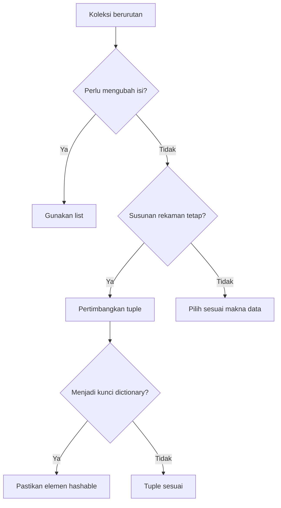

# List & Tuple dalam Python

## Tujuan Pembelajaran

Setelah mempelajari materi ini, mahasiswa diharapkan mampu:

- Membuat, mengakses, dan mengolah **list** serta **tuple** menggunakan indeks, slicing, dan perulangan.
- Menjelaskan perbedaan mutabilitas, penyalinan, dan penggunaan list serta tuple.
- Memilih struktur data yang sesuai untuk koleksi hasil pengamatan dan rekaman biologis sederhana.
- Menggunakan list comprehension, packing, dan unpacking dalam program Python.
- Mengintegrasikan list dan tuple dengan fungsi serta pembacaan berkas untuk analisis bioinformatika dasar.

## Konsep Utama

### 1. Koleksi berurutan dalam Python

Dalam bioinformatika, satu nilai sering tidak cukup untuk menggambarkan suatu pengamatan. Kita mungkin memiliki beberapa nama spesies, hasil pengukuran aktivitas enzim, atau panjang sekuens dari banyak sampel. Python menyediakan **list** dan **tuple** untuk mengelompokkan sejumlah objek.

Keduanya merupakan **sequence**, yaitu koleksi yang mempertahankan urutan elemen. Keduanya juga mengizinkan nilai berulang dan dapat menyimpan objek dengan tipe berbeda.

```python
# List: menggunakan kurung siku
panjang_sekuens = [120, 98, 145, 120]

# Tuple: biasanya ditulis menggunakan kurung biasa
sampel = ("S01", "Escherichia coli", 120)
```

Urutan dalam `panjang_sekuens` dapat mencerminkan urutan sampel. Sementara itu, setiap posisi pada `sampel` mempunyai makna tertentu: identitas sampel, nama spesies, dan panjang sekuens.

Secara teknis, list dan tuple menyimpan referensi ke objek. Karena itu, keduanya dapat memuat objek lain, termasuk list atau tuple bersarang.

```python
pengukuran = [
    ["S01", 2.4],
    ["S02", 3.1],
]
```

Walaupun pencampuran tipe diperbolehkan, rancangan yang konsisten lebih mudah diproses. Misalnya, gunakan satu list angka untuk sekumpulan pengukuran yang memiliki makna dan satuan sama.

### 2. Membuat list dan tuple

List dapat dibuat dengan literal `[]` atau fungsi `list()`. Tuple dapat dibuat menggunakan literal atau fungsi `tuple()`.

```python
gen = ["rpoB", "gyrA", "recA"]
list_kosong = []

kodon = ("ATG", "GAA", "TAA")
tuple_kosong = ()

basa = list("ACGT")
angka_tetap = tuple([1, 2, 3])
```

`list("ACGT")` menghasilkan `["A", "C", "G", "T"]`, bukan satu elemen berisi seluruh string.

Hal penting pada tuple adalah **koma**, terutama ketika hanya ada satu elemen:

```python
satu_gen = ("rpoB",)       # Tuple satu elemen
nama_gen = ("rpoB")        # String, bukan tuple
pasangan = "S01", 120      # Juga merupakan tuple
```

Kurung biasa membantu keterbacaan, tetapi koma yang membentuk tuple. Untuk pemula, menuliskan tuple dengan kurung biasa merupakan kebiasaan yang baik.

### 3. Indeks, slicing, dan penelusuran elemen

Python menggunakan indeks berbasis nol. Elemen pertama berada pada indeks `0`, sedangkan indeks negatif menghitung dari akhir.

```python
gen = ["rpoB", "gyrA", "recA", "lacZ"]

print(gen[0])      # rpoB
print(gen[-1])     # lacZ
print(gen[1:3])    # ['gyrA', 'recA']
```

Bentuk umum slicing adalah `koleksi[start:stop:step]`. Posisi `start` disertakan, sedangkan `stop` tidak disertakan.

```python
print(gen[:2])     # Dua elemen pertama
print(gen[::2])    # Elemen pada indeks 0, 2, ...
print(gen[::-1])   # Urutan dibalik
```

Aturan indeks dan slicing juga berlaku pada tuple. Slicing menghasilkan list atau tuple sesuai tipe koleksi asal.

Indeks tunggal di luar rentang menimbulkan `IndexError`, tetapi batas slicing yang melewati panjang koleksi biasanya disesuaikan secara otomatis.

Untuk menelusuri elemen, gunakan `for`. Jika posisi elemen juga diperlukan, gunakan `enumerate()`:

```python
for indeks, nama in enumerate(gen):
    print(indeks, nama)
```

Pemeriksaan keanggotaan memakai `in`, sedangkan banyaknya elemen diperoleh melalui `len()`:

```python
print("recA" in gen)   # True
print(len(gen))       # 4
```

### 4. Mutabilitas: perbedaan terpenting

**List bersifat mutable**: elemen dan panjangnya dapat diubah setelah dibuat.

```python
aktivitas = [2.1, 2.5, 2.8]

aktivitas[0] = 2.2
aktivitas.append(3.0)
```

**Tuple bersifat immutable**: referensi elemen pada setiap posisinya tidak dapat diganti, ditambahkan, atau dihapus secara langsung.

```python
koordinat = (10, 25)

# Jika dijalankan, baris berikut menimbulkan TypeError:
# koordinat[0] = 12
```

Namun, immutable tidak berarti seluruh objek di dalam tuple pasti tidak dapat berubah. Tuple dapat berisi list yang tetap mutable.

```python
rekaman = ("S01", [2.1, 2.5])
rekaman[1].append(2.8)

print(rekaman)
# ('S01', [2.1, 2.5, 2.8])
```

Tuple tersebut tetap menunjuk list yang sama pada posisi kedua; isi list itulah yang berubah.

Variabel yang merujuk tuple juga masih dapat diberi nilai baru. Jadi, tuple bukan mekanisme untuk menjadikan nama variabel sebagai konstanta.

### 5. Operasi dan metode penting

List menyediakan beberapa metode untuk mengubah isinya:

| Operasi | Fungsi | Hal yang perlu diperhatikan |
|---|---|---|
| `append(x)` | Menambahkan satu objek di akhir | List yang ditambahkan tetap menjadi satu elemen |
| `extend(iterable)` | Menambahkan setiap elemen dari iterable | Berguna untuk menggabungkan pengukuran |
| `insert(i, x)` | Menyisipkan objek pada posisi tertentu | Elemen sesudahnya bergeser |
| `remove(x)` | Menghapus kemunculan pertama nilai `x` | Menimbulkan `ValueError` jika tidak ditemukan |
| `pop(i)` | Menghapus dan mengembalikan elemen | Tanpa indeks, mengambil elemen terakhir |
| `sort()` | Mengurutkan list secara langsung | Mengembalikan `None` |
| `reverse()` | Membalik list secara langsung | Bukan pengurutan menurun secara otomatis |

Perhatikan perbedaan `append()` dan `extend()`:

```python
a = [100, 120]
a.append([90, 110])
print(a)  # [100, 120, [90, 110]]

b = [100, 120]
b.extend([90, 110])
print(b)  # [100, 120, 90, 110]
```

Tuple tidak mempunyai metode pengubah isi seperti `append()`. Namun, list dan tuple sama-sama memiliki `count()` untuk menghitung kemunculan nilai dan `index()` untuk mencari indeks kemunculan pertama.

Untuk mengurutkan tanpa mengubah koleksi asal, gunakan `sorted()`. Hasilnya selalu berupa list, termasuk ketika masukannya tuple.

```python
panjang = (120, 90, 150)
terurut = sorted(panjang)

print(terurut)  # [90, 120, 150]
```

Hindari `hasil = data.sort()` jika menginginkan list terurut dalam `hasil`: nilai yang diperoleh justru `None`.

### 6. Referensi, aliasing, dan penyalinan

Penugasan tidak otomatis membuat salinan koleksi.

```python
awal = [10, 20, 30]
alias = awal
alias[0] = 99

print(awal)  # [99, 20, 30]
```

`awal` dan `alias` merujuk list yang sama. Untuk membuat salinan list tingkat terluar, gunakan `copy()`, `list()`, atau slicing.

```python
salinan = awal.copy()
salinan[0] = 10

print(awal)    # [99, 20, 30]
print(salinan) # [10, 20, 30]
```

Salinan tersebut merupakan **shallow copy**. Jika list berisi list lain, objek bagian dalam masih dibagi bersama.

```python
matriks = [[1, 2], [3, 4]]
salinan = matriks.copy()
salinan[0][0] = 99

print(matriks)  # [[99, 2], [3, 4]]
```

Untuk struktur bersarang yang memerlukan penyalinan rekursif, modul standar `copy` menyediakan `deepcopy()`. Gunakan sesuai kebutuhan karena dapat meningkatkan pemakaian memori dan waktu.

### 7. Packing, unpacking, dan list comprehension

**Packing** mengelompokkan nilai menjadi tuple; **unpacking** membagikan elemen koleksi ke beberapa variabel.

```python
rekaman = ("S01", "rpoB", 120)
id_sampel, nama_gen, panjang = rekaman
```

Jumlah variabel biasanya harus sesuai jumlah elemen. Tanda `*` dapat menampung elemen tersisa sebagai list:

```python
pertama, *sisanya = [100, 120, 90]
# pertama = 100
# sisanya = [120, 90]
```

Fungsi yang terlihat mengembalikan beberapa nilai sebenarnya sering mengembalikan tuple:

```python
def rentang_nilai(nilai):
    return min(nilai), max(nilai)

minimum, maksimum = rentang_nilai([2.1, 2.5, 2.8])
```

**List comprehension** membuat list baru dari iterable, dengan transformasi atau penyaringan:

```python
panjang = [80, 120, 95, 150]
lolos = [n for n in panjang if n >= 100]
# [120, 150]
```

Jangan menyamakan `(x for x in data)` dengan tuple comprehension. Bentuk tersebut menghasilkan **generator**. Untuk membentuk tuple dari ekspresi itu, gunakan `tuple(x for x in data)`.

## Tabel dan Diagram

Tabel berikut merangkum pertimbangan pemilihan struktur.

| Aspek | List | Tuple |
|---|---|---|
| Penulisan umum | `[a, b, c]` | `(a, b, c)` |
| Mempertahankan urutan | Ya | Ya |
| Mengizinkan duplikasi | Ya | Ya |
| Elemen dapat diganti langsung | Ya | Tidak |
| Penambahan/penghapusan langsung | Ya | Tidak |
| Contoh penggunaan | Kumpulan hasil pengukuran | Rekaman dengan susunan kolom tetap |
| Dapat menjadi kunci dictionary | Tidak | Jika semua elemennya hashable |

**Hashable** berarti objek memiliki nilai hash yang stabil dan memenuhi aturan perbandingan yang diperlukan untuk penggunaan sebagai kunci dictionary. Tuple berisi string dan integer dapat menjadi kunci; tuple yang berisi list tidak dapat.

Diagram berikut membantu memilih struktur berdasarkan kebutuhan, bukan sekadar bentuk datanya.



Tuple tidak otomatis lebih tepat untuk semua data yang kebetulan tidak sedang diubah. Makna data, keterbacaan, dan kebutuhan operasi tetap penting.

## Contoh Konkret

Misalkan berkas `panjang.tsv` berisi data latihan berikut, tanpa baris judul:

```text
S01	120
S02	95
S03	150
```

Kita ingin membacanya sebagai **list berisi tuple**, lalu memilih rekaman dengan panjang minimal 100 nukleotida.

```python
def baca_panjang(nama_berkas):
    rekaman = []

    with open(nama_berkas, encoding="utf-8") as berkas:
        for nomor, baris in enumerate(berkas, start=1):
            if not baris.strip():
                continue

            kolom = baris.rstrip("\r\n").split("\t")
            if len(kolom) != 2:
                raise ValueError(f"Format salah pada baris {nomor}")

            id_sampel, panjang_teks = kolom
            panjang = int(panjang_teks)

            if panjang < 0:
                raise ValueError(f"Panjang negatif pada baris {nomor}")

            rekaman.append((id_sampel, panjang))

    return rekaman


data = baca_panjang("panjang.tsv")
lolos = [(sid, n) for sid, n in data if n >= 100]

print(lolos)
# [('S01', 120), ('S03', 150)]
```

List luar memungkinkan penambahan rekaman selama pembacaan. Tuple bagian dalam mempertahankan pasangan identitas dan panjang. Validasi jumlah kolom membantu mendeteksi format yang salah; konversi `int()` juga menolak teks yang bukan representasi bilangan bulat.

Ambang 100 di sini hanyalah aturan latihan, bukan standar universal kualitas sekuens.

## Hubungan dengan Bioinformatika

### Data sekuens dan anotasi

Sekuens DNA tunggal biasanya cukup disimpan sebagai string. Namun, banyak sekuens dapat dikelompokkan dalam list, sedangkan pasangan identitas dan sekuens dapat direpresentasikan sebagai tuple.

```python
sekuens = [
    ("S01", "ACGTGC"),
    ("S02", "ATATGC"),
]

panjang = [(sid, len(seq)) for sid, seq in sekuens]
```

Dalam pekerjaan nyata, format seperti FASTA dan FASTQ mempunyai aturan tersendiri. Parser khusus, misalnya dari Biopython, lebih sesuai daripada pembacaan manual yang terlalu sederhana.

### Pengukuran enzim dan metabolisme

Materi kinetika enzim melibatkan pasangan konsentrasi substrat dan laju awal. Setiap pasangan dapat disimpan sebagai tuple, lalu dikumpulkan dalam list:

```python
# Data ilustratif: konsentrasi dalam mM, laju dalam satuan relatif
pengamatan = [(0.5, 0.12), (1.0, 0.20), (2.0, 0.31)]
```

Setiap tuple menjaga keterkaitan kedua nilai. Walaupun demikian, pasangan data saja tidak membuktikan bahwa suatu sistem mengikuti model Michaelis–Menten; kondisi eksperimen dan analisis model tetap diperlukan.

Untuk banyak pengukuran metabolisme, **satuan, identitas sampel, dan metadata** harus dicatat secara konsisten.

### Taksonomi, evolusi, dan skala data

List dapat menyimpan nama takson, sedangkan tuple dapat menggambarkan rekaman sederhana seperti `(spesies, gen, panjang)`. Saat mengurutkan data, urutkan rekaman lengkap agar identitas dan nilainya tidak terpisah.

Untuk komputasi numerik besar, list bukan pengganti langsung array NumPy. Operasi `list_a + list_b` menggabungkan list, bukan menjumlahkan nilai secara elemen demi elemen. Untuk tabel dengan banyak kolom dan metadata, struktur bertabel atau objek dengan atribut bernama sering lebih jelas daripada tuple panjang.

## Ringkasan

- List dan tuple merupakan koleksi berurutan yang mendukung indeks, slicing, iterasi, serta nilai berulang.
- List bersifat mutable; tuple tidak mengizinkan penggantian referensi elemen secara langsung.
- Tuple tetap dapat memuat objek mutable, sehingga immutabilitasnya tidak otomatis berlaku secara rekursif.
- Penugasan membuat alias, bukan salinan; shallow copy masih berbagi objek bersarang.
- Unpacking dan list comprehension membantu menulis pengolahan data yang ringkas dan jelas.
- Dalam bioinformatika, list berisi tuple cocok untuk koleksi rekaman sederhana, asalkan makna posisi dan satuan didokumentasikan.

## Pertanyaan Latihan

1. Buat list berisi lima nama gen. Tampilkan elemen pertama, elemen terakhir, dan tiga elemen pertama menggunakan slicing.
2. Jelaskan perbedaan `("ATG")` dan `("ATG",)`. Mengapa keberadaan koma penting?
3. Prediksi hasil kode berikut, lalu jelaskan hubungan referensinya:
   ```python
   a = [100, 120]
   b = a
   c = a.copy()
   b.append(150)
   print(a)
   print(c)
   ```
4. Diberikan `data = [("S01", 80), ("S02", 140), ("S03", 110)]`. Gunakan list comprehension untuk mengambil identitas sampel dengan panjang minimal 100, kemudian urutkan rekaman lengkap berdasarkan panjang menggunakan `sorted()` dan parameter `key`.
5. Tulislah fungsi yang menerima list pengukuran aktivitas enzim dan mengembalikan tuple `(minimum, maksimum, rata_rata)`. Tentukan perilaku fungsi jika masukannya kosong, lalu jelaskan alasan pilihan tersebut.

## Bacaan Lanjutan

- **Dokumentasi resmi Python — The Python Tutorial:** bagian struktur data, list, tuple, dan sequence.
- **Dokumentasi resmi Python — Built-in Types:** penjelasan operasi sequence, mutabilitas, dan metode list.
- **Dokumentasi resmi Python — modul `copy`:** perbedaan shallow copy dan deep copy.
- **Biopython Tutorial & Cookbook:** pengenalan representasi sekuens dan pembacaan berkas biologis.
- **NCBI:** contoh data sekuens serta metadata biologis untuk memahami jenis informasi yang perlu disimpan dalam analisis.

---

## Contoh Kode

Jalankan: `python Python/01-Basics/10-List-Tuple/main.py`

<details><summary>Contoh output</summary>

```text
upa tuple: ('GAA', 'TAA')
Jumlah gen: 4
Apakah 'recA' ada? True
Indeks 'recA': 2
Jumlah kemunculan 'ATG': 1
Penelusuran dengan enumerate (nomor tampilan mulai dari 1):
  1. rpoB
  2. gyrA
  3. recA
  4. lacZ
gen[100] menimbulkan IndexError: indeks di luar rentang.

================================================================
3. Mutabilitas dan operasi list
================================================================
List awal: ['rpoB', 'gyrA', 'recA']
Setelah gen[1] = 'lacZ': ['rpoB', 'lacZ', 'recA']
Setelah append('dnaK'): ['rpoB', 'lacZ', 'recA', 'dnaK']
Setelah extend(['groEL', 'rpoB']): ['rpoB', 'lacZ', 'recA', 'dnaK', 'groEL', 'rpoB']
Setelah insert(1, 'gyrA'): ['rpoB', 'gyrA', 'lacZ', 'recA', 'dnaK', 'groEL', 'rpoB']
Setelah remove('rpoB'): ['gyrA', 'lacZ', 'recA', 'dnaK', 'groEL', 'rpoB']
pop() mengambil 'rpoB'; list tersisa: ['gyrA', 'lacZ', 'recA', 'dnaK', 'groEL']
sorted(gen) membuat list baru: ['dnaK', 'groEL', 'gyrA', 'lacZ', 'recA']
List asli setelah sorted(): ['gyrA', 'lacZ', 'recA', 'dnaK', 'groEL']
List asli setelah sort(): ['dnaK', 'groEL', 'gyrA', 'lacZ', 'recA']
Tuple menolak penggantian elemen: kodon[0] = 'GTG'.
Tuple asli: ('ATG', 'GAA', 'TAA')
Tuple baru hasil penggabungan: ('ATG', 'GAA', 'TAA', 'TAG')
List di dalam tuple masih dapat diubah: ('S01', [2.4, 3.1, 2.8])

================================================================
4. Penyalinan: alias, shallow copy, dan deep copy
================================================================
asli setelah alias.append(80): [120, 98, 145, 80]
alias is asli: True
Salinan list sebelum perubahan: [120, 98, 145]
salinan is asli: False
Data bersarang setelah nilai S01 diubah: [['S01', 9.9], ['S02', 3.1]]
Shallow copy berbagi list bagian dalam: [['S01', 9.9], ['S02', 3.1]]
Deep copy tidak ikut berubah: [['S01', 2.4], ['S02', 3.1]]

================================================================
5. Analisis bioinformatika sederhana tanpa berkas
================================================================
Data ditulis langsung di kode, tanpa pembacaan berkas:
  S01: ATGCGTAC
  S02: GGCCGG
  S03: ATATAT
  S04: ACGTACGTAA
  S05: GCGCATGC

Hasil: ID | panjang (bp) | GC (%)
  S01 |  8 |  50.00
  S02 |  6 | 100.00
  S03 |  6 |   0.00
  S04 | 10 |  40.00
  S05 |  8 |  75.00

List comprehension panjang sekuens: [8, 6, 6, 10, 8]
Rata-rata panjang: 7.60 bp
Sampel dengan panjang >= 8 bp dan GC >= 50%: ['S01', 'S05']
ID menurut GC menurun: ['S02', 'S05', 'S01', 'S04', 'S03']
GC tertinggi: S
```

</details>
