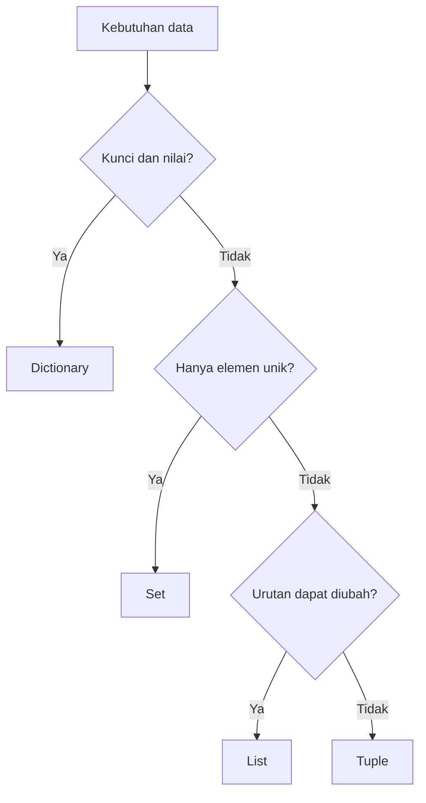

# Dictionary & Set dalam Python

## Tujuan Pembelajaran

Setelah mempelajari materi ini, mahasiswa diharapkan mampu:

- Menjelaskan perbedaan dictionary, set, list, dan tuple serta memilih struktur data sesuai kebutuhan.
- Membuat, mengakses, memperbarui, dan menghapus elemen dictionary maupun set.
- Menggunakan operasi himpunan untuk membandingkan kelompok data biologis.
- Menerapkan dictionary dan set dalam penghitungan nukleotida, pengelompokan taksonomi, serta perbandingan daftar gen.
- Mengenali kesalahan umum terkait kunci, elemen unik, urutan, dan objek yang dapat digunakan dalam dictionary atau set.

## Konsep Utama

### 1. Mengapa Memerlukan Dictionary dan Set?

Pada materi sebelumnya, list dan tuple digunakan untuk menyimpan urutan elemen. Keduanya cocok ketika posisi elemen penting. Namun, tidak semua persoalan paling mudah diselesaikan menggunakan indeks.

Misalnya, kita ingin menyimpan panjang beberapa sekuens DNA. Dua list terpisah dapat digunakan:

```python
id_sekuens = ["seq_A", "seq_B", "seq_C"]
panjang = [120, 95, 150]
```

Masalahnya, hubungan identitas dan panjang bergantung pada kesesuaian posisi. Jika salah satu list berubah urutan, hubungan tersebut dapat keliru.

Dictionary menyimpan hubungan itu secara langsung:

```python
panjang_sekuens = {
    "seq_A": 120,
    "seq_B": 95,
    "seq_C": 150,
}
```

Sementara itu, jika kita hanya ingin mengetahui identitas sekuens yang pernah ditemukan, tanpa menyimpan nilai tambahan dan tanpa duplikasi, set lebih tepat:

```python
sekuens_teramati = {"seq_A", "seq_B", "seq_C"}
```

Intinya, **dictionary menyatakan pemetaan**, sedangkan **set menyatakan keanggotaan dalam suatu himpunan**.

### 2. Dictionary: Pasangan Kunci dan Nilai

Dictionary atau `dict` menyimpan pasangan **kunci** (*key*) dan **nilai** (*value*). Setiap kunci bersifat unik dan menunjuk ke satu nilai.

```python
gen = {
    "simbol": "GEN_A",
    "panjang_nt": 900,
    "organisme": "organisme_contoh",
}
```

Nilai diakses menggunakan kuncinya:

```python
print(gen["simbol"])      # GEN_A
print(gen["panjang_nt"])  # 900
```

Berbeda dari list, akses utama dictionary bukan berdasarkan posisi. Ekspresi `gen[0]` mencari kunci berupa bilangan `0`, bukan mengambil pasangan pertama.

Jika kunci tidak ditemukan, penggunaan tanda kurung siku menghasilkan `KeyError`. Metode `.get()` dapat digunakan jika ketidakadaan kunci merupakan kondisi yang wajar:

```python
print(gen.get("fungsi"))                    # None
print(gen.get("fungsi", "Belum diketahui"))  # Belum diketahui
```

Gunakan akses langsung ketika kunci wajib tersedia, sehingga kekurangan data segera terdeteksi. Gunakan `.get()` ketika nilai yang hilang memang perlu ditangani secara eksplisit.

### 3. Menambah, Memperbarui, dan Menghapus Data

Penugasan pada kunci baru akan menambah pasangan. Penugasan pada kunci yang sudah ada akan mengganti nilainya.

```python
gen["fungsi"] = "Belum dianotasi"
gen["panjang_nt"] = 930
```

Beberapa pasangan dapat diperbarui sekaligus menggunakan `.update()`:

```python
gen.update({
    "organisme": "sampel_A",
    "status": "ditinjau",
})
```

Untuk menghapus pasangan, gunakan `del` atau `.pop()`:

```python
del gen["status"]

fungsi = gen.pop("fungsi", "Tidak tersedia")
print(fungsi)  # Belum dianotasi
```

`.pop()` menghapus kunci sekaligus mengembalikan nilainya. Argumen kedua menjadi nilai pengganti jika kunci tidak ditemukan.

Kunci duplikat tidak menghasilkan dua pasangan terpisah:

```python
data = {"GEN_A": 10, "GEN_A": 15}
print(data)  # {'GEN_A': 15}
```

Nilai terakhir menggantikan nilai sebelumnya. Ini penting ketika membaca berkas: identitas yang berulang dapat menyebabkan data tertimpa tanpa peringatan.

### 4. Iterasi dan Pemeriksaan Keanggotaan

Operator `in` pada dictionary memeriksa **kunci**, bukan nilai:

```python
panjang = {"seq_A": 120, "seq_B": 95}

print("seq_A" in panjang)    # True
print(120 in panjang)        # False
print(120 in panjang.values())  # True
```

Tiga pola iterasi yang umum adalah:

```python
for identitas in panjang:
    print(identitas)

for ukuran in panjang.values():
    print(ukuran)

for identitas, ukuran in panjang.items():
    print(identitas, ukuran)
```

Metode `.keys()`, `.values()`, dan `.items()` menyediakan tampilan kunci, nilai, serta pasangan kunci–nilai.

Pada Python 3.7 dan sesudahnya, dictionary menjamin urutan penyisipan. Namun, urutan tersebut **bukan urutan terurut otomatis**. Jika diperlukan urutan alfabetis:

```python
for identitas in sorted(panjang):
    print(identitas, panjang[identitas])
```

Hindari menambah atau menghapus kunci saat sedang mengiterasi dictionary yang sama. Jika perlu menyaring data, sering kali lebih jelas membuat dictionary baru.

### 5. Set: Kumpulan Elemen Unik

Set menyimpan elemen unik tanpa pasangan nilai. Duplikasi otomatis dihilangkan:

```python
gen_terdeteksi = {"GEN_A", "GEN_B", "GEN_A"}
print(sorted(gen_terdeteksi))  # ['GEN_A', 'GEN_B']
```

Perhatikan perbedaan pembuatan objek kosong:

```python
dictionary_kosong = {}
set_kosong = set()
```

`{}` menghasilkan dictionary kosong, bukan set kosong.

Set dapat dibentuk dari list:

```python
hasil_pengamatan = ["GEN_A", "GEN_B", "GEN_A", "GEN_C"]
gen_unik = set(hasil_pengamatan)

print(len(gen_unik))  # 3
```

Set tidak mendukung akses posisi seperti `gen_unik[0]`. Urutan iterasinya juga tidak dijamin. Gunakan `sorted()` jika memerlukan tampilan berurutan dan konsisten.

Operasi dasar set meliputi:

```python
gen_unik.add("GEN_D")
gen_unik.update(["GEN_E", "GEN_F"])
gen_unik.discard("GEN_X")
gen_unik.remove("GEN_A")
```

`.discard()` tidak menimbulkan kesalahan jika elemen tidak ada. Sebaliknya, `.remove()` menghasilkan `KeyError` jika elemen tidak ditemukan.

Konversi list menjadi set menghilangkan informasi **jumlah kemunculan dan urutan**. Karena itu, set tidak cocok jika frekuensi pengamatan masih diperlukan.

### 6. Operasi Himpunan

Misalkan dua sampel memiliki daftar gen berikut:

```python
sampel_a = {"GEN_A", "GEN_B", "GEN_C"}
sampel_b = {"GEN_B", "GEN_C", "GEN_D"}
```

Operasi yang tersedia meliputi:

- **Gabungan**: seluruh elemen yang terdapat pada salah satu atau kedua set.
- **Irisan**: elemen yang terdapat pada kedua set.
- **Selisih**: elemen pada set pertama yang tidak terdapat pada set kedua.
- **Selisih simetris**: elemen yang hanya terdapat pada salah satu set.

```python
print(sorted(sampel_a | sampel_b))
# ['GEN_A', 'GEN_B', 'GEN_C', 'GEN_D']

print(sorted(sampel_a & sampel_b))
# ['GEN_B', 'GEN_C']

print(sorted(sampel_a - sampel_b))
# ['GEN_A']

print(sorted(sampel_a ^ sampel_b))
# ['GEN_A', 'GEN_D']
```

Selisih bersifat berarah: `sampel_a - sampel_b` berbeda dari `sampel_b - sampel_a`.

Hubungan subset dapat diperiksa dengan `<=`:

```python
gen_target = {"GEN_B", "GEN_C"}
print(gen_target <= sampel_a)  # True
```

Gunakan `<` untuk subset sejati, yaitu subset yang tidak sama dengan set pembanding. Metode `.isdisjoint()` memeriksa apakah dua set tidak memiliki elemen bersama.

### 7. Hashability dan Efisiensi

Dictionary dan set menggunakan mekanisme *hashing*. Karena itu, kunci dictionary dan elemen set harus **hashable**, yaitu memiliki nilai hash yang stabil selama masa hidup objek serta mengikuti aturan kesetaraan yang konsisten.

Objek yang umum digunakan adalah:

- String, seperti `"GEN_A"`.
- Bilangan, seperti `42`.
- Tuple yang seluruh elemennya hashable.

List, dictionary, dan set biasa tidak hashable sehingga tidak dapat langsung menjadi kunci dictionary atau elemen set.

```python
lokasi = {
    ("kromosom_1", 100): "varian_contoh"
}
```

Tuple tersebut dapat menjadi kunci karena berisi string dan bilangan. Tuple yang berisi list tidak dapat digunakan dengan cara yang sama. Sebaliknya, **nilai dictionary** boleh berupa list, dictionary lain, atau objek lainnya.

Untuk data yang sesuai, pencarian keanggotaan pada dictionary dan set memiliki kompleksitas waktu rata-rata $O(1)$, sedangkan pencarian pada list umumnya $O(n)$. Ini bukan jaminan bahwa setiap operasi selalu memerlukan waktu tetap; kondisi terburuk dan biaya menghitung hash tetap perlu dipertimbangkan.

### 8. Comprehension dan Struktur Bersarang

Dictionary comprehension membentuk pemetaan dari suatu iterable:

```python
sekuens = {
    "seq_A": "ATGC",
    "seq_B": "GGCTA",
}

panjang = {
    identitas: len(dna)
    for identitas, dna in sekuens.items()
}
```

Set comprehension membentuk kumpulan unik:

```python
basa_teramati = {basa for basa in "ATGCGG"}
print(sorted(basa_teramati))  # ['A', 'C', 'G', 'T']
```

Dictionary juga dapat menyimpan data bertingkat:

```python
anotasi = {
    "GEN_A": {"jalur": "glikolisis", "status": "contoh"},
    "GEN_B": {"jalur": "respirasi", "status": "contoh"},
}

print(anotasi["GEN_A"]["jalur"])  # glikolisis
```

Struktur ini praktis untuk data kecil. Untuk data besar atau analisis tabular, alat lain seperti basis data atau pustaka pengolahan tabel mungkin lebih sesuai.

## Tabel dan Diagram

| Aspek | List | Tuple | Dictionary | Set |
|---|---|---|---|---|
| Peran utama | Urutan elemen | Urutan tetap | Pemetaan kunci–nilai | Kumpulan unik |
| Akses utama | Indeks | Indeks | Kunci | Keanggotaan |
| Duplikasi | Diizinkan | Diizinkan | Kunci unik | Tidak diizinkan |
| Dapat diubah | Ya | Tidak pada strukturnya | Ya | Ya |
| Urutan | Dipertahankan | Dipertahankan | Urutan penyisipan | Tidak dijamin |
| Contoh biologis | Pembacaan berulang | Koordinat tetap | ID dan anotasi | Gen unik |

Diagram berikut membantu memilih struktur data berdasarkan informasi yang perlu dipertahankan.



## Contoh Konkret

### Menghitung Nukleotida dengan Dictionary

Fungsi berikut menghitung basa DNA standar. Huruf diubah menjadi kapital, sedangkan karakter lain ditolak agar data tidak diabaikan secara diam-diam.

```python
def hitung_basa(sekuens):
    jumlah = {"A": 0, "T": 0, "G": 0, "C": 0}

    for basa in sekuens.upper():
        if basa not in jumlah:
            raise ValueError(f"Karakter tidak didukung: {basa}")
        jumlah[basa] += 1

    return jumlah


hasil = hitung_basa("ATGCGCAT")
print(hasil)
# {'A': 2, 'T': 2, 'G': 2, 'C': 2}
```

Dalam data nyata, simbol seperti `N` dapat menunjukkan basa yang belum diketahui. Fungsi ini sengaja tidak mendukungnya; kebijakan penanganan simbol ambigu harus ditentukan sesuai tujuan analisis.

Untuk sekuens tidak kosong yang hanya berisi A, T, G, dan C, persentase GC dihitung sebagai:

$$
\%GC = \frac{n_G + n_C}{n_A + n_T + n_G + n_C} \times 100
$$

```python
total = sum(hasil.values())

if total == 0:
    print("Persentase GC tidak terdefinisi untuk sekuens kosong.")
else:
    persen_gc = 100 * (hasil["G"] + hasil["C"]) / total
    print(persen_gc)  # 50.0
```

### Membaca Daftar Gen dari Berkas

Menggabungkan fungsi, File I/O, dan set memungkinkan pembuatan pembaca daftar identitas:

```python
def baca_gen_unik(nama_berkas):
    with open(nama_berkas, encoding="utf-8") as berkas:
        return {
            baris.strip()
            for baris in berkas
            if baris.strip()
        }
```

Fungsi ini menganggap setiap baris tidak kosong berisi satu identitas gen. Baris judul atau komentar belum ditangani. Jika berkas memuat keduanya, aturan pembacaan perlu diperluas.

## Hubungan dengan Bioinformatika

**Pemetaan identitas dan anotasi.** Dictionary dapat menghubungkan ID sekuens dengan panjang, organisme asal, atau informasi fungsi. Jika satu gen memiliki beberapa anotasi, gunakan list atau set sebagai nilainya, bukan mengulang kunci yang sama.

**Perbandingan hasil eksperimen.** Set cocok untuk membandingkan gen yang terdeteksi pada dua kondisi. Irisan menunjukkan gen bersama, sedangkan selisih menunjukkan gen yang hanya tercatat pada salah satu kondisi. Namun, tidak terdeteksinya gen tidak otomatis berarti gen tersebut tidak ada; hasil dipengaruhi metode, kedalaman pengukuran, dan ambang analisis.

**Taksonomi.** Dictionary dapat memetakan identitas sampel ke informasi taksonomi. Set membantu menemukan takson unik atau takson yang muncul pada beberapa sampel.

**Metabolisme seluler.** Daftar gen terkait glikolisis dapat dibandingkan dengan gen yang teranotasi dalam suatu genom. Meski demikian, kecocokan daftar gen belum membuktikan suatu jalur aktif. Aktivitas metabolik juga dipengaruhi ekspresi, regulasi, dan kondisi lingkungan.

**Evolusi.** Perbandingan kelompok gen antarmakhluk hidup dapat diawali dengan operasi set. Akan tetapi, kesamaan atau perbedaan simbol gen saja tidak cukup untuk menyimpulkan kekerabatan atau seleksi alam. Identifikasi ortolog dan bukti biologis lain tetap diperlukan.

Pada semua penerapan tersebut, samakan sistem identitas sebelum membandingkan data. Dua nama berbeda dapat merujuk pada entitas yang sama, sementara nama yang sama dapat ambigu.

## Ringkasan

- Dictionary menyimpan pasangan kunci–nilai dengan kunci unik; set menyimpan elemen unik.
- Gunakan dictionary untuk pemetaan, set untuk keanggotaan dan operasi himpunan.
- Kunci dictionary dan elemen set harus hashable.
- Dictionary mempertahankan urutan penyisipan, sedangkan urutan set tidak dijamin.
- `.get()`, `.items()`, `.add()`, serta operasi `|`, `&`, `-`, dan `^` merupakan alat dasar yang penting.
- Pemilihan struktur data harus mempertimbangkan informasi yang tidak boleh hilang, terutama urutan, frekuensi, dan hubungan antarobjek.

## Pertanyaan Latihan

1. Mengapa dictionary lebih sesuai daripada dua list terpisah untuk menyimpan pasangan ID sekuens dan panjangnya? Jelaskan satu risiko penggunaan dua list.

2. Buat dictionary `panjang = {"seq_A": 100, "seq_B": 150}`. Tambahkan `seq_C` dengan panjang 90, ubah panjang `seq_A` menjadi 110, lalu tampilkan seluruh pasangan menggunakan `.items()`.

3. Diberikan `a = {"GEN_A", "GEN_B", "GEN_C"}` dan `b = {"GEN_C", "GEN_D"}`. Tentukan hasil gabungan, irisan, `a - b`, dan selisih simetrisnya.

4. Mengapa list tidak dapat langsung menjadi kunci dictionary? Berikan contoh tuple yang valid sebagai kunci dan tuple yang tidak valid.

5. Tulis fungsi yang menerima list identitas gen dan mengembalikan dictionary frekuensi kemunculannya. Mengapa mengubah list menjadi set terlebih dahulu tidak tepat untuk tugas ini?

## Bacaan Lanjutan

- **Dokumentasi resmi Python — Python Tutorial, “Data Structures”**: pengenalan dictionary, set, comprehension, dan teknik iterasi.
- **Dokumentasi resmi Python — Library Reference, “Built-in Types”**: rincian operasi `dict`, `set`, dan `frozenset`.
- **Dokumentasi resmi Python — Glossary, “hashable”**: penjelasan persyaratan objek sebagai kunci atau elemen himpunan.
- **NCBI**: contoh penggunaan identitas rekaman dan metadata biologis.
- **UniProt**: contoh hubungan antara identitas protein, nama, organisme, dan anotasi fungsi.

---

## Contoh Kode

Jalankan: `python Python/01-Basics/11-Dict-Set/main.py`

<details><summary>Contoh output</summary>

```text
Apakah GEN_B termasuk gen unik? True
sorted(set) menghasilkan list terurut untuk tampilan konsisten.
Set sendiri tidak memiliki jaminan urutan atau akses indeks.

=== 2. Operasi dasar dictionary ===
Data awal: {'simbol': 'GEN_A', 'panjang_nt': 900, 'organisme': 'organisme_contoh'}
Akses kunci wajib, gen['simbol']: GEN_A
Kunci opsional melalui get(): None
get() dengan nilai pengganti: Belum diketahui
Setelah penambahan dan pembaruan: {'simbol': 'GEN_A', 'panjang_nt': 930, 'organisme': 'sampel_A', 'fungsi': 'Belum dianotasi', 'status': 'ditinjau'}
Nilai yang diambil sekaligus dihapus dengan pop(): Belum dianotasi
Setelah penghapusan: {'simbol': 'GEN_A', 'panjang_nt': 930, 'organisme': 'sampel_A'}
pop() pada kunci yang tidak ada: Tidak tersedia
Iterasi pasangan menggunakan items():
  simbol -> GEN_A
  panjang_nt -> 930
  organisme -> sampel_A
Urutan kunci sesuai penyisipan: ['simbol', 'panjang_nt', 'organisme']
'simbol' in gen memeriksa kunci: True
'GEN_A' in gen.values() memeriksa nilai: True
Kunci berulang mengganti nilai sebelumnya: {'GEN_A': 25}

=== 3. Menghitung nukleotida ===
Pemetaan identitas ke panjang sekuens: {'seq_A': 10, 'seq_B': 6, 'seq_C': 0}
seq_A: DNA='ACGTACGTNN', hitungan={'A': 2, 'C': 2, 'G': 2, 'T': 2, 'N': 2}
  GC di antara basa A/C/G/T: 50.0%
seq_B: DNA='GGCCAT', hitungan={'A': 1, 'C': 2, 'G': 2, 'T': 1, 'N': 0}
  GC di antara basa A/C/G/T: 66.7%
seq_C: DNA='', hitungan={'A': 0, 'C': 0, 'G': 0, 'T': 0, 'N': 0}
  GC di antara basa A/C/G/T: tidak terdefinisi (tidak ada basa A/C/G/T)
Validasi data menangkap kesalahan: Simbol DNA tidak didukung: ['X']

=== 4. Mengelompokkan spesies berdasarkan genus ===
Jumlah catatan pengamatan: 5
  Bacillus: 2 spesies unik -> ['Bacillus cereus', 'Bacillus subtilis']
  Escherichia: 2 spesies unik -> ['Escherichia coli', 'Escherichia fergusonii']

=== 5. Operasi dasar set dan perbandingan daftar gen ===
Set setelah add() dan update(): ['GEN_A', 'GEN_B', 'GEN_C']
Set setelah remove() dan discard(): ['GEN_A', 'GEN_B']
Gen sampel A: ['GEN_A', 'GEN_B', 'GEN_C']
Gen sampel B: ['GEN_B', 'GEN_C', 'GEN_D']
Gabungan A | B: ['GEN_A', 'GEN_B', 'GEN_C', 'GEN_D']
Irisan A & B (gen bersama): ['GEN_B', 'GEN_C']
Selisih A - B (khusus A): ['GEN_A']
Selisih B - A (khusus B): ['GEN_D']
Beda simetris A ^ B (hanya salah satu): ['GEN_A', 'GEN_D']
Apakah gen bersama merupakan subset A? True
Apakah A dan B tidak beririsan? False

=== 6. Kesalahan umum: kunci, elemen, dan hashability ===
KeyError: gen[0] mencari kunci 0, bukan pas
```

</details>
