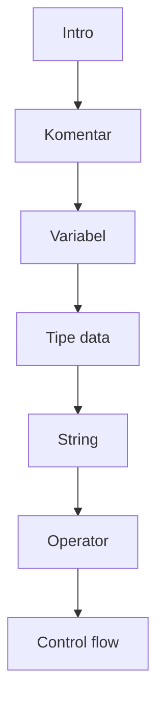

# Latihan Dasar Python

[Kembali ke halaman utama](../README.md)

Latihan di folder ini memperkenalkan sintaks Python sebelum mengolah data biologis. Contoh yang tersedia masih bersifat umum; jangan menganggapnya sebagai pipeline analisis sekuens.

**Navigasi:** [Urutan latihan](#urutan-latihan) · [Menjalankan](#menjalankan) · [Cara berlatih](#cara-berlatih)

## Urutan Latihan



| Latihan | Fokus | Perilaku saat dijalankan |
|---|---|---|
| [01 — Intro](01-Basics/01-Intro/main.py) | `print` dan menjalankan skrip | Mencetak dua pesan pengantar. |
| [02 — Komentar](01-Basics/02-Comment/main.py) | Komentar dan string literal | Tidak mencetak output. String tiga kutip bukan sintaks komentar khusus. |
| [03 — Variabel](01-Basics/03-Variable/main.py) | Assignment, pembaruan nilai, case sensitivity | Mencetak nilai sebelum/sesudah perubahan. |
| [04 — Tipe data](01-Basics/04-Data-Type/main.py) | `int`, `float`, `str`, `bool` | Mencetak contoh tiap tipe. |
| [05 — String](01-Basics/05-String/main.py) | Index, slice, method, formatting | Mencetak hasil manipulasi teks. |
| [06 — Operator](01-Basics/06-Operator/main.py) | Aritmetika, perbandingan, logika, membership | Mencetak hasil operasi. |
| [07 — Control flow](01-Basics/07-Control-Program/main.py) | `if`, `elif`, nested condition, `match` | Meminta input interaktif; masukkan angka valid untuk pertanyaan numerik. |

## Menjalankan

Dari root repo, dengan Python **3.10+**:

```bash
python3 Python/01-Basics/01-Intro/main.py
python3 Python/01-Basics/07-Control-Program/main.py
```

Tidak diperlukan package tambahan. Gunakan data fiktif untuk semua input. Contoh login dengan nilai hardcoded hanya demonstrasi percabangan, bukan autentikasi yang aman. Beberapa contoh memakai titik koma; Python tidak mewajibkannya pada akhir baris.

## Cara Berlatih

1. Prediksi output sebelum menjalankan kode.
2. Ubah satu nilai, jalankan lagi, lalu jelaskan perubahan hasilnya.
3. Untuk string, coba sekuens sintetis `ACGTACGT`: hitung panjang dan jumlah `G` tanpa mengklaimnya sebagai data organisme nyata.
4. Bedakan error sintaks, error input, dan hasil logika yang tidak sesuai harapan.

Fungsi, file I/O, koleksi, dan topik lanjutan masih mengikuti [manifest kurikulum](../scripts/curriculum.json). Tujuh latihan awal ini belum menjadi entri manifest sehingga tidak menaikkan angka progress kategori Python.

Referensi: [Python Tutorial](https://docs.python.org/3/tutorial/).
