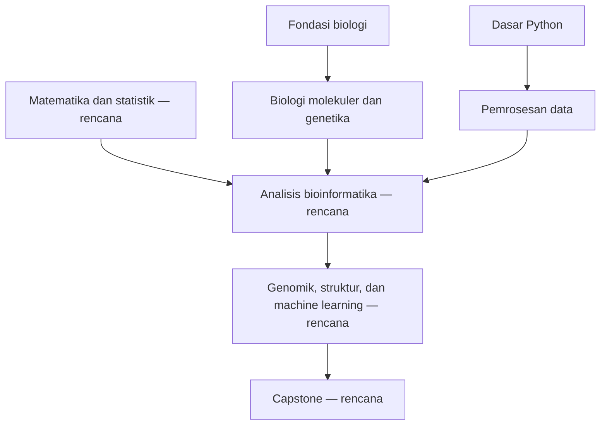
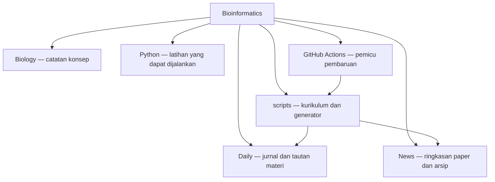
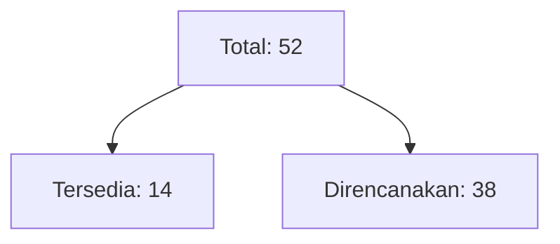
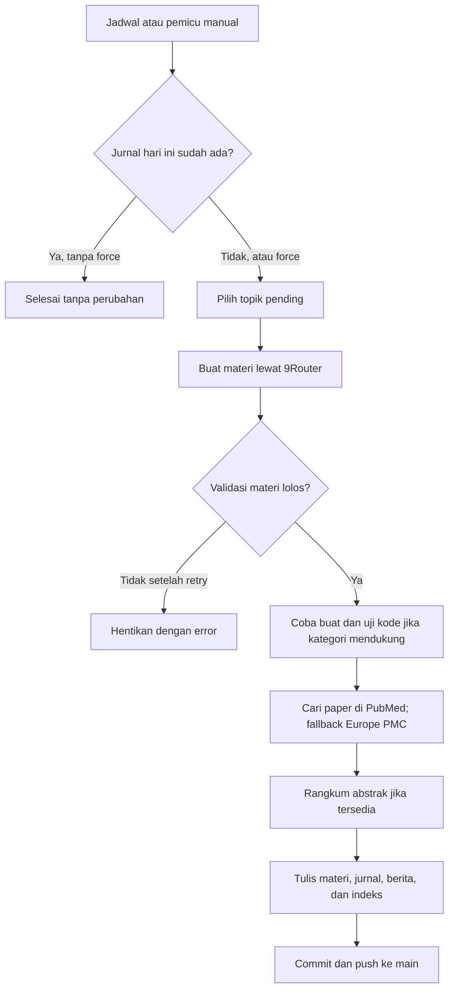

# Bioinformatics

Catatan belajar bioinformatika berbahasa Indonesia: memahami biologi, berlatih Python, lalu menghubungkan keduanya dengan analisis data biologis. Repo ini adalah **jurnal belajar**, bukan pipeline penelitian siap produksi atau bukti penguasaan seluruh kurikulum.

[Mulai dari biologi](Biology/01-History/README.md) · [Latihan Python](Python/README.md) · [Update terbaru](Daily/LATEST.md) · [Ringkasan paper](News/LATEST.md)

<details>
<summary>Daftar isi</summary>

- [Mulai Belajar](#bagian-1)
- [Peta Belajar](#bagian-2)
- [Isi Repositori](#bagian-3)
- [Kurikulum](#bagian-4)
- [Progress Belajar](#bagian-5)
- [Pembaruan Harian](#bagian-6)
- [Konvensi Dokumentasi](#bagian-7)
- [Referensi](#bagian-8)
- [Lisensi dan Batas Penggunaan](#bagian-9)

</details>

<a id="bagian-1"></a>

## Mulai Belajar

1. Ikuti materi biologi sesuai urutan pada tabel kurikulum. Baca diagram konsep, lalu kerjakan pertanyaan latihan sebelum membuka topik berikutnya.
2. Jalankan contoh Python yang sudah tersedia. Ubah input atau variabelnya dan jelaskan perbedaan hasilnya.
3. Baca ringkasan paper sebagai pengantar, lalu periksa sumber aslinya. Ringkasan otomatis berdasarkan abstrak bukan pengganti penilaian metode dan hasil penelitian.

Untuk menjalankan contoh lokal, gunakan Git dan **Python 3.10+** (`match` pada latihan control flow memerlukannya). Workflow harian menggunakan Python 3.12. Contoh dasar yang tersedia hanya memakai standard library.

```bash
git clone https://github.com/petrushandika/Bioinformatics.git
cd Bioinformatics
python3 Python/01-Basics/01-Intro/main.py
```

Latihan [`07-Control-Program`](Python/01-Basics/07-Control-Program/main.py) bersifat interaktif. Input username/password di sana hanya demonstrasi percabangan: **jangan gunakan kredensial asli** dan jangan jadikan contoh itu implementasi autentikasi.

<a id="bagian-2"></a>

## Peta Belajar



Urutan tahun pada kurikulum adalah pengelompokan tahap belajar, bukan durasi wajib. Topik lanjutan belum tersedia sampai folder dan materinya dibuat.

<a id="bagian-3"></a>

## Isi Repositori



| Lokasi | Isi dan cara menggunakannya |
|---|---|
| [`Biology/`](Biology/) | Materi sejarah, sel, molekuler, genetika, biokimia, protein, enzim, metabolisme, evolusi, dan taksonomi. |
| [`Python/`](Python/README.md) | Tujuh latihan awal: intro, komentar, variabel, tipe data, string, operator, dan control flow. |
| [`Daily/LATEST.md`](Daily/LATEST.md) | Pintu masuk ke update harian terbaru; arsip per tanggal berada di `Daily/`. |
| [`News/LATEST.md`](News/LATEST.md) | Tautan paper dan arsip ringkasan berbasis abstrak. |
| [`scripts/curriculum.json`](scripts/curriculum.json) | Sumber status dan urutan topik yang digunakan otomatisasi. |
| [`scripts/daily_update.py`](scripts/daily_update.py) | Generator materi, pengambilan paper, dan pembaruan indeks. |
| [Workflow harian](.github/workflows/daily-update.yml) | Jadwal, konfigurasi Python, dan trigger manual. |

<a id="bagian-4"></a>

## Kurikulum

Terinspirasi oleh [OSSU Bioinformatics](https://github.com/ossu/bioinformatics), dengan urutan dan materi lokal yang disesuaikan. Ini bukan salinan lengkap atau sertifikasi OSSU.

**Legenda:** ✅ materi tersedia menurut status generator; 🔜 masih direncanakan. Status tersedia **tidak berarti sudah dipelajari, ditinjau pakar, atau lulus evaluasi**. Folder yang belum tersedia ditulis sebagai teks, bukan tautan kosong.

<!-- CURRICULUM:START -->
### Tahun 1 — Fondasi

| Status | Kategori | Topik | Folder |
|--------|----------|-------|--------|
| ✅ | 🧬 Biologi | Sejarah Biologi & Bioinformatika | [Biology/01-History](./Biology/01-History/) |
| ✅ | 🧬 Biologi | Struktur Sel | [Biology/02-Cell-Structure](./Biology/02-Cell-Structure/) |
| ✅ | 🧬 Biologi | Biologi Molekuler & Dogma Sentral | [Biology/03-Molecular-Biology](./Biology/03-Molecular-Biology/) |
| ✅ | 🧬 Biologi | Genetika & Hukum Mendel | [Biology/04-Genetics](./Biology/04-Genetics/) |
| ✅ | 🧬 Biologi | Biokimia Dasar | [Biology/05-Biochemistry](./Biology/05-Biochemistry/) |
| ✅ | 🧬 Biologi | Struktur & Fungsi Protein | [Biology/06-Protein](./Biology/06-Protein/) |
| ✅ | 🧬 Biologi | Enzim & Kinetika Enzim | [Biology/07-Enzyme](./Biology/07-Enzyme/) |
| ✅ | 🧬 Biologi | Metabolisme Seluler (Glikolisis & Respirasi) | [Biology/08-Metabolism](./Biology/08-Metabolism/) |
| ✅ | 🧬 Biologi | Evolusi & Seleksi Alam | [Biology/09-Evolution](./Biology/09-Evolution/) |
| ✅ | 🧬 Biologi | Taksonomi & Klasifikasi Makhluk Hidup | [Biology/10-Taxonomy](./Biology/10-Taxonomy/) |
| ✅ | 💻 Python | Fungsi & Modul dalam Python | [Python/01-Basics/08-Function](./Python/01-Basics/08-Function/) |
| ✅ | 💻 Python | File I/O dalam Python | [Python/01-Basics/09-File-IO](./Python/01-Basics/09-File-IO/) |
| ✅ | 💻 Python | List & Tuple dalam Python | [Python/01-Basics/10-List-Tuple](./Python/01-Basics/10-List-Tuple/) |
| ✅ | 💻 Python | Dictionary & Set dalam Python | [Python/01-Basics/11-Dict-Set](./Python/01-Basics/11-Dict-Set/) |
| 🔜 | 💻 Python | Loop (For & While) dalam Python | `Python/01-Basics/12-Loop/` |
| 🔜 | 💻 Python | Pemrograman Berorientasi Objek (OOP) | `Python/01-Basics/13-OOP/` |
| 🔜 | 💻 Python | Error Handling & Exception | `Python/01-Basics/14-Exception/` |
| 🔜 | 💻 Python | List Comprehension & Lambda | `Python/01-Basics/15-Comprehension/` |
| 🔜 | 📊 Matematika & Statistik | Aljabar Dasar untuk Bioinformatika | `Mathematics/01-Algebra/` |
| 🔜 | 📊 Matematika & Statistik | Statistika Deskriptif | `Mathematics/02-Statistics/` |
| 🔜 | 📊 Matematika & Statistik | Probabilitas & Distribusi | `Mathematics/03-Probability/` |

### Tahun 2 — Konsep Inti

| Status | Kategori | Topik | Folder |
|--------|----------|-------|--------|
| 🔜 | 📊 Matematika & Statistik | Aljabar Linear & Matriks | `Mathematics/04-Linear-Algebra/` |
| 🔜 | 🧬 Biologi | Sekuensing DNA & NGS | `Biology/11-DNA-Sequencing/` |
| 🔜 | 🔬 Bioinformatika | BLAST & Sequence Alignment | `Bioinformatics/01-BLAST/` |
| 🔜 | 🔬 Bioinformatika | Pengenalan BioPython | `Bioinformatics/02-BioPython/` |
| 🔜 | 🔬 Bioinformatika | Analisis Sekuens dengan Python | `Bioinformatics/03-Sequence-Analysis/` |
| 🔜 | 🔬 Bioinformatika | Pairwise Sequence Alignment | `Bioinformatics/04-Pairwise-Alignment/` |
| 🔜 | 🔬 Bioinformatika | Multiple Sequence Alignment | `Bioinformatics/05-MSA/` |
| 🔜 | 🖥️ Komputasi | Linux & Shell Scripting untuk Bioinformatika | `Computing/01-Linux-Shell/` |
| 🔜 | 🖥️ Komputasi | Database & SQL untuk Data Biologis | `Computing/02-Database-SQL/` |
| 🔜 | 🔬 Bioinformatika | Format File Biologis: FASTA, FASTQ, GenBank, SAM/BAM, VCF | `Bioinformatics/07-File-Formats/` |
| 🔜 | 🔬 Bioinformatika | Database Biologis: NCBI, UniProt, Ensembl, PDB | `Bioinformatics/08-Biological-Databases/` |
| 🔜 | 📊 Matematika & Statistik | Uji Hipotesis & p-value | `Mathematics/05-Hypothesis-Testing/` |
| 🔜 | 📊 Matematika & Statistik | Statistik dengan R | `Mathematics/06-Statistics-with-R/` |

### Tahun 3 — Spesialisasi

| Status | Kategori | Topik | Folder |
|--------|----------|-------|--------|
| 🔜 | 🔬 Bioinformatika | Analisis Filogenetik | `Bioinformatics/06-Phylogenetics/` |
| 🔜 | 🤖 Machine Learning | Pengenalan Machine Learning untuk Bioinformatika | `MachineLearning/01-Intro/` |
| 🔜 | 🤖 Machine Learning | Scikit-learn untuk Analisis Biologis | `MachineLearning/02-Sklearn/` |
| 🔜 | 🔬 Bioinformatika | Hidden Markov Model untuk Analisis Sekuens | `Bioinformatics/09-Hidden-Markov-Model/` |
| 🔜 | 🔬 Bioinformatika | Prediksi Struktur Protein & AlphaFold | `Bioinformatics/10-Protein-Structure-Prediction/` |
| 🔜 | 📊 Matematika & Statistik | Biostatistik: Multiple Testing & False Discovery Rate | `Mathematics/07-Multiple-Testing/` |
| 🔜 | 🔬 Bioinformatika | RNA-seq & Analisis Ekspresi Gen Diferensial | `Bioinformatics/11-RNA-Seq-Differential-Expression/` |
| 🔜 | 🔬 Bioinformatika | Genome Assembly | `Bioinformatics/12-Genome-Assembly/` |
| 🔜 | 🔬 Bioinformatika | Variant Calling & Anotasi Varian | `Bioinformatics/13-Variant-Calling/` |
| 🔜 | 🔬 Bioinformatika | Gene Ontology & Pathway Enrichment | `Bioinformatics/14-Gene-Ontology-Enrichment/` |
| 🔜 | 🤖 Machine Learning | Clustering & PCA untuk Data Ekspresi Gen | `MachineLearning/04-Clustering-PCA/` |

### Tahun 4 — Aplikasi Lanjutan

| Status | Kategori | Topik | Folder |
|--------|----------|-------|--------|
| 🔜 | 🤖 Machine Learning | Deep Learning untuk Genomik | `MachineLearning/03-Deep-Learning/` |
| 🔜 | 🔬 Bioinformatika | Analisis Single-cell RNA-seq | `Bioinformatics/15-Single-Cell/` |
| 🔜 | 🔬 Bioinformatika | Metagenomik & Analisis Mikrobioma | `Bioinformatics/16-Metagenomics/` |
| 🔜 | 🖥️ Komputasi | Workflow Reproducible: Snakemake & Nextflow | `Computing/03-Reproducible-Workflows/` |
| 🔜 | 🔬 Bioinformatika | Bioinformatika Struktural & Molecular Docking | `Bioinformatics/17-Structural-Bioinformatics/` |
| 🔜 | 🤖 Machine Learning | Protein Language Models | `MachineLearning/05-Protein-Language-Models/` |
| 🔜 | 🎓 Capstone | Proyek Capstone: Pipeline Analisis Genomik End-to-end | `Capstone/01-Final-Project/` |

<!-- CURRICULUM:END -->

<a id="bagian-5"></a>

## Progress Belajar

Grafik berikut menghitung **ketersediaan materi dalam manifest kurikulum**, bukan kemampuan belajar. Tujuh contoh Python awal merupakan latihan tambahan yang belum tercantum sebagai entri manifest; angka kategori Python karena itu tidak menghitungnya.

<!-- PROGRESS:START -->


| Kategori | Tersedia | Total | Progress |
|----------|---------|-------|----------|
| 🧬 Biologi | 10 | 11 | 91% |
| 💻 Python | 4 | 8 | 50% |
| 📊 Matematika & Statistik | 0 | 7 | 0% |
| 🔬 Bioinformatika | 0 | 17 | 0% |
| 🤖 Machine Learning | 0 | 5 | 0% |
| 🖥️ Komputasi | 0 | 3 | 0% |
| 🎓 Capstone | 0 | 1 | 0% |
| **Total** | **14** | **52** | **27%** |
<!-- PROGRESS:END -->

<a id="bagian-6"></a>

## Pembaruan Harian

Workflow dijadwalkan pada **23:17 UTC / 06:17 WIB**. Waktu mulai bisa tertunda oleh antrean GitHub Actions. Pemicu manual tersedia di tab Actions; `repository_dispatch` juga didukung. Jika jurnal tanggal WIB yang sama sudah ada, proses berhenti tanpa perubahan kecuali opsi `force` diaktifkan.



Jika seluruh topik sudah tersedia, proses melewati pembuatan materi dan tetap mencoba memperbarui ringkasan paper. Kegagalan pembuatan kode tidak selalu menggagalkan materi; lihat apakah `main.py` benar-benar ada. Validasi struktur dan eksekusi contoh **bukan verifikasi ilmiah otomatis**.

### Konfigurasi pengelola

| Pengaturan GitHub Actions | Kegunaan |
|---|---|
| Secret `ROUTER_API_KEY` | Autentikasi generator; jangan ditaruh di kode atau README. |
| Variable `ROUTER_BASE_URL` | Override endpoint generator; default ada di workflow. |
| Variable `ROUTER_MODELS` | Daftar model utama/cadangan, dipisahkan koma. |
| Input manual `topics` | Jumlah topik per run, dibatasi 1–5. |
| Input manual `force` | Memproses ulang tanggal yang sama; dapat menimpa jurnal/ringkasan tanggal tersebut. |

**Perhatian:** menjalankan `scripts/daily_update.py` bukan preview read-only. Skrip memanggil layanan eksternal, menulis berkas, men-stage seluruh perubahan, dan membuat commit. `--no-push` hanya menonaktifkan push, bukan penulisan atau commit. Gunakan checkout bersih yang terpisah bila perlu menjalankannya lokal.

<a id="bagian-7"></a>

## Konvensi Dokumentasi

- Semua chart, peta konsep, alur, dan diagram ditulis dalam fenced code block **`mermaid`** di Markdown, bukan gambar atau ASCII art.
- Tabel perbandingan tetap tabel Markdown. Sekuens biologis, persamaan, kode, dan output tetap format teks/kode yang sesuai; bukan dipaksakan menjadi diagram.
- Setiap diagram harus disertai penjelasan; Mermaid memvisualisasikan konsep, bukan bukti eksperimen.
- Bagian kurikulum dan progress di antara marker HTML dikelola generator. Edit sumber status pada `scripts/curriculum.json`, bukan angka hasil render.
- Perbaiki klaim ilmiah dengan sumber yang dapat diperiksa. Bedakan contoh sintetis, hasil eksekusi, hipotesis, dan hasil penelitian.

GitHub merender Mermaid langsung di halaman Markdown. Pada editor lokal, aktifkan dukungan preview Mermaid untuk melihat diagram.

<a id="bagian-8"></a>

## Referensi

- [OSSU Bioinformatics](https://github.com/ossu/bioinformatics) — inspirasi jalur belajar.
- [NCBI](https://www.ncbi.nlm.nih.gov/) dan [EMBL-EBI](https://www.ebi.ac.uk/) — database dan materi bioinformatika.
- [UniProt](https://www.uniprot.org/) — informasi urutan dan fungsi protein.
- [RCSB PDB](https://www.rcsb.org/) — struktur makromolekul biologis.
- [Python Tutorial](https://docs.python.org/3/tutorial/) — referensi bahasa untuk latihan kode.

<a id="bagian-9"></a>

## Lisensi dan Batas Penggunaan

Belum ada berkas `LICENSE` di repositori ini; jangan menganggap materi otomatis berlisensi MIT. Sumber eksternal tetap mengikuti ketentuan masing-masing. Materi disusun untuk belajar, bukan rekomendasi klinis atau dasar diagnosis.
